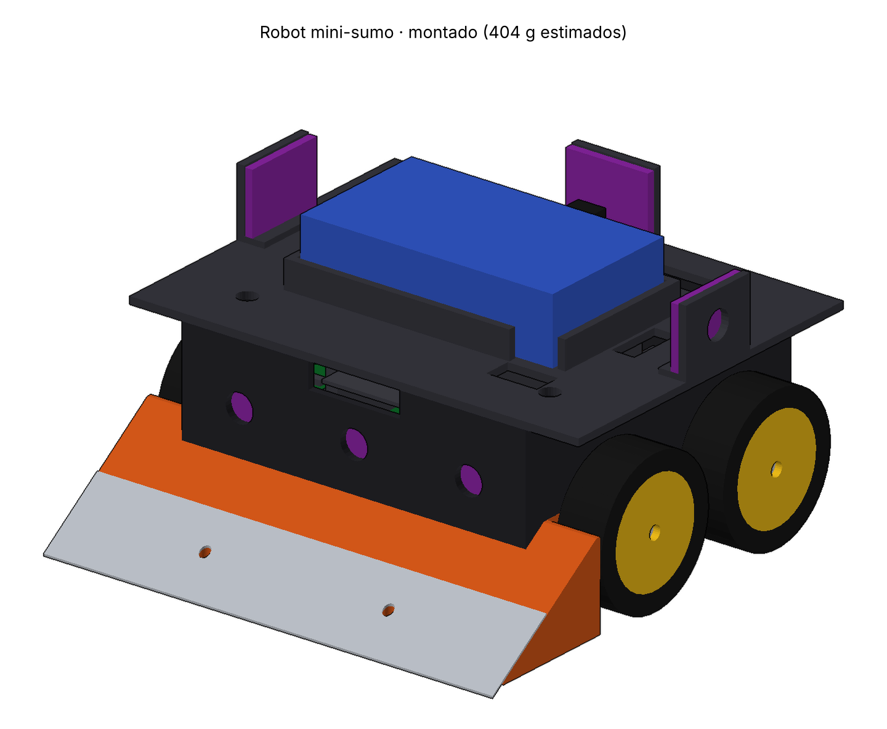

# 🍺 Robot Mini-Sumo · Hombres de las Tabernas

Robot mini-sumo autónomo (10 × 10 cm, < 500 g) para **Tecnología Eléctrica**, Grado en Robótica (USC), 2.ª edición. Compite según el reglamento **OSHWDem Mini Sumo rev. 7**.

**Equipo:** Mateo Esmerodes Rodríguez · Paulo Bouza García · Mario Costoya Mera

## Concepto

Rampa (cuña) clásica, **tracción 4WD** con 4 N20, una **ESP32-S3-DevKitC-1 enchufada** sobre una **PCB propia que es también el chasis**, 6 sensores ToF para encontrar al rival, 4 de línea y arranque y parada por IR con el módulo **Sobotz ST4RT** que entrega el profesor (protocolo RC5).

## Documentación

**Diseño actual: v1.2 (10/11/2026), sin construir.** Cambios en [CHANGELOG](CHANGELOG.md). Nada está probado en un robot físico.

| Doc | Contenido | Estado |
|---|---|---|
| [📝 Ficha técnica v1.2](docs/Ficha-tecnica.md) | Plantilla del profesor rellenada con el diseño v1.2 | 🟡 faltan nombre del robot y modelos comprados |
| [05 · PCB](docs/05-PCB.md) | Placa base v1.2, bloques, rutado, fabricación | 🟡 rutado terminado y DRC limpio; falta revisión humana antes de pedirla |
| [06 · Módulo de arranque ST4RT](docs/06-Modulo-arranque-ST4RT.md) | Lo que se sabe del módulo del profesor, riesgos e integración | 🟡 pendiente del módulo real |
| [07 · Firmware](docs/07-Firmware.md) | Estructura, compilación, arranque/parada, estrategia | ✅ compila · 🟡 sin probar en el robot |
| [08 · Cálculos v1.2](docs/08-Calculos-v1.2.md) | Eléctricos, mecánicos y de rendimiento con fuentes y márgenes | ✅ teórico |
| [09 · Compra y presupuesto](docs/09-Lista-de-compra-y-presupuesto.md) | Qué comprar, dónde, precio visto o estimado | ✅ |
| [10 · Fabricación y montaje](docs/10-Montaje-y-fabricacion.md) | PCB, impresión, montaje, cableado, puesta en marcha | ✅ borrador |
| [11 · Cumplimiento](docs/11-Cumplimiento-normativo.md) | Reglamento, plantilla de inspección, requisitos académicos, preguntas al profesor | ✅ |
| [12 · Memoria del rediseño](docs/12-Memoria-rediseno-v1.2.md) | Revisión, decisiones y alternativas | ✅ |
| [Informe académico](informe/Informe-academico.md) | Borrador de ≤ 6 páginas con marcadores | 🟡 |

Histórico de la v1.1 (octubre de 2026; algunos datos ya no aplican, ver el aviso de cada uno): [00 · Requisitos](docs/00-Requisitos-y-reglamento.md) · [01 · Componentes](docs/01-Seleccion-de-componentes.md) · [02 · Arquitectura eléctrica](docs/02-Arquitectura-electrica.md) · [03 · Mecánica y 3D](docs/03-Disposicion-mecanica.md) · [04 · DevKitC-1](docs/04-ESP32-DevKitC-1.md) · [Consumos y cálculos](docs/Informe-consumos-y-calculos.md) · [Anexo de la ficha entregada](docs/Anexo-calculos-ficha-tecnica.md) · [Informe de progreso 06/10](docs/Informe-progreso-2026-10-06.md).



## Estructura

```
docs/                   Documentación (también es una bóveda de Obsidian)
hardware/geometria.py   Parámetros mecánicos compartidos (PCB + 3D)
hardware/generar_todo.sh  Regenera PCB, 3D, STL/STEP e imágenes
hardware/pcb/           Proyecto KiCad (scripts/design.py = circuito)
hardware/mecanica/cad/  Modelo 3D paramétrico (FreeCAD) y renderizador
hardware/mecanica/step/ Exportaciones STEP (Onshape/FreeCAD)
hardware/mecanica/stl/  Piezas listas para imprimir
firmware/               Código del ESP32-S3 (Arduino) y pruebas de lógica en el PC (docs/07)
media/fotos/            Fotos del proceso
informe/                Informe académico (borrador)
hardware/calculos/      Cálculos reproducibles (python3 calculos_electricos.py)
hardware/pcb/fabricacion/  Gerber, taladros, posiciones, BOM, PDF e informe DRC (rutado terminado, pendiente de revisión)
```

## Herramientas (Linux)

```bash
sudo pacman -S --needed kicad kicad-library freecad   # Arch (Ubuntu: PPA de KiCad 9 y FreeCAD)
```

Probado con KiCad 9.0.9 y FreeCAD 0.21.2 (los scripts también funcionan con KiCad 10). Rutado automático: Freerouting 1.9.0 + Java 21 (y `xvfb-run` sin pantalla). Firmware: arduino-cli con el core `esp32` 3.0.7 y la librería Pololu VL53L0X 1.3.

Opcional, para exportar la PCB a 3D con todos los componentes (~5 GB):

```bash
sudo pacman -S --needed kicad-library-3d
```

Licencias: hardware **CERN-OHL-S v2**, software **MIT**.
