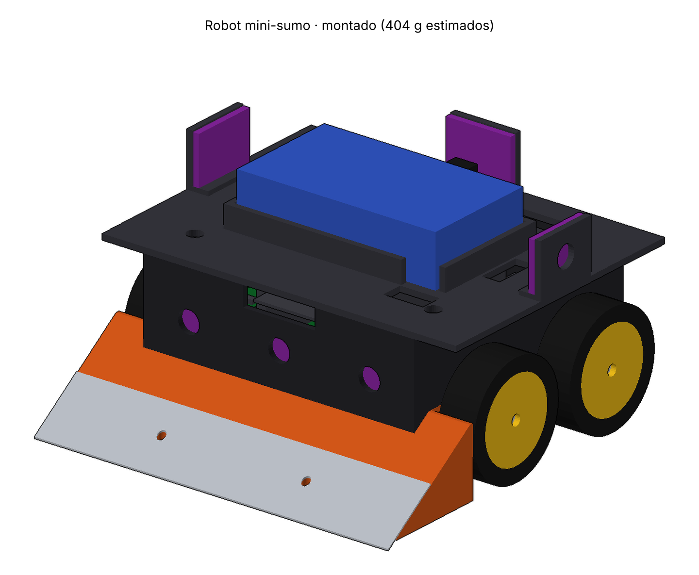

# 🍺 Robot Mini-Sumo · Hombres de las Tabernas

Robot mini-sumo autónomo (10 × 10 cm, < 500 g) para **Tecnología Eléctrica**, Grado en Robótica (USC), 2.ª edición. Compite según el reglamento **OSHWDem Mini Sumo rev. 7**.

**Equipo:** Mateo Esmerodes Rodríguez · Paulo Bouza García · Mario Costoya Mera

**Versión actual: v1.2** (placa base rutada, sin fabricar todavía) · historial en el [CHANGELOG](CHANGELOG.md) · cómo se versiona en [VERSIONES](docs/VERSIONES.md)

## Concepto

Rampa (cuña) clásica, **tracción 4WD** con 4 N20, una **ESP32-S3-DevKitC-1 enchufada** sobre una **PCB propia que es también el chasis**, 6 sensores ToF para encontrar al rival, 4 de línea y **módulo de arranque IR** con corte de motores por hardware.



## Documentación

| Doc | Contenido | Estado |
|---|---|---|
| [00 · Requisitos y reglamento](docs/00-Requisitos-y-reglamento.md) | Lo que obliga al diseño | ✅ |
| [01 · Selección de componentes](docs/01-Seleccion-de-componentes.md) | Qué pieza y por qué | ✅ borrador |
| [02 · Arquitectura eléctrica](docs/02-Arquitectura-electrica.md) | Alimentación, interconexión, pinout | ✅ borrador |
| [03 · Disposición mecánica y 3D](docs/03-Disposicion-mecanica.md) | Piezas, niveles, masas, montaje, impresión | ✅ borrador |
| [04 · ESP32-S3-DevKitC-1](docs/04-ESP32-DevKitC-1.md) | DevKit enchufable: montaje, alimentación, pinout, rutado | ✅ borrador |
| [Ficha técnica](docs/Ficha-tecnica.md) | Respuestas a la ficha de la competición, con los cálculos | ✅ |
| [Consumos y cálculos](docs/Informe-consumos-y-calculos.md) | Pieza a pieza con fuentes oficiales; batería, motores, potencia, autonomía | ✅ |
| [Revisión de la PCB v1.2](docs/revisiones/2026-11-21_Revision_PCB_v1.2.pdf) | Problemas encontrados en la placa rutada y cómo arreglarlos | ✅ |
| Lista de compra · Costes · Informe final (6 páginas) | | ⏳ |

Entregas del curso (ficha rellena, croquis y modelo de ficha): [`docs/entregas/`](docs/entregas/).

## Estructura

```
CHANGELOG.md                 Historial de versiones (qué cambió y qué se quitó)
docs/                        Documentación (también es una bóveda de Obsidian)
docs/VERSIONES.md            Sistema de versiones del proyecto
docs/entregas/               Documentos entregados en la asignatura
docs/revisiones/             Revisiones de diseño (una por versión revisada)
hardware/pcb/                Proyecto KiCad 10: robot_sumo.kicad_pro / _sch / _pcb, librería propia, BOM
hardware/geometria.py        Cotas mecánicas compartidas (contorno, taladros, motores, DevKit…)
hardware/mecanica/cad/       Modelo 3D paramétrico (FreeCAD), renderizador y exportador de cajas de la PCB
hardware/mecanica/step/      Exportaciones STEP (Onshape/FreeCAD)
hardware/mecanica/stl/       Piezas listas para imprimir
hardware/calculos/           Cálculos eléctricos (consumos, autonomía…) y sus resultados
hardware/generar_todo.sh     Regenera 3D, STL/STEP, imágenes y cálculos a partir de la PCB
```

**La PCB se edita a mano en KiCad 10** (`hardware/pcb/robot_sumo.kicad_pro`). El nombre de los ficheros no cambia entre versiones: la versión va en el cajetín de KiCad, en el CHANGELOG y en las etiquetas de git.

## Herramientas (Linux)

```bash
sudo pacman -S --needed kicad kicad-library freecad
```

Opcional, para exportar la PCB a 3D con todos los componentes (~5 GB):

```bash
sudo pacman -S --needed kicad-library-3d
```

Licencias: hardware **CERN-OHL-S v2**, software **MIT**.
