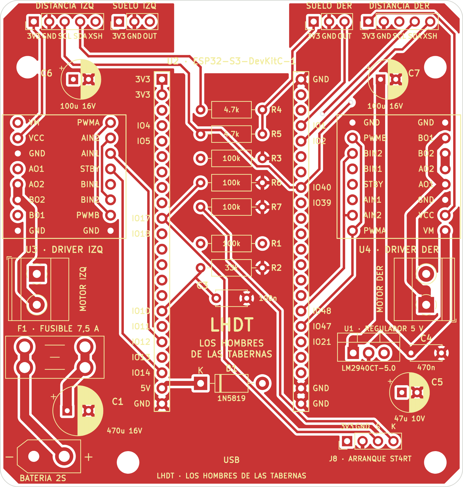

# 🍺 Robot Mini-Sumo · LHDT (Los Hombres de las Tabernas)

Robot mini-sumo autónomo (10 × 10 cm, < 500 g) para **Tecnología Eléctrica**, Grado en Robótica (USC). Reglamento de referencia: OSHWDem Mini Sumo.

**Equipo:** Mateo Esmerodes Rodríguez · Paulo Bouza García · Mario Costoya Mera

## Diseño actual: v2 básico (23/11/2026)

Robot sencillo para cumplir: **2 motores N20**, **ESP32-S3-DevKitC-1**, **2 sensores de distancia VL53L0X**, **2 sensores de suelo QRE1113**, batería LiPo 2S y el **módulo de arranque ST4RT** del profesor. Placa propia de **agujero pasante**, con los módulos enchufados y todo rotulado en la serigrafía.

Nada está montado ni probado todavía.

| Qué | Dónde |
|---|---|
| Diseño completo: piezas, pines, placa, cálculos, montaje y compra | [docs/01-Diseno-v2-basico.md](docs/01-Diseno-v2-basico.md) |
| Proyecto KiCad (esquemático y PCB) | [hardware/pcb/](hardware/pcb/) |
| Ficheros para pedir la placa (Gerber, BOM, esquema en PDF) | [hardware/pcb/fabricacion/](hardware/pcb/fabricacion/) |
| Firmware (Arduino) | [firmware/sumo_lhdt_v2/](firmware/sumo_lhdt_v2/) |
| Cambios | [CHANGELOG.md](CHANGELOG.md) |



## Diseño anterior

Todo el trabajo anterior (v1: 4 motores, placa SMD, simulaciones, ficha técnica entregada…) está guardado tal cual en [`../archivo/v1-4motores/`](../archivo/v1-4motores/ARCHIVO.md) (el commit `7e4c077` tiene el estado completo antes de moverlo).

## Regenerar la placa (Linux, KiCad 7 o superior)

```bash
cd hardware/pcb/scripts
python3 gen_lib.py && python3 gen_pro.py && python3 gen_sch.py   # librería, proyecto y esquemático
python3 gen_pcb.py                                               # coloca componentes (BORRA el rutado)
python3 autoroute.py freerouting-1.9.0.jar 150                   # rutado con Freerouting 1.9 (Java)
python3 drc.py && python3 paridad.py                             # DRC y esquemático = placa
./fabricacion.sh                                                 # Gerber, BOM y PDF
```

`robot_sumo.kicad_pcb` ya está rutado: **no hace falta** ejecutar `gen_pcb.py` ni `autoroute.py` para pedir la placa (si se ejecutan, el rutado sale distinto y hay que revisarlo otra vez).
