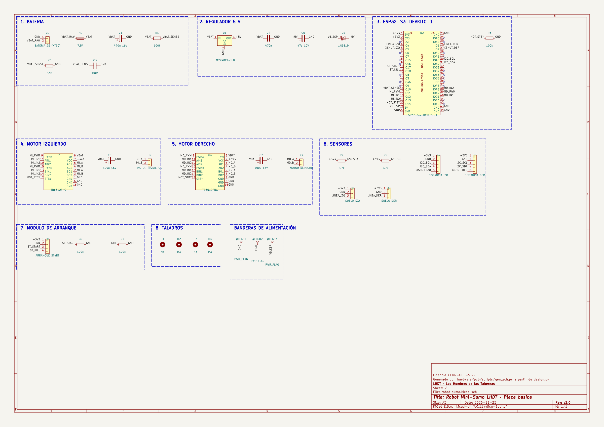
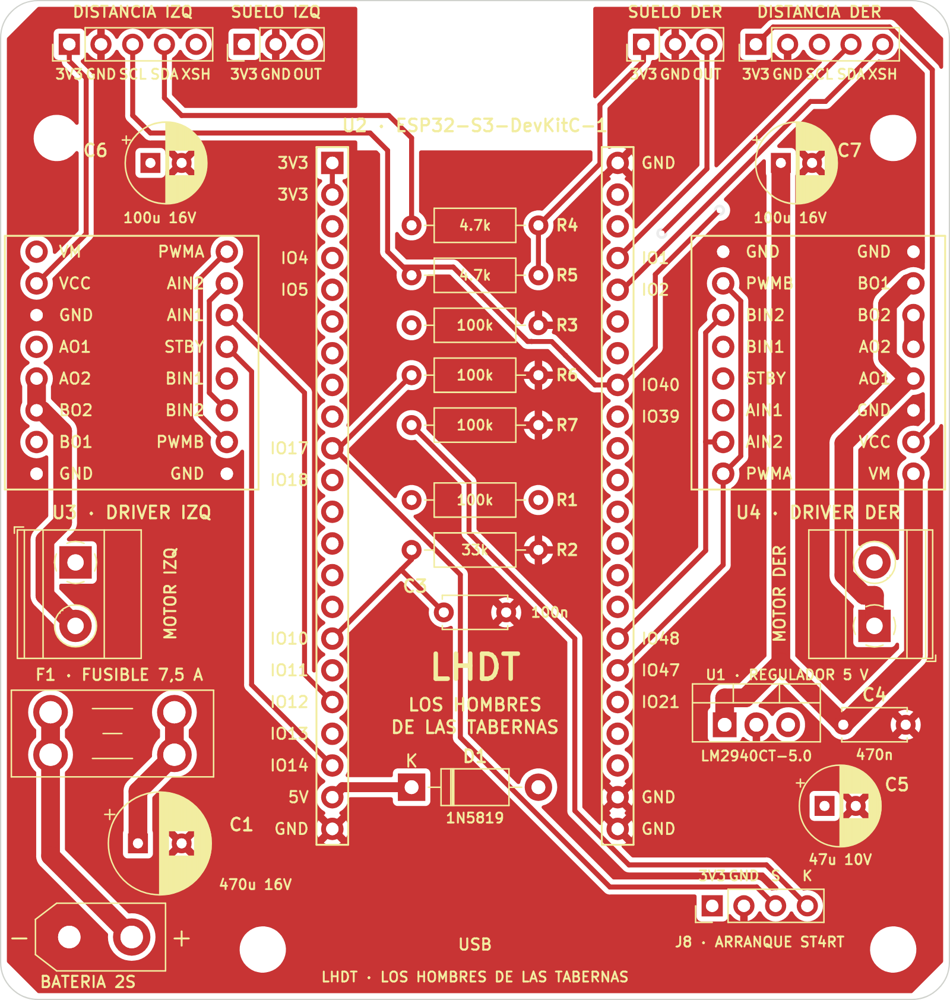
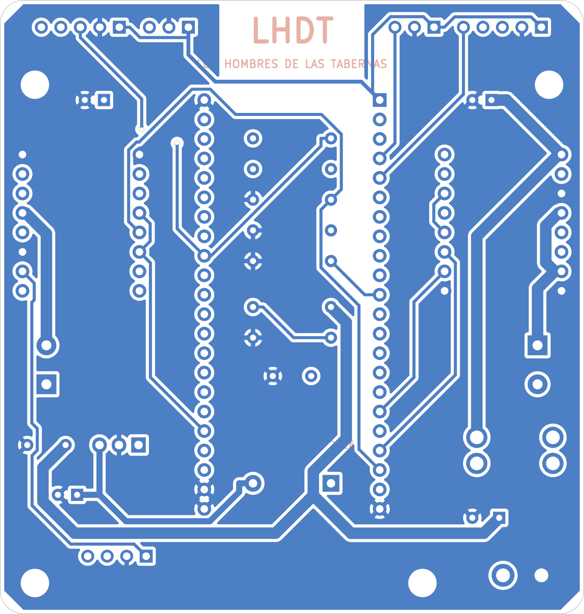

# Diseño v2 básico

Robot mini-sumo sencillo, pensado para **cumplir** y poder hacer el examen. Sustituye al diseño v1 de 4 motores (guardado entero en [`archivo/v1-4motores/`](../../archivo/v1-4motores/ARCHIVO.md)).

> Todo lo de este documento es **teórico**: nada está montado ni probado. Los valores con 🔶 son estimaciones que hay que medir.

## 1. Qué lleva

| Parte | Qué es | Cuántos | Cómo va a la placa |
|---|---|---|---|
| Control | ESP32-S3-DevKitC-1 (la misma de antes) | 1 | Pinchada en 2 tiras hembra 1×22 |
| Motores | N20 6 V ~500 rpm (los mismos de antes) | 2 | Clema de tornillo |
| Drivers | Módulo TB6612FNG, formato SparkFun ROB-14450 | 2 (uno por motor) | Pinchado en 2 tiras hembra 1×8 |
| Distancia | Módulo VL53L0X (los mismos de antes) | 2, delante | Tira de 5 pines + cable Dupont |
| Suelo | Módulo QRE1113 analógico (**los que ya tenemos**) | 2, delante | Tira de 3 pines + cable Dupont |
| Batería | LiPo 2S 7,4 V con XT30 (la misma de antes) | 1 (+1 de repuesto) | XT30 macho en la placa |
| Arranque | Módulo Sobotz ST4RT (**lo da el profesor**, no se compra) | 1 | Tira de 4 pines + cable Dupont a medida |
| 5 V | Regulador LM2940CT-5.0 (TO-220) | 1 | Soldado |

Todo lo que se suelda en la placa es **de agujero pasante** (resistencias de 1/4 W, condensadores de disco y electrolíticos, diodo DO-41, regulador TO-220, tiras de pines, clemas). Los módulos van enchufados, así que se pueden cambiar sin desoldar.

## 2. Cómo funciona (esquema por bloques)

1. **Batería**: LiPo 2S (6,0–8,4 V) → XT30 (J1) → fusible de 7,5 A (F1) → línea **VBAT**. C1 (470 µF) guarda energía para los picos de los motores. R1/R2 bajan la tensión para que la ESP32 la mida.
2. **5 V**: el LM2940 (U1) saca 5 V de VBAT. El diodo D1 los lleva al pin 5V de la DevKit; así, si se enchufa el USB a la vez, el USB no se mete en el regulador. La DevKit hace sus 3,3 V y los da para los sensores.
3. **ESP32**: lee sensores y manda a los drivers.
4. y 5. **Motores**: cada TB6612FNG tiene dos canales; aquí se usan **los dos en paralelo para un solo motor** (A y B unidos en la placa). Así cada motor tiene el doble de corriente disponible.
6. **Sensores**: los dos VL53L0X comparten el bus I2C; salen de fábrica con la misma dirección, por eso cada uno tiene su pin XSHUT y el firmware les cambia la dirección al arrancar. Los QRE1113 dan una tensión: más baja sobre blanco.
7. **Arranque**: el ST4RT da S (START) y K (KILL). Con 100 kΩ a GND en la placa: si el módulo no está, el robot no arranca.

### Pines de la ESP32

| Señal | GPIO | Pin de la DevKit | Va a |
|---|---|---|---|
| LINEA_IZQ | IO4 | J1-4 | Sensor de suelo izquierdo (J6) |
| XSHUT_IZQ | IO5 | J1-5 | Sensor de distancia izquierdo (J4) |
| ST_START | IO17 | J1-10 | Módulo de arranque, S (J8) |
| ST_KILL | IO18 | J1-11 | Módulo de arranque, K (J8) |
| VBAT_SENSE | IO10 | J1-16 | Divisor de batería |
| MI_PWM / MI_IN1 / MI_IN2 | IO11 / IO12 / IO13 | J1-17/18/19 | Driver izquierdo (U3) |
| MOT_STBY | IO14 | J1-20 | STBY de los dos drivers |
| LINEA_DER | IO1 | J3-4 | Sensor de suelo derecho (J7) |
| XSHUT_DER | IO2 | J3-5 | Sensor de distancia derecho (J5) |
| I2C_SCL / I2C_SDA | IO40 / IO39 | J3-8 / J3-9 | Los dos VL53L0X |
| MD_IN2 / MD_PWM / MD_IN1 | IO48 / IO47 / IO21 | J3-16/17/18 | Driver derecho (U4) |

La misma tabla está en [`firmware/sumo_lhdt_v2/pines.h`](../firmware/sumo_lhdt_v2/pines.h) y en [`hardware/pcb/scripts/design.py`](../hardware/pcb/scripts/design.py).

## 3. La placa

- **76 × 80 mm**, 2 capas, FR4 1,6 mm, cobre de 1 oz. Cabe de sobra en los 10 × 10 cm.
- Reglas holgadas para que la fabrique cualquiera: pistas de **0,4 mm** como mínimo (VBAT y motores a **1,5 mm**, 5 V a 0,8 mm), separaciones de 0,3 mm, vías de 0,9 mm. Plano de GND en las dos caras.
- **Distribución**: delante los conectores de los sensores; en el centro la ESP32; a cada lado su driver con la clema de su motor; detrás a la izquierda la batería y el fusible; detrás a la derecha el regulador y el módulo de arranque.
- **Serigrafía para leerla sin esquema**: cada conector lleva su nombre (DISTANCIA IZQ, SUELO DER, MOTOR IZQ, BATERIA 2S, ARRANQUE ST4RT…) y el nombre de cada pin (3V3, GND, SCL, SDA, XSH, OUT, S, K); junto a las tiras de la ESP32 está el GPIO de cada pin usado y dentro de los drivers el nombre de cada pin del módulo; las resistencias llevan su valor dentro del cuerpo.
- **Nombre del equipo**: "LHDT · LOS HOMBRES DE LAS TABERNAS" delante (borde trasero y bajo la ESP32) y en grande en la cara inferior.
- Bajo la antena de la ESP32 no hay plano de cobre (para no tapar el WiFi/Bluetooth, aunque no se use en combate).
- Debajo de la ESP32 van solo componentes bajos (resistencias, C3 y D1): hay que **soldarlos antes de pinchar la DevKit**.
- 4 taladros M3 para fijarla a la base mecánica del equipo.

**Comprobaciones hechas (23/11/2026)**: DRC de KiCad con **0 errores y 0 conexiones sin rutar**; el esquemático y la placa coinciden pin a pin (135 pads, 0 diferencias, `scripts/paridad.py`).

## 4. Cálculos

| Qué | Cálculo | Resultado |
|---|---|---|
| Corriente de bloqueo de un N20 🔶 | Estimada en la v1: 1,6 A a 6 V → R ≈ 3,75 Ω → a 8,4 V: 8,4 / 3,75 | **2,24 A** (hay que medirla) |
| Driver por motor | TB6612FNG: 1,2 A continuos y 3,2 A de pico por canal; dos canales en paralelo | **2,4 A continuos, 6,4 A de pico** |
| Margen en bloqueo | El firmware limita el ataque al 85 % de PWM → 0,85 × 2,24 A | **≈ 1,9 A** de media por motor, por debajo de 2,4 A |
| Fusible | 2 motores bloqueados + electrónica: 2 × 2,24 + 0,3 | **≈ 4,8 A** → fusible de 7,5 A (al 64 %) |
| Consumo de 3,3/5 V 🔶 | ESP32 sin WiFi ~0,1–0,2 A + 2 VL53L0X ~0,04 A + 2 QRE1113 ~0,05 A | **≈ 0,25 A** como máximo |
| Calor en el LM2940 | (8,4 − 5) V × 0,25 A | **≈ 0,85 W**; con ~50 °C/W sin disipador 🔶 → unos +43 °C. Aguanta sin disipador |
| Batería mínima para 5 V | 5 V + caída del LM2940 (≤ 0,5 V) | Regula hasta **5,5 V** (la LiPo 2S no debe bajar de 6,0 V) |
| 5 V en la DevKit | 5 V − caída de D1 (1N5819, ~0,35 V) 🔶 | **≈ 4,65 V**, suficiente para su regulador de 3,3 V |
| Medida de batería | 8,4 V × 33 / (100 + 33) | **2,08 V** en el ADC (máx. ~3,1 V) |
| Pistas de 1,5 mm | IPC-2221, capa exterior, 1 oz | Aguantan unos **3,5 A** con +10 °C: de sobra para 2,24 A |

## 5. Montaje

1. Soldar primero lo bajo: resistencias, C3, C4, D1 (la banda blanca del diodo hacia la "K" de la serigrafía).
2. Después: tiras hembra (2 × 1×22 para la ESP32 y 4 × 1×8 para los drivers), tiras macho de los sensores y del arranque, clemas, portafusibles, condensadores electrolíticos (la pata larga al "+"), regulador y XT30 (rojo/+ a la derecha según la serigrafía).
3. **Antes de pinchar nada**: con el polímetro, que no haya corto entre VBAT y GND ni entre 5 V y GND. Conectar la batería sin módulos: entre el pin 5V de la ESP32 y GND debe haber entre 4,6 y 4,9 V.
4. Pinchar la DevKit (USB hacia atrás) y los dos drivers (la fila VM/VCC/GND hacia fuera, como dice la serigrafía).
5. Motores a las clemas. Si una rueda gira al revés, cambiar `SIGNO_IZQ` o `SIGNO_DER` en el firmware (o los cables de la clema).
6. Sensores con cables Dupont: VL53L0X (VIN→3V3, GND, SCL, SDA, XSHUT→XSH); QRE1113 (VCC→3V3, GND, OUT).
7. Módulo de arranque: **cuando llegue (diciembre)**, mirar su patillaje y hacer el cable para que +→3V3, −→GND, S→S y K→K.

## 6. Qué hay que comprar

Sin precios: hay que mirarlos en la tienda y apuntar lo pagado (es lo que va al informe).

| Artículo | Cant. | Nota | Pagado |
|---|---|---|---|
| ESP32-S3-DevKitC-1 | 1 | La misma de la v1 (si no está comprada) | ☐ |
| Módulo TB6612FNG formato SparkFun (20,3 × 20,3 mm, filas a 15,24 mm) | 2 (+1) | **Comprobar con el calibre que las dos filas están a 15,24 mm** y el orden de pines: VM, VCC, GND, AO1, AO2, BO2, BO1, GND / PWMA, AIN2, AIN1, STBY, BIN1, BIN2, PWMB, GND | ☐ |
| Motor N20 6 V ~500 rpm + rueda | 2 | Los mismos de la v1 | ☐ |
| VL53L0X | 2 | Los mismos de la v1 | ☐ |
| LiPo 2S con XT30 | 1–2 | La misma de la v1 | ☐ |
| LM2940CT-5.0 (TO-220) | 1 | Si no hay, un 7805 sirve pero deja de dar 5 V con la batería por debajo de ~7 V | ☐ |
| Portafusibles Keystone 3568 + fusible mini (ATM) 7,5 A | 1 + 2 | | ☐ |
| XT30 macho de PCB (XT30UPB-M) | 1 | | ☐ |
| 1N5819 | 1 | | ☐ |
| Electrolíticos: 470 µF 16 V Ø8 (1), 100 µF 16 V Ø6,3 (2), 47 µF 10 V Ø6,3 (1) | 4 | | ☐ |
| Cerámicos de disco paso 5 mm: 100 nF (1), 470 nF (1) | 2 | | ☐ |
| Resistencias 1/4 W: 100 kΩ (4), 33 kΩ (1), 4,7 kΩ (2) | 7 | | ☐ |
| Tira hembra 2,54 mm: 1×22 (2) y 1×8 (4) | — | O tiras de 1×40 cortadas | ☐ |
| Tira macho 2,54 mm | 1 | Para J4–J8 | ☐ |
| Clema de tornillo 2 polos paso 5,08 mm | 2 | | ☐ |
| Cables Dupont hembra-hembra | ~20 | | ☐ |
| PCB (76 × 80 mm, 2 capas) | 5 (mínimo del fabricante) | Gerber en `hardware/pcb/fabricacion/gerber_LHDT_v2.zip` | ☐ |

**No se compra**: el módulo ST4RT (lo da el profesor) ni los sensores de suelo QRE1113 (ya los tenemos).

## 7. Pedir la placa

Subir `hardware/pcb/fabricacion/gerber_LHDT_v2.zip` al fabricante con: 2 capas, 76 × 80 mm, 1,6 mm, 1 oz, acabado HASL, **sin montaje**. Las reglas mínimas (0,4 mm de pista, 0,3 mm de separación, taladro mínimo 0,45 mm) las hace cualquier fabricante.

## 8. Pendiente

- Medir la corriente de bloqueo real de los N20 (con fuente de laboratorio y la rueda sujeta) y comprobar que no pasa de 2,4 A a 8,4 V. Si pasa, bajar `POT_ATAQUE` en el firmware.
- Confirmar el patillaje y los niveles del ST4RT cuando llegue (diciembre), y si K baja a 0 en la parada.
- Comprobar el formato del módulo TB6612FNG comprado antes de pedir la placa.
- Base mecánica propia del equipo (requisito académico): falta diseñarla. La placa tiene 4 taladros M3 (en (4,5; 11), (71,5; 11), (21; 76) y (71,5; 76) mm desde la esquina delantera izquierda).
- Compilar el firmware en el IDE de Arduino (aquí solo se ha comprobado la sintaxis con g++, sin las librerías reales).
