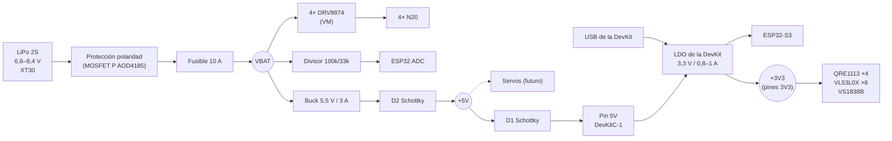
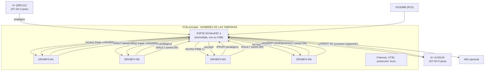

# 02 · Arquitectura eléctrica

> Borrador. **Desde el 19/10/2026 el ESP32 es una ESP32-S3-DevKitC-1 enchufada** sobre la placa base (antes, un módulo WROOM soldado): detalles, pinout definitivo y rutado en [04 · ESP32-S3-DevKitC-1](04-ESP32-DevKitC-1.md).

## Árbol de alimentación

### Presupuesto de corriente

| Carga | Raíl | Típica | Pico |
|---|---|---|---|
| 4 motores N20 (limitados por ITRIP) | VBAT | 1–3 A | 4 × 2,5 A = 10 A |
| ESP32-S3 con Wi-Fi | 3,3 V | 100 mA | 350 mA |
| 6× VL53L0X | 3,3 V | 6×10 mA | 6×20 mA |
| 4× QRE1113 (LED ~15 mA) | 3,3 V | 60 mA | 60 mA |
| VS1838B, LED de estado | 3,3 V | 5 mA | 25 mA |
| **Total 3,3 V** | | ~220 mA | **~540 mA** → LDO de la DevKit (800 mA en la v1.1, 1 A en clones con AMS1117) ✔ |

Disipación del LDO de la DevKit en el peor caso: (4,7 − 3,3) × 0,54 ≈ 0,75 W en picos cortos; de media ~0,2 W.

## Diagrama de interconexión

## Pinout (ESP32-S3-DevKitC-1)

La tabla completa, con el pin de la DevKit (J1/J3) de cada señal, está en [04 · ESP32-S3-DevKitC-1](04-ESP32-DevKitC-1.md#pinout). Resumen:

| GPIO | Señal | GPIO | Señal |
|---|---|---|---|
| 1, 2, 4, 5 | LINE_FL, LINE_FR, LINE_RL, LINE_RR (ADC1) | 21 | DRV_nSLEEP |
| 6, 7, 8, 9 | ISENSE_M1…M4 (ADC1) | 38 | DRV_nFAULT |
| 10 | VBAT_SENSE (ADC1) | 39, 40 | I2C_SDA, I2C_SCL |
| 11, 12 / 13, 14 | M1_IN1/IN2, M2_IN1/IN2 (PWM 20 kHz) | 41, 42, 47, 48, 3, 17 | XSHUT_L, FL, F, FR, R, B |
| 15, 16 / 45, 46 | M3_IN1/IN2, M4_IN1/IN2 | 18 | IR_START |
| 43, 44 | AUX_TX/RX (compartidos con el USB-UART) | 0 | Botón BOOT de la DevKit (usuario) |

Libres a propósito: GPIO35–37 (PSRAM octal en las variantes R8) y GPIO19/20 (USB nativo de la DevKit).

> GPIO45 y GPIO46 son pines de arranque y tienen que estar a 0 al encender: por eso llevan entradas IN del DRV8874, que tienen pull-down interno (y los drivers están dormidos por R17 hasta que el firmware levanta nSLEEP).

## Seguridad de los pines

| Señal que entra al ESP32 | Tensión máxima | Por qué es segura |
|---|---|---|
| QRE1113 | 3,3 V | Alimentado a 3,3 V |
| VL53L0X I²C | 3,3 V | Módulo alimentado a 3,3 V, pull-ups a 3,3 V |
| VS1838B | 3,3 V | Alimentado a 3,3 V |
| IPROPI | ≈ VREF (< 3,3 V) | El DRV8874 regula la corriente al llegar a VREF |
| nFAULT | 3,3 V | Open-drain con pull-up a 3,3 V |
| VBAT_SENSE | 8,4 × 33/133 = 2,1 V | Margen hasta 12,7 V antes de pasar de 3,15 V |

Los DRV8874 aceptan 3,3 V como nivel alto lógico (V_IH ≈ 1,5 V), así que no hace falta adaptación.

## Configuración del DRV8874

- **PMODE** en modo PWM (IN1/IN2): permite adelante, atrás, **freno** (ambas entradas altas) y rueda libre.
- **Límite de corriente:** `I_TRIP = V_REF / (A_IPROPI × R_IPROPI)`, con A_IPROPI = 450 µA/A (hoja de datos de TI).
  - Ejemplo: R_IPROPI = 1 kΩ e I_TRIP = 2,5 A → V_REF ≈ 1,13 V (divisor desde 3,3 V).
  - En el ADC se lee 0–1,13 V, proporcional a 0–2,5 A.
  - Se ajusta cuando midamos la corriente de bloqueo real del N20.
- **Condensadores:** 10 µF + 100 nF cerámicos en VM de cada driver, y 2 × 22 µF / 25 V cerámicos de reserva en VBAT (más bajos que un electrolítico, que no cabía).
- **Térmica:** pad expuesto sobre plano de GND con vías térmicas hacia la cara inferior.

## Reglas para la PCB

- 2 capas, 1,6 mm, cobre de 1 oz.
- Pistas de potencia (VBAT y motores) de **≥ 1,2 mm**; pistas de señal de 0,25 mm.
- Plano de GND continuo en la cara inferior. La zona de motores y drivers va **separada** de la zona analógica (QRE e IPROPI).
- La antena de la DevKit vuela por delante de su placa, a 12 mm sobre la placa base: debajo no se rellena cobre. Nada de metal encima.
- Las filas de pines de la DevKit parten la placa en tres zonas: la potencia de cada motor se queda en su lado y VBAT cruza por los huecos sin zócalo (ver [04](04-ESP32-DevKitC-1.md#placa-base)).
- Serigrafía: **"HOMBRES DE LAS TABERNAS"**, logo de la jarra, nombre del robot, versión y licencia (CERN-OHL-S).
