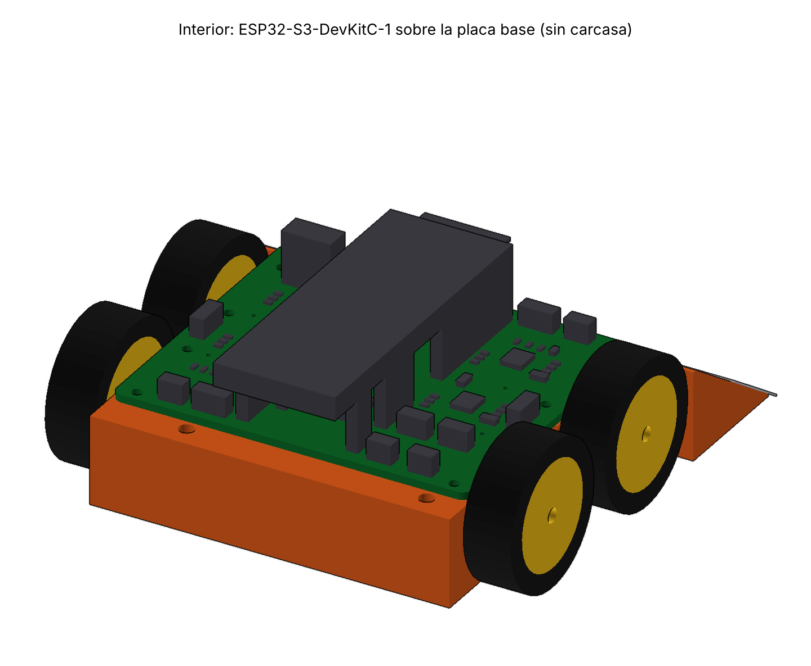
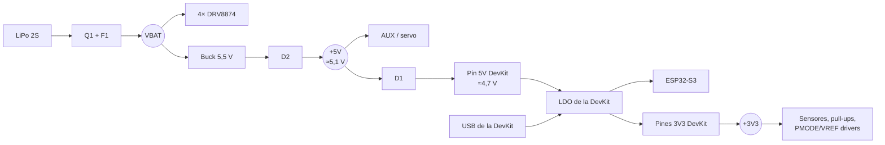
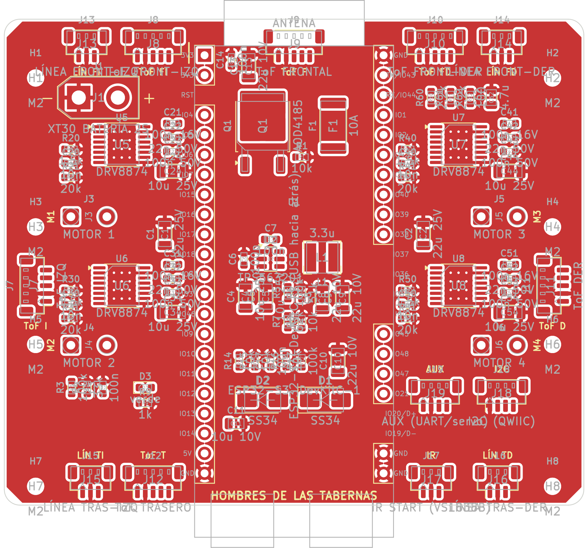
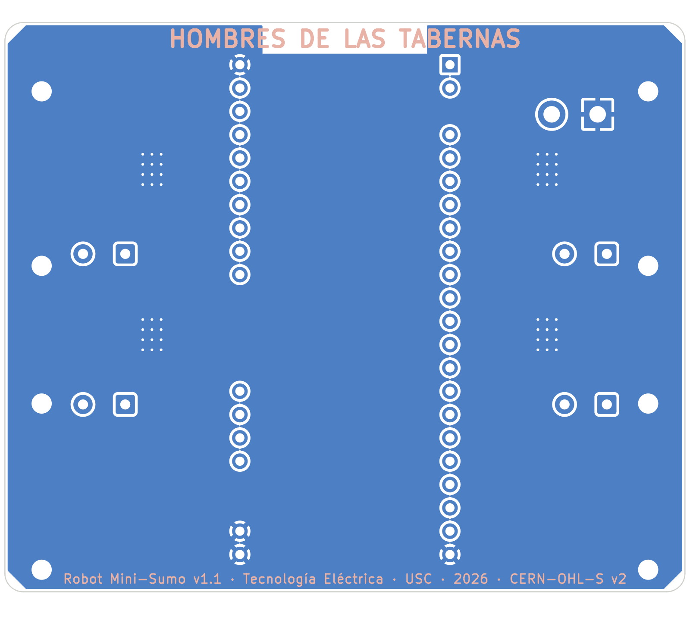

# 04 · Cerebro: ESP32-S3-DevKitC-1 enchufable (placa base v1.1)

> Cambio del 19/10/2026. Antes, el robot llevaba solo el módulo **ESP32-S3-WROOM-1 soldado** en nuestra PCB, con su USB-C, botones, LED y LDO alrededor. Ahora lleva la **placa de desarrollo completa** (la ESP32-S3-DevKitC-1, con su propia PCB y sus conectores) **pinchada en tiras hembra** sobre la placa base. La placa base hace las conexiones.



## Por qué

| | Módulo soldado (v1.0) | DevKitC-1 enchufable (v1.1) |
|---|---|---|
| Montaje | Soldar el WROOM (castellated, 41 pads + pad térmico) | Soldar dos tiras hembra de 2,54 mm |
| Si se quema el ESP32 | Desoldar el módulo | **Se saca y se pone otra** (~8–10 €) |
| USB, botones BOOT/RESET, LED RGB, LDO | En nuestra PCB (13 componentes más) | **Ya vienen en la DevKit** |
| Programar | USB-C de nuestra placa | Cualquiera de los dos USB de la DevKit (nativo o UART) |
| Variantes con PSRAM octal (R8) | Prohibidas (GPIO35–37) | **Valen todas**: N8, N8R2, N8R8, N16R8… (no usamos GPIO35–37) |
| Altura | Módulo a 3 mm de la PCB | DevKit a 11 mm de la PCB: el techo sube 5 mm |
| Peso | — | +8 g aprox. (DevKit + tiras) |

## La placa

**Espressif ESP32-S3-DevKitC-1** (v1.0 o v1.1), o un clon con **el mismo pinout y la misma separación entre filas** (p. ej. YD-ESP32-S3; ⚠️ comprobadlo antes de comprar, algunos clones son más anchos).

- 2 filas de 22 pines, paso 2,54 mm, **filas separadas 22,86 mm (0,9")**.
- Placa ≈ 62,7 × 25,4 mm; la antena del módulo sobresale ~6 mm por delante.
- Cotas en [`hardware/geometria.py`](../hardware/geometria.py) (`DEVKIT_*`). **Medid la placa real** con el calibre cuando llegue: si algo no cuadra, se cambia ahí y se regenera todo.

## Cómo va montada

| | |
|---|---|
| Posición | Centrada en x, **a lo largo del robot**: antena hacia delante, **USB hacia la pared trasera** |
| Programar | El cable USB entra por una **ventana en la pared trasera** de la carcasa, sin desmontar nada |
| Zócalos | Tiras hembra estándar de **8,5 mm**, cortadas a medida (abajo) |
| Altura | Cara inferior de la DevKit a z = 32,6 mm (11 mm sobre la PCB); cara superior ≈ 37,5 mm |
| Debajo de la DevKit | Caben componentes de hasta ~10 mm: protección, buck, conector del ToF frontal… Lo que va debajo se enchufa **antes** de pinchar la DevKit |

### Zócalos: solo donde hay señal

No hace falta zócalo en todos los pines. Dejando sin zócalo los que no usamos quedan **huecos por donde pasan las pistas gruesas** (VBAT) entre las zonas de la placa:

| Fila | Tramos de tira hembra | Pines sin zócalo |
|---|---|---|
| J1 (izquierda) | 1–2 (2 pines) · 4–22 (19 pines) | 3 = RST |
| J3 (derecha) | 1–10 (10 pines) · 15–18 (4 pines) · 21–22 (2 pines) | 11–13 = GPIO35–37 (PSRAM), 14 = GPIO0 (BOOT), 19–20 = USB nativo |

Total: **37 pines** → se cortan de dos tiras 1×40. Las colas de los pines se cortan a ~1,5 mm por debajo de la PCB; las cunas llevan una ranura debajo de cada fila.

## Alimentación



- **Nuestro LDO (AMS1117) desaparece**: el +3V3 de la placa base sale de los pines 3V3 de la DevKit (su LDO da 800 mA en la DevKitC-1 v1.1; los clones suelen llevar un AMS1117 de 1 A). Consumo de 3,3 V: ~220 mA típico, ~540 mA de pico → cabe.
- **D1** (SS34) entre nuestro +5V y el pin 5V de la DevKit. Espressif dice que USB y pin 5V son fuentes excluyentes; con el diodo, si se enchufa el USB con la batería puesta, el VBUS del PC no alimenta nuestra placa y nuestro buck no empuja corriente hacia el PC.
- **Con solo el USB enchufado** (batería quitada) funcionan el ESP32 **y todos los sensores** (la DevKit alimenta el +3V3). Los motores no, claro.

## Pinout

| Pin DevKit | GPIO | Señal | Notas |
|---|---|---|---|
| J1-1, J1-2 | — | +3V3 | Salida del LDO de la DevKit |
| J1-4, J1-5 | 4, 5 | LINE_RL, LINE_RR | ADC1 |
| J1-6, J1-7 | 6, 7 | ISENSE_M1, ISENSE_M2 | ADC1 |
| J1-8, J1-9 | 15, 16 | M3_IN1, M3_IN2 | PWM |
| J1-10 | 17 | **XSHUT_B** | antes en GPIO36 |
| J1-11 | 18 | **IR_START** | antes en GPIO37 |
| J1-12 | 8 | ISENSE_M3 | ADC1 |
| J1-13 | 3 | **XSHUT_R** | antes en GPIO35 (GPIO3 era el LED WS2812) |
| J1-14 | 46 | **M4_IN2** | pin de arranque: el pull-down interno del DRV8874 lo mantiene a 0 |
| J1-15, J1-16 | 9, 10 | ISENSE_M4, VBAT_SENSE | ADC1 |
| J1-17 … J1-20 | 11, 12, 13, 14 | M1_IN1, M1_IN2, M2_IN1, M2_IN2 | PWM |
| J1-21 | — | V5_ESP | Entrada 5 V de la DevKit (desde D1) |
| J1-22, J3-1, J3-21, J3-22 | — | GND | |
| J3-2, J3-3 | 43, 44 | AUX_TX, AUX_RX | Compartidos con el puente USB-UART de la DevKit |
| J3-4, J3-5 | 1, 2 | LINE_FL, LINE_FR | ADC1 |
| J3-6, J3-7 | 42, 41 | XSHUT_FL, XSHUT_L | |
| J3-8, J3-9 | 40, 39 | I2C_SCL, I2C_SDA | Pull-ups de 2,2 k en la placa base |
| J3-10 | 38 | DRV_nFAULT | Entrada |
| J3-15 | 45 | **M4_IN1** | pin de arranque: el pull-down interno del DRV8874 lo mantiene a 0 |
| J3-16, J3-17 | 48, 47 | XSHUT_FR, XSHUT_F | |
| J3-18 | 21 | DRV_nSLEEP | Con R17 a GND: motores parados mientras arranca |

Notas:
- **Movidos respecto a la v1.0:** XSHUT_R, XSHUT_B, IR_START (fuera de GPIO35–37 para que valga cualquier variante) y M4_IN1/M4_IN2 (a GPIO45/46, que solo aceptan señales que estén a 0 al arrancar; los IN del DRV8874 tienen pull-down).
- **Botón de usuario:** el BOOT de la DevKit (GPIO0).
- **LED de estado:** ya no hay WS2812 en la placa base. El LED RGB de la DevKit está en GPIO38 (v1.1) o GPIO48 (v1.0 y la mayoría de clones), que aquí usamos para nFAULT y XSHUT_FR, así que **no sirve como LED de estado** (como mucho parpadea al arrancar). Para avisos: el LED verde de alimentación, la consola USB o la telemetría Wi-Fi.

Para el firmware (Arduino / PlatformIO, placa "ESP32S3 Dev Module"):

```cpp
// pines.h — ESP32-S3-DevKitC-1 sobre la placa base v1.1
constexpr int LINE_FL = 1,  LINE_FR = 2,  LINE_RL = 4,  LINE_RR = 5;      // ADC1
constexpr int ISENSE_M1 = 6, ISENSE_M2 = 7, ISENSE_M3 = 8, ISENSE_M4 = 9;  // ADC1
constexpr int VBAT_SENSE = 10;                                             // ADC1, ×(133/33)
constexpr int M1_IN1 = 11, M1_IN2 = 12, M2_IN1 = 13, M2_IN2 = 14;
constexpr int M3_IN1 = 15, M3_IN2 = 16, M4_IN1 = 45, M4_IN2 = 46;
constexpr int DRV_nSLEEP = 21, DRV_nFAULT = 38;
constexpr int I2C_SDA = 39, I2C_SCL = 40;
constexpr int XSHUT_L = 41, XSHUT_FL = 42, XSHUT_F = 47, XSHUT_FR = 48, XSHUT_R = 3, XSHUT_B = 17;
constexpr int IR_START = 18;
constexpr int BTN_USER = 0;    // botón BOOT de la DevKit
```

## Placa base

| Cara superior | Cara inferior |
|---|---|
|  |  |

En la cara superior, el contorno gris es la DevKit (capa Fab).

- **Quitado** (lo trae la DevKit): módulo WROOM, USB-C + protección USBLC6 + resistencias CC, botones RESET/BOOT y su RC, LED WS2812, LDO AMS1117. De 109 a **96 componentes**.
- **Añadido:** zócalo de la DevKit (U1), diodo D1 y su condensador C11.
- **Las filas de pines parten la placa en tres zonas** (izquierda, centro bajo la DevKit, derecha). Para no pelearse con eso al rutar:
  - Cada driver, su pad de motor y sus condensadores están **en su lado**: la corriente de los motores no cruza nunca las filas.
  - **XT30 delante a la izquierda.** VBAT_RAW entra al centro (Q1, F1, buck) por el **hueco del pin J1-3** y VBAT sale hacia la derecha por el **hueco de J3-11…14**. Los drivers de la izquierda cogen VBAT antes de entrar.
  - Las señales sí pueden cruzar entre dos pines: caben pistas de 0,25 mm.
  - Pads de los motores junto a cada driver, fuera de la zona donde apoya el motor; el cable llega por un canal de la cuna.
- Bajo la antena (que vuela por delante de la DevKit) hay un área sin relleno de cobre.

## Mecánica

| Cambio | Antes | Ahora |
|---|---|---|
| Altura del techo (`TECHO_Z`) | 34 mm | **39 mm** (envolvente 98 × 98 × 55 mm) |
| Tornillos de las esquinas | M2 × 18 | **M2 × 25** (taladros de inserto de 7 mm en las esquinas) |
| Pared trasera | Hueco para la antena del WROOM | **Ventana para los USB** |
| Pared delantera | — | Rebaje de holgura para la antena |
| Paso del XT30 por el techo | Centro | **Delante a la izquierda** |
| Agujero del USB-C en el techo | Sí | Ya no hace falta |
| Cunas | Ranura de cable junto al motor | **Canal hasta los pads laterales** + ranura bajo cada fila de pines |
| Masa estimada | 396 g | **404 g** (margen ~96 g) |

El XT30 queda 6 mm más hondo que antes respecto al techo; el conector de la batería sigue entrando por el agujero (se enchufa ~7 mm y el cuerpo sobresale por arriba). Si resulta incómodo, se puede poner un latiguillo XT30 corto.

## Pendiente

- [ ] **Medir la DevKit real** (separación entre filas, largo, posición de los USB) y ajustar `DEVKIT_*` en `geometria.py`.
- [ ] **Regenerar con KiCad 10** en el ordenador del equipo: `hardware/generar_todo.sh`. El `.kicad_pcb` de este cambio se generó en un entorno con KiCad 7 (el formato es el de KiCad 7; KiCad 10 lo abre sin problema y al regenerar se actualiza). El esquemático sí está en formato KiCad 10. Pasar **ERC y DRC** ahí.
- [ ] Rutado de la placa siguiendo las zonas de arriba.
- [ ] Las imágenes `pcb_esquematico.png` y `pcb_render_3d.png` del informe del 06/10 son de la v1.0; rehacerlas desde KiCad 10.
