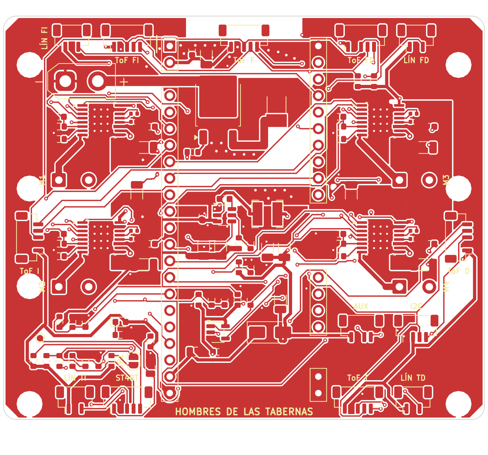
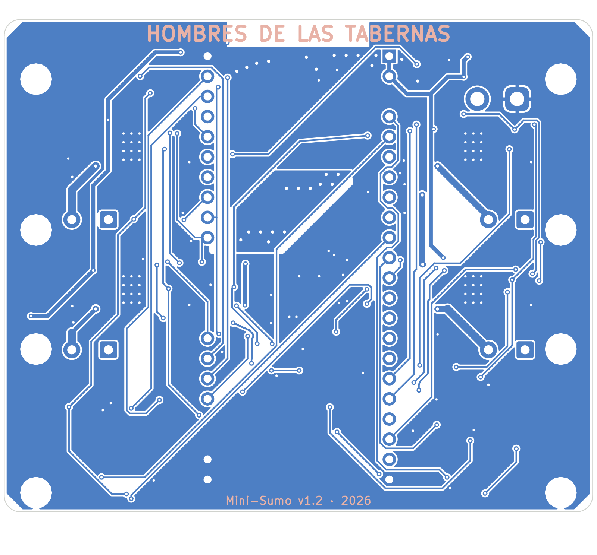

# 05 · Placa base v1.2 (PCB)

Proyecto KiCad en [`hardware/pcb/`](../hardware/pcb/). Todo se genera con scripts a partir del circuito descrito en [`scripts/design.py`](../hardware/pcb/scripts/design.py) y de la geometría compartida [`hardware/geometria.py`](../hardware/geometria.py).

> **Estado (16/11/2026): rutado terminado, DRC limpio y revisado antes de fabricar. Se corrigió el tronco de VBAT (ver [3.2](#32-corrección-del-16112026-tronco-de-vbat)).**
> - ERC: **0** infracciones. DRC (`kicad-cli pcb drc --severity-all`): **0 infracciones, 0 avisos y 0 conexiones sin rutar** ([informe](../hardware/pcb/fabricacion/drc_v1.2.rpt)).
> - 2 capas, planos de GND en las dos caras, zonas de VBAT en la cara superior y un puente de VBAT en la cara inferior.
> - No está fabricada ni probada: todo lo de aquí son cálculos. Ver la lista del [apartado 4](#4-qué-revisar-antes-de-pedir-la-placa).
> - Se puede pedir con **cobre de 1 oz** (ver [3.2](#32-corrección-del-16112026-tronco-de-vbat)).

*English: the board is generated from scripts and fully routed (Freerouting 1.9 + own clean-up scripts). ERC and DRC are clean (0 errors, 0 warnings, 0 unrouted). VBAT trunk fixed on 16/11/2026; 1 oz copper is enough. Not fabricated or tested.*

## 1. Datos de la placa

| | |
|---|---|
| Tamaño | 74 × 62 mm, esquinas achaflanadas, 8 taladros M2 (NPTH) |
| Capas | 2, FR4 1,6 mm, cobre 1 oz |
| Clases de red | Potencia 0,4 mm / 0,2 mm (VBAT y motores, ensanchadas después hasta 2 mm donde cabe) · Alimentación 0,5 mm / 0,2 mm · Default 0,2 mm / 0,15 mm de holgura |
| Planos | GND en las dos caras, con zonas sin cobre de 2 mm de radio alrededor de los taladros |
| Serigrafía | **"HOMBRES DE LAS TABERNAS"** en la cara inferior (1,8 mm) y en la superior (1,0 mm), versión `v1.2`, nombres de los conectores ("ST4RT", "BANCO", "ToF …", "LÍN …", M1–M4) |
| Componentes | 48 líneas de BOM ([`bom.csv`](../hardware/pcb/bom.csv)); R68 y R69 se marcan DNP (sin montar) |





## 2. Bloques

| Bloque | Componentes | Notas v1.2 |
|---|---|---|
| Entrada de batería | J1 (XT30), Q1 AOD4185 (inversión de polaridad), F1 15 A, C1/C2, divisor R3/R4 a VBAT_SENSE | Fusible de 10 A → 15 A |
| Buck 5,3 V | U2 TPS563201, L1 3,3 µH, R5–R8, C4–C9 | R7 = 59 kΩ; D2 eliminado |
| Alimentación de la DevKit | D1 al pin 5V de la DevKit, LDO de la DevKit a 3,3 V | — |
| Control | U1 ESP32-S3-DevKitC-1 en dos tiras hembra de 2,54 mm | GPIO21 = DRV_EN (R17 100 kΩ a GND) |
| Drivers | U5–U8 DRV8874 con R_IPROPI 1,5 kΩ, VREF común (I_TRIP = 2,44 A), nFAULT común | — |
| **Arranque ST4RT** | J17 (JST-SH 5), R62/C62, R63–R66, R68/R69 (DNP), JP1 + R67, **U3 74LVC1G08**, C15, TP1 | Nuevo. nSLEEP = DRV_EN · KILL ([06](06-Modulo-arranque-ST4RT.md#3-integración-en-el-robot-v12)) |
| Sensores | J7–J12 ToF (3V3, GND, SCL, SDA, XSHUT), J13–J16 línea (3V3, GND, señal), R60/R61 4,7 kΩ | Pull-ups subidas de valor |
| Expansión | J18 Qwiic (I²C), J19 AUX (5 V, UART) | — |

Esquemático completo: [`fabricacion/robot_sumo_esquematico.pdf`](../hardware/pcb/fabricacion/robot_sumo_esquematico.pdf) y [imagen](img/pcb_esquematico.png).

## 3. Cómo se regenera

```bash
cd hardware/pcb
export KICAD_CONFIG_HOME=/tmp/sumo_check/kcfg            # lo crea check.sh
scripts/check.sh /tmp/sumo_check        # 1. librerías, proyecto, esquemático y PCB SIN RUTAR + ERC/DRC
python3 scripts/autoroute.py /ruta/a/freerouting-1.9.0.jar 60   # 2. Freerouting (deja algunas redes sin terminar)
python3 scripts/acabado.py              # 3. termina las redes que falten con un rutador propio (A*) y cose GND
python3 scripts/ensanchar.py            # 4. ensancha VBAT y motores hasta donde deja el DRC y añade las zonas de VBAT
python3 scripts/acabado.py GND          # 5. vuelve a coser las islas de GND que cortan las zonas de VBAT
kicad-cli pcb drc --severity-all -o fabricacion/drc_v1.2.rpt robot_sumo.kicad_pcb   # 6. tiene que dar 0 / 0
scripts/fabricacion.sh                  # 7. Gerber, taladros, posiciones, BOM y PDF en fabricacion/
```

Herramientas probadas: KiCad 9.0.9, **Freerouting 1.9.0** con Java 21 (necesita pantalla: sin `DISPLAY` el script usa `xvfb-run`; Freerouting 2.1 no respeta el número de pasadas y, si se corta por tiempo, guarda un rutado a medias).

**La placa del repositorio es ahora la fuente.** `check.sh` y `generar_todo.sh` la vuelven a generar desde cero y **borran el rutado**. Además, el rutado de Freerouting no sale idéntico cada vez y la placa actual lleva unos pocos retoques hechos a mano con scripts sueltos (M4_IN1, DRV_VREF, +3V3 junto a U1.22 y el tramo VBAT_REV de Q1 a F1 a 1,2 mm). Si se cambia algo del circuito, copiar antes `robot_sumo.kicad_pcb`, y repetir los pasos 2–6 y revisar el resultado.

Cómo se llegó aquí: la primera pasada (Freerouting 2.1, pistas de potencia de 0,8 mm) dejó 72 conexiones sin rutar. Las causas eran que una pista de 0,8 mm no entra en los pines de 0,4 mm y 0,65 mm de paso del DRV8874, que la salida de los pines de los drivers estaba congestionada y que las filas de la DevKit parten la placa en tres. Se cambió:
- La salida de cada driver es ahora una plantilla fija (`salida_driver()` en `gen_pcb.py`): VBAT, OUTA/OUTB, bomba de carga e ISENSE salen ya rutados y bloqueados, con una vía en OUTB.
- C_VCP y C_CP de los drivers pasan a 0402 y se recolocan junto a los pines 12–14. R_IPROPI, C_IPROPI y R_IMODE van al lado izquierdo.
- La clase Potencia pasa a 0,4 mm y el ensanchado se hace al final (`ensanchar.py`).
- Zonas: holgura 0,2 mm, alivios térmicos de 0,4 mm para los PTH y conexión maciza para la DevKit.

### 3.1 Anchos de las pistas de potencia

| Tramo | Corriente máx. (diseño) | Cobre | Comentario |
|---|---|---|---|
| XT30 → Q1 → F1 (VBAT_RAW, VBAT_REV) | 10,2 A (4 drivers en I_TRIP) | 1,5 mm (VBAT_RAW) · 1,2 mm (VBAT_REV) · 1,0 mm hasta F1.1 | El pin 3 de Q1 (DPAK) es el cuello de botella real |
| F1 → reparto | 10,2 A | Zonas de VBAT (cara superior) + puente de VBAT en la cara inferior | Corregido el 16/11/2026: antes pasaba todo por una pista de 0,4 mm (ver 3.2) |
| Cruce de la fila izquierda de la DevKit hacia U5/U6 | ≤ 4,9 A (2 drivers) | La zona de VBAT pasa entre varios pines de la tira, más pistas de 0,4 mm | Entre dos pines (paso 2,54 mm) solo cabe 0,44 mm; los tramos estrechos miden ≈ 1,5 mm |
| Entrada a cada driver (pin 11) | ≤ 2,44 A | 0,4 mm, unos 3 mm | Limitado por el pin de 0,4 mm |
| Salidas de motor (OUTA/OUTB) | ≤ 2,44 A | 1,0 mm casi todo (41 mm), 0,4 mm solo en la salida del pin (15 mm en total) | — |

Capacidad orientativa según IPC-2221 (pista exterior, subida de 20 °C): 0,4 mm ≈ **1,7 A** con 1 oz y ≈ **2,8 A** con 2 oz; 1,0 mm ≈ 3,2 A / 5,4 A; 1,5 mm ≈ 4,4 A / 7,2 A. Son corrientes continuas, y los picos de 2,44 A por motor duran lo que dura un empuje. Las 3 pistas de 0,4 mm del cruce izquierdo dan ≈ 5 A con 1 oz y ≈ 8 A con 2 oz. Desde la corrección del 16/11/2026 ya no hay ningún tramo largo y estrecho por el que pase más de un motor, así que **basta con 1 oz**. Estos números salen de la fórmula de IPC-2221 (I = 0,048 · ΔT^0,44 · A^0,725, con A en mil²) y no se han medido.

Si se rehace la placa (v1.3): colocar Q1 y F1 a la izquierda de la DevKit, junto a U5/U6, para que el tronco de 10 A no tenga que cruzar una fila de pines, o pasar a 4 capas con un plano de VBAT.

### 3.2 Corrección del 16/11/2026: tronco de VBAT

En la revisión antes de fabricar salió un fallo: **toda la corriente de los motores (≈ 9,8 A con los 4 en I_TRIP) pasaba de F1 a los drivers por una sola pista de 0,4 mm × 5,7 mm**, porque la zona de VBAT central no llegaba hasta el pad de F1. Esa pista se habría comportado como un fusible.

Cambios (sin tocar el circuito):
- La zona de VBAT central sube hasta F1 y llega hasta las filas de pines de la DevKit; la de los drivers izquierdos también llega a la fila, así que el cobre pasa entre los pines libres.
- R1 (pull-down de la puerta de Q1) se mueve junto a Q1, y DRV_nSLEEP baja a la cara inferior antes de Q1. Así queda libre el paso de VBAT bajo Q1 hacia la izquierda.
- Puente de VBAT en la cara inferior (zona `VBAT_puente_B`) con 13 vías de 0,4 mm, que une la zona de F1 con la franja de VBAT que va a los drivers derechos.
- 13 vías de GND en la parte delantera para que el plano GND inferior siga unido.
- Serigrafía: JP1 se rotula "JP1" (antes "BANCO", que se montaba encima de "ST4RT"), y el texto de la cara inferior se acorta a "Mini-Sumo v1.2 · 2026".

Cálculo de la red VBAT (malla de 0,1 mm sobre el cobre real, 1 oz, 4 × 2,44 A): la caída de F1 a los drivers baja de 108–258 mV a **37–51 mV**, y las pérdidas en el cobre de 1,8 W a **0,4 W**. Lo que queda está en tramos cortos junto a los pines. Es un cálculo, no una medida.

## 4. Qué revisar antes de pedir la placa

1. ☑ Rutado completo: 0 conexiones sin rutar (`kicad-cli pcb drc`).
2. ☑ DRC con 0 infracciones y 0 avisos (holguras, alivios térmicos, serigrafía, huellas).
3. ☐ **Revisión a ojo en KiCad por alguien del equipo**, sobre todo:
   - el bucle de conmutación del buck (C4/C5 – U2 – L1 – C8/C9) y su retorno de GND;
   - las vías del pad térmico de los DRV8874;
   - los cruces de VBAT de la fila izquierda de la DevKit ([3.2](#32-corrección-del-16112026-tronco-de-vbat)).
4. ☐ Comprobar con la DevKit real la separación de las filas (22,86 mm) y la altura con las tiras hembra.
5. ☐ Comprobar con el ST4RT real el orden de pines antes de hacer el cable (el de J17 no cambia: el cable se adapta).
6. ☐ Revisar en el visor de JLCPCB la serigrafía, el contorno y los taladros, y el fichero de posiciones si se pide montaje (las coordenadas salen respecto al origen de la hoja de KiCad: fijar el origen auxiliar en la esquina de la placa si el fabricante lo pide).
7. ☐ Pedirla con **cobre de 1 oz**, 74,1 × 62,1 mm, sin montaje.

## 5. Ficheros de fabricación (`hardware/pcb/fabricacion/`)

| Fichero | Contenido |
|---|---|
| `robot_sumo_gerber.zip` | Gerber de cobre, máscara, pasta, serigrafía y contorno + taladros Excellon (PTH y NPTH) |
| `robot_sumo_posiciones.csv` | Posición de los componentes (sin los DNP) |
| `robot_sumo_bom.csv` | Lista de materiales |
| `robot_sumo_esquematico.pdf` | Esquemático |
| `drc_v1.2.rpt` | Informe del DRC (0 infracciones, 0 avisos, 0 sin rutar) |

Corresponden a la placa con el rutado terminado. Antes de pedirla, hacer la revisión del [apartado 4](#4-qué-revisar-antes-de-pedir-la-placa).
