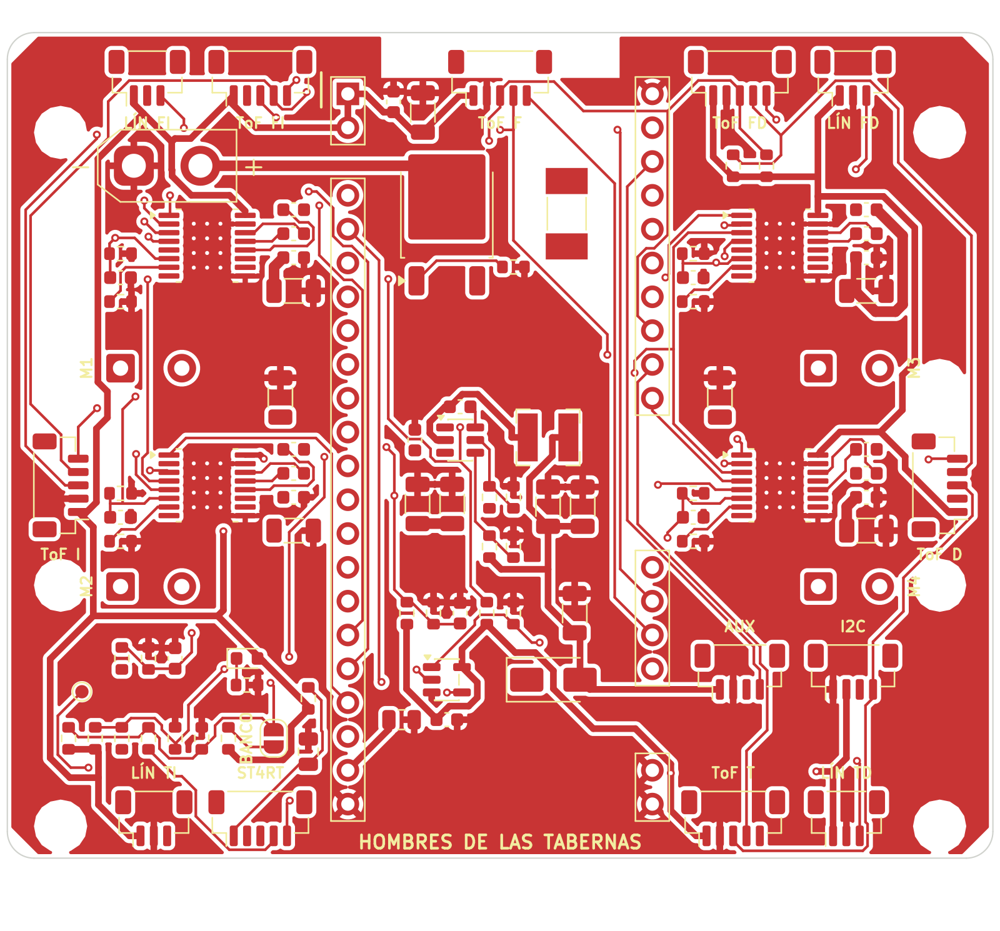
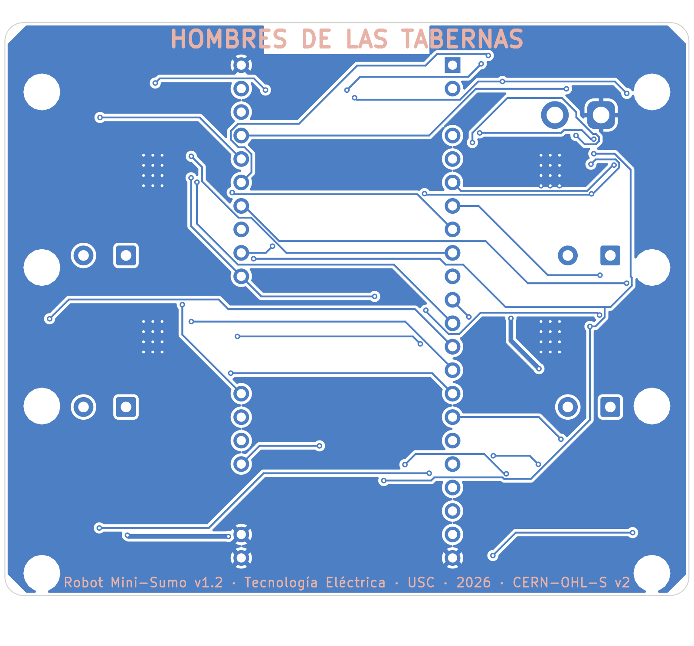

# 05 · Placa base v1.2 (PCB)

Proyecto KiCad en [`hardware/pcb/`](../hardware/pcb/). Todo se genera con scripts a partir del circuito descrito en [`scripts/design.py`](../hardware/pcb/scripts/design.py) y de la geometría compartida [`hardware/geometria.py`](../hardware/geometria.py).

> **Estado (10/11/2026): diseño con rutado incompleto. NO FABRICAR TODAVÍA.**
> - ERC: **0** infracciones. DRC (antes de rutar): solo conexiones pendientes y un aviso de serigrafía.
> - Rutado automático con Freerouting: 700 pistas y 101 vías, **72 conexiones sin rutar** (16 de VBAT, 9 de GND, las salidas de los 4 motores y unas 20 señales). Sin cortocircuitos ni infracciones de holgura en el DRC; quedan 17 avisos de alivio térmico incompleto en GND y una pareja de vías a 0,49 mm (mínimo 0,50 mm).
> - **Falta terminar el rutado a mano en KiCad**, reforzar la potencia y revisar todo antes de pedir la placa. Los Gerber de `fabricacion/` son de la placa tal como está, solo para revisar en el visor del fabricante.

*English: the board is generated from scripts. ERC is clean; the autorouter left 72 connections unrouted (mainly VBAT, GND and the motor outputs), so the layout must be finished by hand in KiCad before ordering. Gerbers in `fabricacion/` are for review only.*

## 1. Datos de la placa

| | |
|---|---|
| Tamaño | 74 × 62 mm, esquinas achaflanadas, 8 taladros M2 (NPTH) |
| Capas | 2, FR4 1,6 mm, cobre 1 oz (2 oz recomendado) |
| Clases de red | Potencia 0,8 mm (VBAT, motores) · Alimentación 0,5 mm · Default 0,2 mm / 0,15 mm de holgura |
| Planos | GND en las dos caras, con zonas sin cobre de 2 mm de radio alrededor de los taladros |
| Serigrafía | **"HOMBRES DE LAS TABERNAS"** en la cara inferior (1,8 mm) y en la superior (1,0 mm), versión `v1.2`, nombres de los conectores ("ST4RT", "BANCO", "ToF …", "LÍN …", M1–M4) |
| Componentes | 48 líneas de BOM ([`bom.csv`](../hardware/pcb/bom.csv)); R68 y R69 se marcan DNP (sin montar) |





## 2. Bloques

| Bloque | Componentes | Notas v1.2 |
|---|---|---|
| Entrada de batería | J1 (XT30), Q1 AOD4185 (inversión de polaridad), F1 15 A, C1/C2, divisor R3/R4 a VBAT_SENSE | Fusible de 10 A → 15 A |
| Buck 5,3 V | U2 TPS563201, L1 3,3 µH, R5–R8, C4–C9 | R7 = 59 kΩ; D2 eliminado |
| Alimentación de la DevKit | D1 al pin 5V de la DevKit, LDO de la DevKit a 3,3 V | — |
| Control | U1 ESP32-S3-DevKitC-1 en dos tiras hembra de 2,54 mm | GPIO21 = DRV_EN (R17 100 kΩ a GND) |
| Drivers | U4–U7 DRV8874 con R_IPROPI 1,5 kΩ, VREF común (I_TRIP = 2,44 A), nFAULT común | — |
| **Arranque ST4RT** | J17 (JST-SH 5), R62/C62, R63–R66, R68/R69 (DNP), JP1 + R67, **U3 74LVC1G08**, C15, TP1 | Nuevo. nSLEEP = DRV_EN · KILL ([06](06-Modulo-arranque-ST4RT.md#3-integración-en-el-robot-v12)) |
| Sensores | J7–J12 ToF (3V3, GND, SCL, SDA, XSHUT), J13–J16 línea (3V3, GND, señal), R60/R61 4,7 kΩ | Pull-ups subidas de valor |
| Expansión | J18 Qwiic (I²C), J19 AUX (5 V, UART) | — |

Esquemático completo: [`fabricacion/robot_sumo_esquematico.pdf`](../hardware/pcb/fabricacion/robot_sumo_esquematico.pdf) y [imagen](img/pcb_esquematico.png).

## 3. Cómo se regenera

```bash
cd hardware/pcb
scripts/check.sh /tmp/sumo_check        # librerías, proyecto, esquemático y PCB sin rutar + ERC/DRC
python3 scripts/autoroute.py /ruta/a/freerouting.jar 25 00:03:00   # rutado automático (parcial)
scripts/fabricacion.sh                  # Gerber, taladros, posiciones, BOM y PDF en fabricacion/
```

Herramientas probadas: KiCad 9.0.9 (los scripts también funcionan con KiCad 10), Freerouting 2.1.0 con Java 21. **`check.sh` y `generar_todo.sh` vuelven a generar la placa desde cero y borran el rutado**: una vez se empiece a rutar a mano, la placa pasa a ser la fuente y no hay que volver a ejecutarlos sin copiar antes `robot_sumo.kicad_pcb`.

## 4. Qué falta antes de fabricar (lista de revisión)

1. ☐ Terminar las 72 conexiones pendientes. Empezar por la potencia:
   - VBAT del fusible a los 4 drivers y al buck: mejor como **zona de cobre** en la cara superior (≥ 2 mm de ancho equivalente para 10 A en 1 oz, o 2 oz) que como pistas de 0,8 mm.
   - Salidas de los motores (OUTA/OUTB de U4–U7) a los pads de los motores (J3–J6, serigrafía M1–M4) con 0,8 mm.
   - Pad térmico de cada DRV8874 a GND con varias vías a la cara inferior.
2. ☐ Retornos de GND: que el plano inferior quede continuo bajo los drivers y el buck (bucle de conmutación corto: C4/C5 – U2 – L1 – C8/C9).
3. ☐ Corregir los 17 alivios térmicos incompletos (o aceptar los que tengan 1 radio si la pista es corta) y la pareja de vías ISENSE_M3/DRV_nFAULT a 0,49 mm.
4. ☐ DRC con 0 errores y 0 conexiones pendientes (`kicad-cli pcb drc`).
5. ☐ Comprobar con la DevKit real la separación de las filas (22,86 mm) y la altura con las tiras hembra.
6. ☐ Comprobar con el ST4RT real el orden de pines antes de hacer el cable (el de J17 no cambia: el cable se adapta).
7. ☐ Revisar en el visor de JLCPCB la serigrafía, el contorno y los taladros, y el fichero de posiciones si se pide montaje (las coordenadas salen respecto al origen de la hoja de KiCad: fijar el origen auxiliar en la esquina de la placa si el fabricante lo pide).

## 5. Ficheros de fabricación (`hardware/pcb/fabricacion/`)

| Fichero | Contenido |
|---|---|
| `robot_sumo_gerber.zip` | Gerber de cobre, máscara, pasta, serigrafía y contorno + taladros Excellon (PTH y NPTH) |
| `robot_sumo_posiciones.csv` | Posición de los componentes (sin los DNP) |
| `robot_sumo_bom.csv` | Lista de materiales |
| `robot_sumo_esquematico.pdf` | Esquemático |
| `drc_v1.2_rutado_parcial.rpt` | Informe del DRC del estado actual |

Corresponden a la placa **con el rutado parcial**: sirven para revisar, no para pedir.
