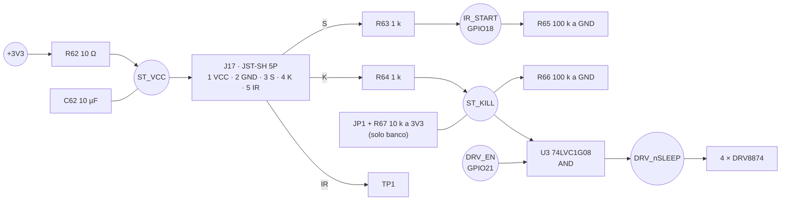

# 06 · Módulo de arranque IR Sobotz ST4RT (lo aporta el profesor)

> **Estado:** integración diseñada en PCB v1.2, firmware y carcasa. **Nada está probado con el módulo real**, que llega a principios de diciembre de 2026. Todo lo que dice este documento sobre el ST4RT procede de la web del fabricante leída a través de un buscador (la web no se pudo abrir directamente desde el entorno de trabajo) y del código abierto del módulo de referencia con el que Sobotz dice ser compatible. Lo que no está confirmado se marca como tal.

*English summary: the professor supplies a Sobotz ST4RT IR start module. We integrate it as a drop-in for the open-source p1r.se/startmodule.com module: powered from 3.3 V, START (S) to a GPIO, KILL (K) gating the motor drivers' nSLEEP in hardware through an AND gate. Pin order, logic levels and current are unverified until the module arrives.*

## 1. Qué sabemos y de dónde

### 1.1 Anuncio del profesor (2/11/2026)

> "…este año la normativa del campeonato de Robot Sumo requieren que arranquen con una señal que reciben a través de un sensor de IR. […] os daré yo el sensor de IR para que lo montéis en el Robot. NO tenéis que comprarlo vosotros. El modelo es este: https://sobotz.com/en/product/st4rt-sobotz-sumo-start-module/ […] (a principios del mes de diciembre)."

### 1.2 Reglamento OSHWDem Mini Sumo, revisión 7 (2026)

Fuente: [rules.oshwdem.org/loita_sumo_es](https://rules.oshwdem.org/loita_sumo_es) — texto leído del repositorio oficial del reglamento, [brico-labs/Regulamentos, `loita_sumo_es.md`](https://github.com/brico-labs/Regulamentos/blob/gh-pages/loita_sumo_es.md) (último cambio del fichero: 1/9/2026).

| Artículo | Texto (literal) | Qué implica |
|---|---|---|
| 5.4 | "La activación y desactivación de ambos robots en la competición será mediante IR usando el protocolo RC05. El juez tendrá un mando y será el encargado de activar y desactivar los robots para iniciar y acabar los asaltos." | Arranque **y parada** por IR, protocolo RC5. **No** dice qué dirección/comando ni que haya que usar un módulo concreto. |
| 5.5 | "El funcionamiento autónomo de los robots debe comenzar sin retraso tras el inicio con el mando por parte del juez." | Nada de esperas de 5 s: el firmware arranca en cuanto ve START. |
| 8 | "…activará los robots de forma remota que empezarán a operar de manera inmediata." | Ídem. |
| 6.1 | Prohibidos "dispositivos para crear interferencias (jamming), como LED's IR con la intención de saturar los sensores IR del oponente." | Los VL53L0X emiten IR (láser de 940 nm) para medir, no para interferir; ver [11 · Cumplimiento](11-Cumplimiento-normativo.md). |

La plantilla de la ficha técnica del profesor añade en el punto 10: "Responde al sistema de arranque oficial IR (o retardo obligatorio de 5 s inmóvil) e **incluye Kill Switch accesible**".

### 1.3 Ficha del ST4RT (web de Sobotz, vía buscador)

Página: [sobotz.com/en/product/st4rt-sobotz-sumo-start-module](https://sobotz.com/en/product/st4rt-sobotz-sumo-start-module/). Datos tal como los devuelve el buscador el 10/11/2026 — **pendientes de comprobar con el módulo en la mano**:

| Dato | Valor anunciado | Estado |
|---|---|---|
| Alimentación | 2,8–5,2 V | 🟡 anunciado, sin hoja de datos |
| Pines | **K** (kill), **S** (start), **−** (GND), **+** (VCC), con la misma disposición que el módulo p1r.se, más un pin **IR** con la salida en bruto del receptor | 🟡 orden físico sin confirmar |
| Tamaño | ~10,2 × 10,2 × 6 mm | 🟡 a medir |
| Compatibilidad | "Drop-in" del módulo oficial de p1r.se/startmodule.com | 🟡 afirmación del fabricante |
| Memoria de estado | Guarda su estado en memoria no volátil; si el LED ya está encendido antes de la orden de inicio, el módulo sigue "arrancado" y hay que mandar parada y reiniciar el robot | 🟡 |
| Consumo, nivel lógico de S/K, tipo de salida (push-pull o drenador abierto), masa | **No publicados** | ❓ |
| Precio | 12,99 € | Solo informativo: no se compra |

### 1.4 Módulo de referencia: p1r.se / startmodule.com (código abierto)

Como el ST4RT se anuncia compatible, se ha estudiado el diseño abierto original: [github.com/p1rse/robot-sumo-start-module](https://github.com/p1rse/robot-sumo-start-module) (hardware v0.16 y firmware `Source/Prebuilt_Module/for_hw_0.16/main.c`, `Source/Generic_AVR/.../start.c`) y la documentación de [p1r.se/startmodule](https://p1r.se/startmodule/) ("Implement Yourself", "Referees Remote", "Programming Setup").

| Estado | START (S) | KILL (K) | LED | Cómo se llega |
|---|---|---|---|---|
| Encendido (POWER ON) | 0 | **1** | apagado | al alimentar el módulo |
| Arrancado (STARTED) | **1** | 1 | encendido | RC5 dirección **0x07**, comando = **id_dohyo + 1** |
| Parado (STOPPED) | 0 | **0** | parpadea (1 Hz) | RC5 dirección 0x07, comando = **id_dohyo** (también desde POWER ON) |
| Programación | — | — | 2 destellos | RC5 dirección **0x0B**: guarda id_dohyo = comando con el bit 0 a cero |

- Tras una parada, el módulo **no vuelve a arrancar hasta que se le quita la alimentación** (en `main.c`, el estado STOPPED es un bucle infinito).
- El estado se guarda en EEPROM: si el robot sufre un reinicio en pleno combate, al volver la tensión el módulo vuelve a STARTED sin nueva orden.
- En el módulo original, el pin de modo (pull-up interna) elige "modo competición" (lo anterior) o "modo casa" (comando RC5 1 = inicio, 2 = parada, con cualquier dirección). **No sabemos si el ST4RT tiene ese modo.**

## 2. Incompatibilidades y datos que faltan

| # | Riesgo | Por qué importa | Qué hemos hecho | Quién lo confirma |
|---|---|---|---|---|
| 1 | El reglamento dice "RC5", pero **no** que el mando del juez siga el protocolo startmodule (direcciones 0x07/0x0B e id de dohyo). | Si el mando del juez manda otro código RC5, el ST4RT puede no reaccionar. | Nada que hacer en el robot: depende del mando. Pin IR en bruto llevado a un punto de prueba (TP1) por si hiciera falta decodificar RC5 en el ESP32 en una revisión futura (hoy no hay GPIO libre). | **Profesor / organizador**: ¿qué mando se usa? ¿se programan los módulos con un id de dohyo antes de cada combate? |
| 2 | Orden físico de los pines, paso y si trae tira de pines o pads. | Una conexión cruzada puede dañar el módulo o el ESP32. | En la PCB el módulo va a **J17 (JST-SH 5 pines) con cable hecho a medida**: el orden de la PCB no depende del módulo. | Medir con el módulo en la mano. |
| 3 | Nivel alto de S y K = tensión de alimentación (si son push-pull). | Si se alimentara a 5 V, S y K darían 5 V a un GPIO de 3,3 V. | Se alimenta a **3,3 V** (R62 + C62) y S/K llevan **1 kΩ en serie** (R63, R64). | Medir S y K con el polímetro. |
| 4 | Salidas de **drenador abierto** en lugar de push-pull. | Con las pull-down de 100 k (R65, R66) nunca se vería un "1". | Huecos para **pull-ups R68/R69 (no montadas)**: si hiciera falta, se montan y se quitan R65/R66. | Medir. |
| 5 | Consumo del módulo. | Con 10 Ω de filtro, 10 mA hacen caer 0,1 V: el módulo sigue a 3,2 V (> 2,8 V). | Calculado en [08 · Cálculos](08-Calculos-v1.2.md#st4rt). | Medir. |
| 6 | "Kill switch accesible" (plantilla del profesor). | Puede entenderse como la línea K del módulo o como un interruptor físico. | K **duerme los drivers por hardware** (U3). Corte físico total: desenchufar el XT30, accesible desde arriba. Sin interruptor general (no cabía en la v1.1). | **Profesor**: ¿basta con K + XT30 o exige interruptor? |
| 7 | Tras la parada hay que **reiniciar la alimentación** del módulo para el siguiente asalto. | 30 s entre asaltos (art. 13). | Procedimiento: desenchufar y enchufar el XT30 (reinicia módulo y ESP32 a la vez). | Probar con el módulo. |
| 8 | Memoria de estado del módulo (arranca solo tras un reinicio si estaba en STARTED). | Si se enciende el robot con el módulo "arrancado" de una prueba anterior, el robot **se movería al encenderlo**. | El firmware lo trata como "reinicio en combate" (es lo que pide el módulo). **Procedimiento:** comprobar que el LED del módulo está apagado antes de dejar el robot en el dohyo. | Probar. |
| 9 | Línea de visión del receptor. | El juez apunta desde fuera del dohyo. | Torre en el techo: el módulo queda 12 mm por encima del techo y por encima de la batería, visible desde delante, los lados y detrás. | Probar desde 1–2 m. |

## 3. Integración en el robot (v1.2)

### 3.1 Electrónica (placa base v1.2, [`design.py`](../hardware/pcb/scripts/design.py), bloque "Arranque ST4RT")

- **Parada por hardware:** `nSLEEP = DRV_EN AND KILL`. Si el módulo baja K, los cuatro drivers se duermen (salidas en alta impedancia) aunque el ESP32 esté colgado. Retardo de la puerta: nanosegundos.
- **Sin módulo, el robot no se mueve:** R66 deja K a 0. Para probar en el banco sin módulo se cierra **JP1** (puente de soldadura): K pasa a 1 a través de R67. **Abrir JP1 antes de competir** (con el módulo puesto JP1 no anula la parada: el módulo fuerza K a 0 contra los 10 kΩ, pero se deja abierto por claridad).
- **Sin START no hay arranque:** R65 mantiene GPIO18 a 0 si el cable se suelta.
- **Antes**, la v1.1 llevaba un receptor VS1838B en J17 y decodificaba RC5 en el firmware. Se sustituye por el módulo del profesor (no hay que comprar receptor).

### 3.2 Firmware ([07 · Firmware](07-Firmware.md))

Máquina de estados `ESPERA → COMBATE → PARADO`, idéntica a la del módulo de referencia, a partir de la línea S. Filtro de 2 muestras (≈ 1–2 ms) y arranque en el mismo ciclo. Al parar, freno activo 300 ms (si K aún no ha dormido los drivers) y drivers deshabilitados hasta reiniciar.

### 3.3 Mecánica ([03 · Disposición mecánica](03-Disposicion-mecanica.md))

Torre impresa con el techo (`carcasa_techo.stl`): alojamiento de 10,8 × 10,8 mm (módulo + 0,3 mm por lado) y 4 mm de alto, con el fondo a 12 mm sobre el techo, muesca trasera para los pines y paso de cable por dentro hasta J17. Las cotas salen de `geometria.py` (`ST4RT_*`): **medir el módulo y regenerar** si no coinciden. Sujeción: ajuste + cinta de doble cara fina en el fondo (la regla 6.6 prohíbe sustancias pegajosas para la tracción, no para fijar piezas).

## 4. Procedimiento en competición (propuesto, a validar)

1. Antes del asalto: robot apagado (XT30 fuera), colocado detrás de su línea.
2. Enchufar el XT30. Comprobar que el **LED del módulo está apagado** (POWER ON). Si está encendido, avisar al juez para que mande parada y repetir el paso 2.
3. Si el juez programa el id de dohyo, el LED destella dos veces.
4. Orden de inicio del juez → el robot arranca en el mismo instante.
5. Orden de parada → el robot frena y se duerme. Recoger el robot y **desenchufar el XT30** (el módulo no rearranca sin reiniciar la alimentación).

## 5. Pruebas pendientes (con el módulo real)

- [ ] Medir dimensiones, orden de pines, consumo y masa; actualizar `geometria.py` y el cable de J17.
- [ ] Medir los niveles de S y K en cada estado (POWER ON, STARTED, STOPPED) con el módulo alimentado a 3,3 V.
- [ ] Comprobar el tiempo desde la orden del mando hasta el movimiento de las ruedas (vídeo a cámara lenta).
- [ ] Comprobar que K duerme los drivers con el firmware parado (p. ej. con el ESP32 en modo bootloader).
- [ ] Probar el alcance y el ángulo de recepción con el mando que usará el juez.
- [ ] Comprobar el comportamiento tras un reinicio con el módulo en STARTED.
