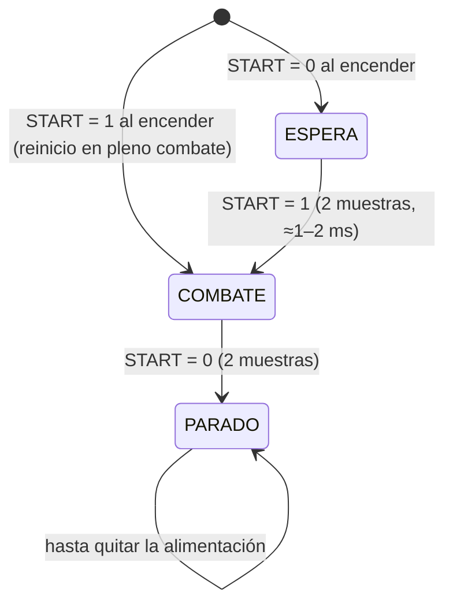

# 07 · Firmware

Código en [`firmware/sumo_lhdt/`](../firmware/sumo_lhdt/) para la **ESP32-S3-DevKitC-1** sobre la placa base v1.2. Arduino (core `esp32` de Espressif 3.x) y librería **Pololu VL53L0X 1.3.x**.

> **Estado:** compila sin errores ni avisos para ESP32-S3 (core esp32 3.0.7: 919 kB de flash, 70 %; 41,7 kB de RAM, 12 %) y la lógica de arranque y estrategia pasa sus pruebas en el PC. **No se ha ejecutado en el robot** (aún no existe): tiempos, umbrales y signos de los motores son valores de partida marcados "A AJUSTAR" en `config.h`.

*English: autonomous sumo firmware. Start/stop follows the ST4RT START line with a latched state machine (WAIT → FIGHT → STOPPED). Edge avoidance has priority over attack. Logic is Arduino-free and unit-tested on the host.*

## 1. Estructura

| Fichero | Qué hace | Depende de Arduino |
|---|---|---|
| `sumo_lhdt.ino` | Vacío a propósito (el IDE necesita un `.ino` con el nombre de la carpeta) | — |
| `principal.cpp` | `setup()` y `loop()`: arranque, bucle de combate, parada | Sí |
| `pines.h` | Pinout de la placa v1.2 (sale de `hardware/pcb/scripts/design.py`) | No |
| `config.h` | Todos los parámetros ajustables | No |
| `arranque.h` | Máquina de estados del módulo de arranque | **No** (se prueba en el PC) |
| `estrategia.h` | Decisiones de combate | **No** (se prueba en el PC) |
| `hardware_robot.h/.cpp` | Motores (LEDC a 20 kHz), línea (ADC), ToF (I²C), batería | Sí |
| `../test/test_logica.cpp` | Pruebas de `arranque.h` y `estrategia.h` | No |

## 2. Compilar y cargar

**Arduino IDE 2:** instalar el core "esp32" de Espressif (3.x) y la librería "VL53L0X" de Pololu → abrir `firmware/sumo_lhdt/sumo_lhdt.ino` → placa **"ESP32S3 Dev Module"** → USB CDC On Boot: *Enabled* (para ver la consola por el USB nativo) → Subir.

**arduino-cli:**

```bash
arduino-cli core install esp32:esp32
arduino-cli lib install "VL53L0X"
arduino-cli compile -b esp32:esp32:esp32s3 firmware/sumo_lhdt
arduino-cli upload  -b esp32:esp32:esp32s3 -p /dev/ttyACM0 firmware/sumo_lhdt
```

**Pruebas de lógica en el PC:**

```bash
g++ -std=c++17 -Wall -Wextra -I firmware/sumo_lhdt firmware/test/test_logica.cpp -o /tmp/test_logica && /tmp/test_logica
```

> Programar **con la batería quitada** (solo USB): así la DevKit alimenta ESP32 y sensores, pero los motores no tienen tensión.

## 3. Funcionamiento



1. **Encendido** (`setup`): lo primero, entradas de los drivers a 0 y DRV_EN a 0. Wi-Fi y Bluetooth apagados (robot autónomo). Se inicializan los 6 ToF (encendido uno a uno con XSHUT y direcciones 0x30–0x35) y se calibran los sensores de línea durante 200 ms sobre el negro. Si START ya está a 1, se salta la calibración y se entra en combate directamente.
2. **ESPERA:** DRV_EN = 1 (drivers despiertos para arrancar sin retardo), motores en rueda libre. El robot no puede moverse: sin START no hay órdenes, y K del módulo puede dormir los drivers por hardware.
3. **COMBATE:** bucle a ≥ 1 kHz: leer línea (4 ADC) → leer ToF disponibles (sin bloquear) → corriente media (IPROPI) → `Estrategia::decidir` → motores.
4. **PARADO:** freno activo 300 ms (IN1 = IN2 = 1) y luego drivers deshabilitados. No se vuelve a arrancar sin reiniciar, igual que el módulo.

### Estrategia (`estrategia.h`)

| Prioridad | Situación | Acción |
|---|---|---|
| 1 | Sensor de línea **delantero** en blanco | Retroceder 180 ms y girar 220 ms hacia el lado contrario |
| 1 | Sensor de línea **trasero** en blanco | Avanzar hasta salir del blanco + 180 ms |
| 2 | Rival visto por FL / F / FR (15–650 mm) | Orientarse (control proporcional) y avanzar; **a fondo** si está a < 15 cm o hay contacto (corriente media > 1,4 A) |
| 2 | Rival visto por L / R / trasero | Girar en el sitio hacia él |
| 3 | Nada | Girar 1,5 s hacia el último lado visto y avanzar 0,35 s; repetir |

- **Nunca se queda quieto** en combate (art. 14: 5 s sin moverse = punto para el rival). Lo comprueba una prueba.
- El giro en el sitio se usa para **buscar y orientarse**, no como ataque (el reglamento prohíbe "girar sobre sí mismos como forma de ataque").
- **Compensación de batería:** búsqueda y crucero se escalan a 7,4 V equivalentes; el ataque a fondo no. Con la batería por debajo de 6,4 V se limita la potencia al 50 %. Motivo: distancia de frenada ante el borde ([08, apartado 6.3](08-Calculos-v1.2.md#63-frenada-ante-el-borde-nuevo-en-v12)).
- Las orientaciones de salida (de frente, de lado, de espaldas, art. 7.3) no necesitan configuración: el primer ciclo ya gira hacia el sensor que ve al rival.

### Motores

Modo PWM del DRV8874 a 20 kHz y 10 bits. Adelante: IN1 = 1, IN2 = PWM invertido (en el tiempo apagado frena: decaimiento lento, respuesta más lineal). Atrás: al revés. Freno: IN1 = IN2 = 1. Los motores derechos van en espejo: `SIGNO_M = {1, 1, −1, −1}` (**comprobar** con las ruedas en el aire).

## 4. Telemetría

Cada 100 ms por el USB (115200): estado, modo de la estrategia, tensión de batería, mV de los 4 sensores de línea, mm de los 6 ToF y nFAULT. Sirve para calibrar en el banco y en el dohyo.

## 5. Parámetros a ajustar (`config.h`)

| Parámetro | Valor de partida | Cómo ajustarlo |
|---|---|---|
| `SIGNO_M` | {1, 1, −1, −1} | Ruedas en el aire, `mover(0.5, 0.5)`: todas hacia delante |
| `FACTOR_UMBRAL_BLANCO` | 0,55 | Ver mV sobre negro y sobre blanco en la telemetría; umbral a mitad |
| `T_RETROCESO_BORDE_MS`, `T_GIRO_BORDE_MS` | 180 / 220 ms | En el dohyo, que el robot quede mirando al centro |
| `POT_CRUCERO` | 0,65 | Medir la distancia de frenada real (vídeo) |
| `TOF_MAX_MM` | 650 | Que no detecte al público ni las paredes |
| `I_CONTACTO_A` | 1,4 A | Corriente media empujando a un robot quieto |
| `TOF_PRESUPUESTO_US` | 20 ms | Más bajo = más rápido pero más ruidoso |

## 6. Pruebas pendientes (todas en el robot real)

- [ ] Sentido de giro de cada motor y lectura de nFAULT.
- [ ] Inicialización de los 6 ToF (la telemetría dice cuántos responden) y alcance real contra un robot negro.
- [ ] Calibración de línea sobre el dohyo del campeonato.
- [ ] Arranque y parada con el módulo ST4RT y el mando del juez ([06](06-Modulo-arranque-ST4RT.md#5-pruebas-pendientes-con-el-módulo-real)).
- [ ] Frenada ante el borde a cada velocidad; ajustar `POT_CRUCERO`.
- [ ] Protección térmica de los motores en empujes largos (pendiente de implementar con la corriente de bloqueo medida).
- [ ] Combate completo de 3 min con la batería de 450 mAh (autonomía).

## 7. Qué cambió respecto a la v1.1

La v1.1 no tenía firmware en el repositorio (solo el `pines.h` de [04](04-ESP32-DevKitC-1.md)). Cambios de pines en la v1.2: GPIO21 pasa a llamarse **DRV_EN** (entra a U3 en lugar de ir directo a nSLEEP) y GPIO18 (**ST_START**) recibe la salida S del módulo ST4RT en lugar del receptor VS1838B; el decodificador RC5 en el firmware ya no hace falta.
