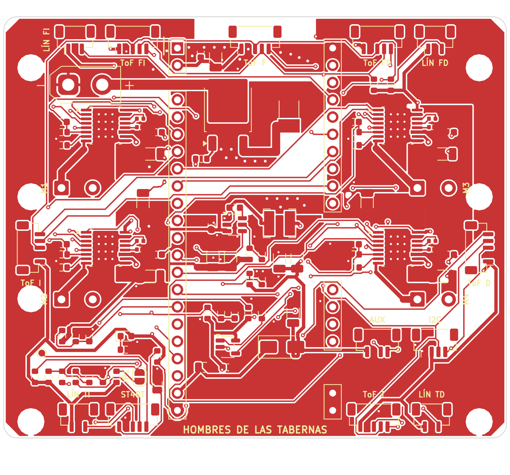
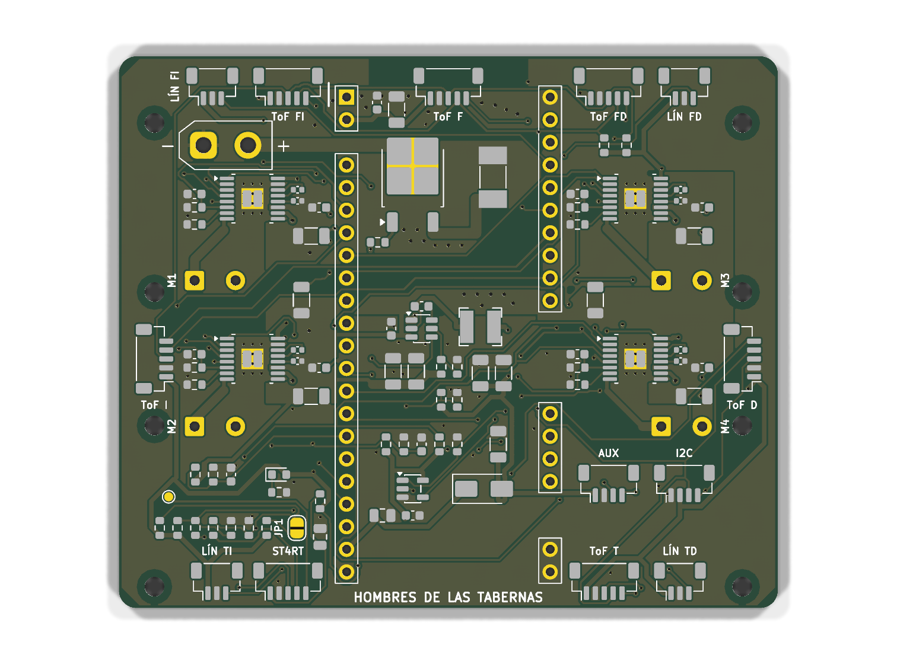
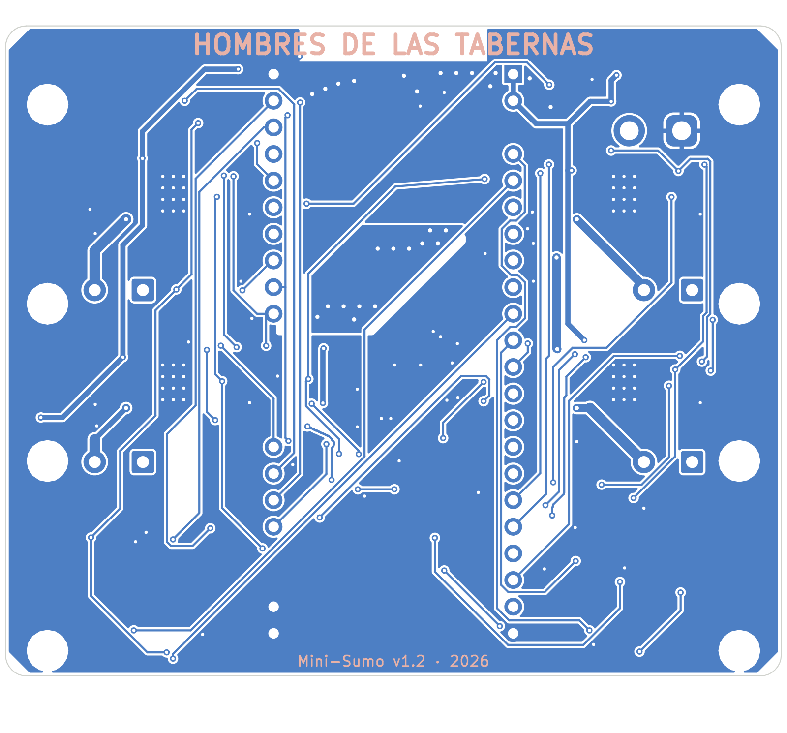
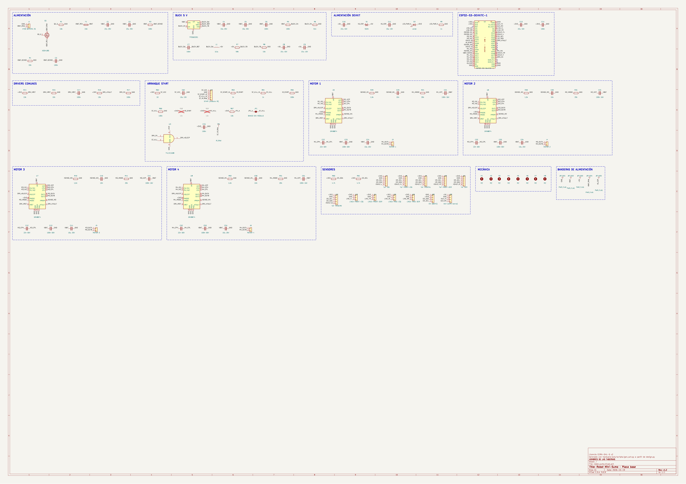
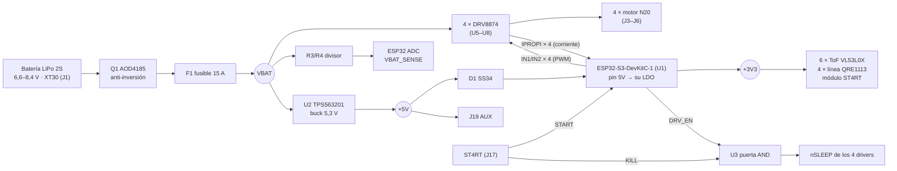

# 13 · Guía de diseño de la PCB v1.2 (explicada para poder rehacerla)

Este documento explica **la placa base v1.2 pieza a pieza**: qué hace cada bloque, por qué se eligió cada componente y no otro, de dónde sale cada valor, por qué cada cosa está en su sitio de la placa y cómo se rutó. La idea es que, leyéndolo de principio a fin, alguien del equipo pueda **diseñar la placa desde cero en KiCad** sin tener que fiarse de los scripts.

Documentos relacionados, por si se quiere ir más a fondo: [05 · PCB](05-PCB.md) (estado y ficheros de fabricación), [08 · Cálculos v1.2](08-Calculos-v1.2.md) (todos los números con su fuente), [04 · DevKit](04-ESP32-DevKitC-1.md), [06 · ST4RT](06-Modulo-arranque-ST4RT.md) y [01 · Selección de componentes](01-Seleccion-de-componentes.md) (escrito para la v1.1).

> **Importante.** Todo lo que hay aquí es **diseño y verificación teórica**. La placa no se ha fabricado ni probado. Los números salen de hojas de datos y de cálculos; ninguno está medido.
>
> Leyenda de los datos: ✅ hoja de datos oficial (comprobada en la revisión del PR #3) · 🟡 dato típico del fabricante o leído de segunda mano, **sin verificar** en la hoja completa · 🔶 estimado o pendiente de medir.

---

## Índice

1. [Qué tiene que hacer la placa](#1-qué-tiene-que-hacer-la-placa)
2. [La placa de un vistazo](#2-la-placa-de-un-vistazo)
3. [Datos de partida](#3-datos-de-partida)
4. [Bloque a bloque](#4-bloque-a-bloque)
   - [4.1 Entrada de batería y protecciones](#41-entrada-de-batería-y-protecciones)
   - [4.2 Medida de la batería](#42-medida-de-la-batería)
   - [4.3 Regulador conmutado (buck) de 5,3 V](#43-regulador-conmutado-buck-de-53-v)
   - [4.4 Alimentación de la DevKit y raíl de 3,3 V](#44-alimentación-de-la-devkit-y-raíl-de-33-v)
   - [4.5 El cerebro: ESP32-S3-DevKitC-1](#45-el-cerebro-esp32-s3-devkitc-1)
   - [4.6 Drivers de motor DRV8874](#46-drivers-de-motor-drv8874)
   - [4.7 Señales comunes de los drivers y parada por hardware](#47-señales-comunes-de-los-drivers-y-parada-por-hardware)
   - [4.8 Módulo de arranque ST4RT](#48-módulo-de-arranque-st4rt)
   - [4.9 Sensores y bus I²C](#49-sensores-y-bus-ic)
   - [4.10 Conectores de expansión](#410-conectores-de-expansión)
   - [4.11 Los 36 condensadores, resumidos](#411-los-36-condensadores-resumidos)
5. [Colocación: por qué cada cosa está donde está](#5-colocación-por-qué-cada-cosa-está-donde-está)
6. [Rutado](#6-rutado)
7. [Fabricación](#7-fabricación)
8. [Cómo diseñarla tú desde cero, paso a paso](#8-cómo-diseñarla-tú-desde-cero-paso-a-paso)
9. [Puntos débiles conocidos y qué falta comprobar](#9-puntos-débiles-conocidos-y-qué-falta-comprobar)
10. [Fuentes](#10-fuentes)

---

## 1. Qué tiene que hacer la placa

Antes de dibujar nada hay que tener claras las obligaciones. Son estas, y cada una se traduce en una decisión concreta:

| Obligación | De dónde sale | Consecuencia en la PCB |
|---|---|---|
| El robot cabe en 10 × 10 cm y pesa < 500 g | Reglamento, art. 5.2 y 5.3 | La PCB mide **74 × 62 mm**: es lo que queda entre las ruedas (por los lados) y entre la cuña y la carcasa trasera (delante y detrás). Hace además de **chasis**: los motores se atornillan debajo. |
| Arranque y parada por IR (RC5) con el mando del juez | Art. 5.4 y 5.5 | Conector para el **módulo ST4RT** que da el profesor, y una **parada por hardware** que duerme los motores aunque el microcontrolador se cuelgue. |
| Energía solo de pilas o baterías | Art. 6.8 | Batería LiPo 2S por XT30. (Los condensadores no cuentan como fuente de energía: solo filtran.) |
| Placa controladora "basada en tecnologías abiertas" | Art. 5.1 | ESP32-S3 (Arduino/ESP-IDF abiertos) y la PCB publicada en el repositorio. |
| **PCB propia** con el **nombre del equipo en la serigrafía** | Asignatura | "HOMBRES DE LAS TABERNAS" en las dos caras. Se pueden usar módulos (DevKit, sensores). |
| 4 motores, 6 sensores de distancia, 4 de línea | Diseño ([01](01-Seleccion-de-componentes.md)) | 4 drivers, 10 conectores de sensor y unas 28 señales hacia el microcontrolador. |
| Los motores bloqueados (empujando) consumen mucho durante segundos | Física del sumo | Drivers con **límite de corriente por hardware**, pistas anchas, fusible y conectores dimensionados para ~10 A. |

---

## 2. La placa de un vistazo

| Cara superior (cobre rojo, serigrafía amarilla) | Render 3D |
|---|---|
|  |  |

Cara inferior (casi entera plano de GND): 

Esquemático completo:  (en PDF: [`fabricacion/robot_sumo_esquematico.pdf`](../hardware/pcb/fabricacion/robot_sumo_esquematico.pdf)).

### Diagrama de bloques



### Lista de bloques y referencias

> Los drivers son **U5, U6, U7 y U8** (U5 = motor 1, ..., U8 = motor 4). El [05 · PCB](05-PCB.md) dice "U4–U7" por error; la placa y el esquemático usan U5–U8.

| Bloque | Componentes |
|---|---|
| Entrada de batería | J1, Q1, R1, F1, C1, C2 |
| Medida de batería | R3, R4, C3 |
| Buck 5,3 V | U2, L1, R5–R8, C4–C9 |
| Alimentación de la DevKit | C10, D1, C11, D3 (LED), R9 |
| Control | U1 (DevKit en tiras hembra), C13, C14 |
| Drivers comunes | R14, R15, C17 (VREF), R16 (nFAULT), R17 (DRV_EN) |
| Motor *k* (k = 1…4) | U(4+k), R(10k+10), C(10k+10), R(10k+11), C(10k+11), C(10k+12), C(10k+13), C(10k+14), J(2+k) → por ejemplo el motor 1 es U5, R20, C20, R21, C21–C24, J3 |
| Arranque ST4RT | J17, R62, C62, R63–R67, R68/R69 (sin montar), JP1, U3, C15, TP1 |
| Sensores | J7–J12 (ToF), J13–J16 (línea), R60, R61 (pull-ups I²C) |
| Expansión | J18 (I²C Qwiic), J19 (AUX: 5 V + UART) |
| Mecánica | H1–H8 (taladros M2) |

El circuito entero está escrito como texto en [`hardware/pcb/scripts/design.py`](../hardware/pcb/scripts/design.py): es la forma más rápida de ver qué pin va a qué red.

---

## 3. Datos de partida

| Dato | Valor | Fuente |
|---|---|---|
| Batería | LiPo 2S: 8,4 V llena, 7,4 V nominal, 6,6 V mínima de uso; 450 mAh 30 C → 13,5 A máx.; R_int ≈ 30 mΩ | 🔶 química LiPo, R_int estimada |
| Motor N20 6 V 500 rpm | Corriente de bloqueo 1,6 A a 6 V → R ≈ 3,75 Ω → **2,24 A a 8,4 V** | 🔶 a medir (referencia Pololu) |
| Consumo del raíl de 3,3 V | 0,30 A típico, **0,56 A pico** (ESP32 + 6 ToF + 4 QRE + ST4RT) | [08 §5.1](08-Calculos-v1.2.md#51-consumo-del-raíl-de-33-v) |
| Pico total de batería | 4 × 2,44 A (límite de los drivers) + electrónica ≈ **10,2 A** | [08 §3](08-Calculos-v1.2.md#3-batería-y-potencia) |

Con estos tres números (tensión 6,6–8,4 V, ~10 A de pico en potencia y ~0,6 A en lógica) se dimensiona todo lo demás.

**Principio general del diseño:** todo lo que habla con el ESP32 se alimenta a **3,3 V**. Así ninguna señal puede llegar a un GPIO con más de 3,3 V y **no hace falta ningún adaptador de nivel**. Los 8,4 V de la batería solo llegan a los drivers, al buck y al divisor de medida.

---

## 4. Bloque a bloque

### 4.1 Entrada de batería y protecciones

```
 J1 XT30          Q1 AOD4185 (P-MOS)             F1 15 A
 VBAT_RAW ──────── D        S ──── VBAT_REV ──── [fusible] ──── VBAT ──┬── C1 22 µF ──┐
                      G                                                └── C2 22 µF ──┤
                      │                                                               │
                     R1 10 k                                                          │
 GND ─────────────────┴───────────────────────────────────────────────────────────── GND
```

**J1 · conector XT30 macho vertical (XT30UPB-M).**
- *Por qué:* aguanta ~15 A continuos 🟡, está polarizado (no se puede enchufar al revés con el conector bien hecho), es pequeño y lo usan casi todas las LiPo pequeñas. Va vertical para enchufar la batería desde arriba, a través del techo.
- **Enchufarlo es el interruptor de encendido.** No hay interruptor general: no cabía, y en minisumo es lo habitual.
- *Alternativas descartadas:* JST-RCY/"BEC" (solo ~3–5 A), XT60 (sobredimensionado y grande), T-Dean (más grande y sin versión de PCB vertical cómoda).

**Q1 · MOSFET de canal P AOD4185 como protección contra inversión de polaridad.**
- *Cómo funciona:* el drenador va a la batería y la fuente a la carga. Con la batería bien puesta, la corriente pasa primero por el diodo interno del MOSFET, la fuente sube a ~VBAT y la puerta (a GND por R1) queda a −VBAT respecto a la fuente: el MOSFET conduce del todo y el diodo deja de trabajar. Con la batería al revés, la puerta queda positiva, el MOSFET no conduce y el diodo interno está en inversa: **no pasa corriente**.
- *Por qué un MOSFET y no un diodo:* un diodo Schottky en serie caería ~0,5 V a 10 A (**5 W**, imposible de disipar en este tamaño). El AOD4185 tiene R_DS(on) ≈ 15 mΩ 🟡 → caída de 0,15 V y **P = 10,2² × 0,015 ≈ 1,6 W** solo en los picos de empuje (que duran segundos). En régimen normal (1–3 A) disipa < 0,15 W.
- *Por qué este modelo:* −40 V / −40 A 🟡, encapsulado DPAK (TO-252) que disipa por el cobre, barato y fácil de encontrar. La tensión puerta-fuente máxima es ±20 V 🟡, y con 2S nunca pasamos de 8,4 V, así que no hace falta el zener de protección que se pone con baterías de más celdas.
- **R1 (10 kΩ)** lleva la puerta a GND. 10 kΩ es un valor estándar: bastante bajo para que la puerta no flote, bastante alto para que no consuma nada (no circula corriente en régimen).

**F1 · fusible Littelfuse NANO2 de 15 A (rápido).**
- *Para qué:* si algo hace cortocircuito (un cable de motor pelado tocando el chasis, un driver roto), el fusible abre antes de que la batería queme pistas o se incendie. Una LiPo en cortocircuito puede dar cientos de amperios.
- *Por qué 15 A (en la v1.1 era de 10 A):* el pico de diseño es 10,2 A. A los fusibles se les aplica una reducción del ~25 % (no deben trabajar de forma continua por encima del 75 % de su nominal), así que 10 A × 0,75 = 7,5 A se quedaba corto y saltaría al empujar. Con 15 A: 15 × 0,75 = **11,25 A**, un 11 % por encima del pico. Por encima de eso, el que limita es la batería (13,5 A) y el XT30 (15 A).
- *Por qué NANO2:* es un fusible SMD compacto que aguanta 15 A. Un fusible de automóvil "mini" es mucho más alto y pesado; un fusible rearmable (PTC) a 10 A es enorme y lento.

**C1, C2 · 2 × 22 µF / 25 V cerámicos (1206).**
- *Para qué:* depósito de carga cerca de la entrada. Cuando los motores arrancan o cambian de sentido, piden corriente de golpe; los cables y la batería tienen inductancia y resistencia, así que sin estos condensadores la tensión de VBAT se hundiría unos microsegundos y podría reiniciar la lógica. También absorben la energía que devuelven los motores al frenar.
- *Por qué cerámicos y no un electrolítico de 220 µF:* un electrolítico de esa capacidad mide 6,3 × 7,7 mm de alto y no cabe bajo la DevKit; los cerámicos tienen además una resistencia serie (ESR) mucho menor, que es lo que importa para picos rápidos.
- *Por qué 25 V para una batería de 8,4 V:* los cerámicos X5R/X7R pierden capacidad con la tensión aplicada (efecto DC bias). Un 22 µF de 10 V a 8,4 V se queda en una fracción de su valor; uno de 25 V conserva bastante más 🔶 (depende del modelo: mirar la curva del fabricante al comprar).
- Junto con los 10 µF + 100 nF de cada driver suman ≈ 104 µF en VBAT (unos 3,7 mJ a 8,4 V, nada comparado con la batería).

### 4.2 Medida de la batería

```
VBAT ── R3 100 k ──┬── VBAT_SENSE → GPIO10 (ADC1)
                   ├── R4 33 k ── GND
                   └── C3 100 nF ── GND
```

- **Para qué:** el firmware necesita saber la tensión de la batería para (1) avisar y no bajar de 3,3 V por celda, que estropea una LiPo, y (2) **compensar la velocidad**: con la batería llena el robot va un 13 % más rápido que a 7,4 V, y eso cambia la distancia de frenada ante el borde ([08 §6.3](08-Calculos-v1.2.md#63-frenada-ante-el-borde-nuevo-en-v12)).
- **Cálculo del divisor:** V_ADC = VBAT × 33 / (100 + 33) = VBAT × 0,248.
  - 8,4 V → **2,08 V**; 6,6 V → 1,64 V. El ADC del ESP32-S3 con atenuación de 11 dB lee hasta ~3,1 V ✅, así que queda margen hasta 12,5 V (por si alguien enchufa una 3S por error, el pin no se rompe).
  - Corriente que consume: 8,4 V / 133 kΩ = **63 µA**: despreciable, pero no cero; si el robot se guarda con la batería enchufada, la vacía en meses.
- **Por qué valores tan altos (100 k y 33 k) y no 10 k / 3,3 k:** para que el divisor no gaste batería. El precio de esos valores es que la impedancia de salida (100 k ∥ 33 k ≈ 25 kΩ) es alta para el ADC, que al muestrear carga un condensador interno. **C3** soluciona eso: hace de depósito para el ADC y además filtra el ruido de los motores. τ = 25 kΩ × 100 nF = **2,5 ms**: suficientemente rápido para la batería (que cambia en segundos) y suficientemente lento para que el ruido del PWM a 20 kHz no se vea.
- **Por qué GPIO10:** está en el ADC1 del ESP32-S3, que funciona aunque el Wi-Fi esté encendido (el ADC2 no).

### 4.3 Regulador conmutado (buck) de 5,3 V

```
VBAT ─┬─ C4 10 µF ─┬─ C5 10 µF ─┬─ C6 100 nF ─┐       VIN (3)        SW (2) ── L1 3,3 µH ──┬── +5V ─┬─ C8 22 µF ─┬─ C9 22 µF
      │            │            │             │      ┌──────────────┐                     │        │            │
      ├─ R5 100 k ─┴─ BUCK_EN ──┴─ R6 51 k ── GND    │  U2          │ VBST (6) ─ C7 100 nF ─ SW  R7 59 k       │
      └────────────────────────────────────────────── │ TPS563201    │                          │               │
                                                      │ EN (5)       │ VFB (4) ──── BUCK_FB ─────┤               │
                                                      │ GND (1)      │                          R8 10 k          │
                                                      └──────────────┘                          │               │
                                                                                               GND ────────── GND
```

**Por qué un regulador conmutado y no un lineal (LDO):** hay que bajar de 8,4 V a ~5 V con ~0,6 A. Un lineal disiparía (8,4 − 5,3) × 0,6 ≈ **1,9 W** en forma de calor, en una placa cerrada dentro de una carcasa: se pondría a más de 100 °C. Un buck tiene un rendimiento del ~85–90 % 🟡 y disipa ~0,3 W.

**Por qué el TPS563201 (Texas Instruments):**
- Entrada 4,5–17 V y salida hasta 3 A ✅: cubre la batería 2S con margen y tiene corriente de sobra para la DevKit, los sensores y un posible servo en el conector AUX.
- **Síncrono:** lleva dentro los dos transistores, así que no necesita un diodo externo (menos piezas y menos pérdidas que un buck asíncrono como el MP1584).
- Control **D-CAP2**: no necesita red de compensación (los RC que piden otros reguladores para ser estables). Solo hacen falta la bobina, 2 resistencias de realimentación y los condensadores.
- Encapsulado SOT-23-6 diminuto, ~0,3 € en LCSC 🟡 y montable por JLCPCB.
- *Alternativas descartadas:* LM2596 (módulo enorme, 150 kHz, bobina gigante); módulos "mini-360" o MP1584 de AliExpress (calidad variable, se sueltan con los golpes, ocupan más); un LDO (calor, ver arriba).

**Cálculo de la tensión de salida (R7, R8):**

V_OUT = V_FB × (1 + R7 / R8) = 0,768 V × (1 + 59 k / 10 k) = **5,30 V** (✅ V_FB = 0,768 V, de 0,749 a 0,787 V por tolerancia → 5,17–5,43 V).

- *Por qué 5,3 V y no 5,0 V:* detrás va el diodo D1 (≈ 0,4–0,55 V) y después el LDO de la DevKit, que necesita ~1,1 V de margen (el AMS1117 de los clones). 5,3 − 0,45 = 4,85 V en el pin 5V de la DevKit, por encima de los 4,4 V que necesita el LDO. Con 5,0 V no habría margen con la batería baja.
- *Por qué no más alto:* el buck no puede tener la salida muy cerca de la entrada. Su tiempo apagado mínimo (t_OFF(min) = 220–310 ns ✅) limita el ciclo de trabajo a D_max = 1 − t_OFF · f = 1 − 310 ns × 580 kHz ≈ **82 %** en el peor caso. Con la batería a 6,6 V y los motores empujando, en la entrada del buck quedan ~6,1 V, y la salida máxima es 0,82 × 6,1 ≈ **5,0 V**. Subir la consigna por encima no sirve de nada en ese caso.
- *Por qué 59 k y 10 k:* son valores de la serie E96 (1 %) que dan 5,30 V. R8 = 10 kΩ es lo que recomienda el fabricante como orden de magnitud 🟡 (valores bajos gastan corriente; valores muy altos captan ruido).
- **En la v1.1 había un segundo diodo (D2) en serie a la salida del buck**, que restaba otros 0,5 V sin proteger nada que no protegiera ya D1. Se quitó en la v1.2 ([08 §5.2](08-Calculos-v1.2.md#52-buck-y-pin-5-v-de-la-devkit-cambio-v12)).

**Bobina L1 · 3,3 µH, Bourns SRN4018 (4 × 4 × 1,8 mm, I_sat ≥ 2,5 A 🟡).**
- Rizado de corriente: ΔI = (V_IN − V_OUT) × D / (L × f) = (8,4 − 5,3) × 0,63 / (3,3 µH × 580 kHz) ≈ **1,0 A pico a pico** con la batería llena (0,55 A con la batería a 6,6 V).
- Corriente de pico en la bobina: I_OUT + ΔI/2 ≈ 0,6 + 0,5 = **1,1 A**, muy por debajo de la saturación (2,5 A). Hay margen para tirar de 1–1,5 A en el conector AUX si un día se pone un servo.
- 3,3 µH está en el rango que recomienda TI para esta salida 🟡; una bobina más grande reduciría el rizado pero no cabe en altura bajo la DevKit.

**Condensadores del buck:**
- **C4, C5 (2 × 10 µF / 25 V, entrada):** el buck pide corriente a pulsos de 580 kHz; estos condensadores dan esos pulsos para que no viajen por las pistas de VBAT (que harían de antena). Corriente eficaz que soportan: I_OUT × √(D(1−D)) ≈ 0,6 × 0,48 ≈ 0,3 A, nada para un cerámico. **Tienen que estar pegados a los pines VIN y GND de U2.**
- **C6 (100 nF, entrada):** desacoplo de alta frecuencia; un 100 nF pequeño tiene menos inductancia que un 10 µF de 1206 y filtra los flancos rápidos de la conmutación.
- **C7 (100 nF, entre SW y VBST):** condensador de *bootstrap*. El transistor de arriba del buck necesita una puerta por encima de V_IN para encenderse; este condensador se carga cuando SW está a 0 y luego "sube" con SW. Su valor (100 nF) lo fija la hoja de datos ✅.
- **C8, C9 (2 × 22 µF / 10 V, salida):** alisan la salida. Rizado de tensión ≈ ΔI / (8 · f · C) = 1,0 / (8 × 580 kHz × 44 µF) ≈ **5 mV** (unos 10 mV contando la pérdida de capacidad por DC bias 🔶). Además, el control D-CAP2 necesita una capacidad de salida mínima para ser estable 🟡.

**Habilitación (R5, R6):** el pin EN se lleva a VBAT × 51 / 151 = 2,2 V (6,6 V) – 2,8 V (8,4 V). Así el buck no arranca si la tensión es demasiado baja: con el umbral típico de EN (~1,2–1,6 V 🟡, comprobar en la hoja de datos) el buck se apaga por debajo de ~4–5 V de batería. También evita que EN quede flotando.

### 4.4 Alimentación de la DevKit y raíl de 3,3 V

```
+5V ─┬─ C10 22 µF ─ GND
     └─ D1 SS34 (ánodo +5V, cátodo V5_ESP) ─┬─ C11 10 µF ─ GND
                                            └─ pin 5V de la DevKit (J1-21) → LDO de la DevKit → +3V3 (J1-1, J1-2)
+3V3 ── D3 LED verde ── R9 1 k ── GND           +3V3 ─┬─ C13 22 µF ─ GND
                                                      └─ C14 100 nF ─ GND
```

- **D1 (SS34, Schottky 3 A / 40 V):** cuando se programa el robot por USB, la DevKit recibe 5 V del ordenador y los saca por su pin 5V. Sin D1, esos 5 V entrarían en nuestro buck (y el buck intentaría alimentar el puerto USB del ordenador). Con D1, cada fuente alimenta solo hacia la DevKit y no se pelean. Con el USB solo, la DevKit funciona y alimenta los sensores (útil para calibrar en la mesa), pero **los motores no**, porque VBAT no existe sin batería.
  - Pérdidas: 0,6 A × ~0,45 V ≈ 0,27 W, cómodo para un encapsulado SMA.
  - *Por qué Schottky:* cae ~0,45 V frente a ~0,8 V de un diodo normal, y en esta cadena cada décima cuenta (ver 4.3).
- **C10 (22 µF):** más capacidad en la salida del buck, del lado de la carga (cerca de D1 y del conector AUX).
- **C11 (10 µF):** desacoplo en el pin 5V de la DevKit, tras el diodo.
- **Los 3,3 V los genera la propia DevKit con su LDO** (0,8–1 A según la placa 🟡) y los devuelve por sus pines 3V3. Nuestro consumo de pico en 3,3 V es 0,56 A, dentro de su capacidad. *Por qué no un regulador de 3,3 V propio:* la DevKit ya lo trae y el ESP32 necesita estar en el mismo raíl que sus sensores; poner un segundo regulador en paralelo daría problemas.
- **C13 (22 µF) y C14 (100 nF):** reserva y desacoplo del raíl de 3,3 V en nuestra placa, porque los sensores están a varios centímetros del LDO de la DevKit y los VL53L0X consumen a pulsos.
- **D3 + R9 (LED de encendido):** I = (3,3 − ~2,0 V) / 1 kΩ ≈ **1,3 mA** 🔶 (la caída del LED verde depende del modelo). Poco brillo, pero se ve, y no gasta. Indica que el raíl de 3,3 V existe.

Margen de toda la cadena con la batería baja (el peor caso): pin 5V ≈ **4,46 V** frente a 4,40 V que necesita un AMS1117. Es justo; **hay que medirlo** con la batería a 6,6 V y los motores bloqueados ([08 §5.2](08-Calculos-v1.2.md#52-buck-y-pin-5-v-de-la-devkit-cambio-v12)).

### 4.5 El cerebro: ESP32-S3-DevKitC-1

**Por qué ESP32-S3:** necesitamos **9 entradas analógicas** (4 sensores de línea, 4 corrientes de motor y la batería) y el ESP32-S3 tiene 10 canales en el ADC1 que funcionan con el Wi-Fi encendido; además tiene USB nativo, doble núcleo y muchos GPIO. El ESP32 clásico solo tiene 6 canales útiles en el ADC1; el ESP32-C3 no tiene pines suficientes; un Arduino Nano es de 5 V y tiene 2 KB de RAM. Detalle en [01 §1](01-Seleccion-de-componentes.md#1-microcontrolador--esp32-s3-devkitc-1-enchufada-en-la-pcb).

**Por qué la DevKit entera enchufada y no el módulo soldado:** si se rompe en un combate, se cambia en segundos; trae USB, botones, LED y regulador (13 componentes menos en nuestra placa); y saca todos los GPIO que necesitamos. Va pinchada en **dos tiras hembra de 2,54 mm separadas 22,86 mm (0,9")** y queda unos 11 mm por encima de nuestra placa. Debajo de ella caben componentes SMD bajos: por eso hay piezas "debajo" de la DevKit (buck, U3, condensadores).

**Asignación de pines (por qué cada señal va a cada GPIO):**

| GPIO | Señal | Por qué este pin |
|---|---|---|
| 1, 2, 4, 5 | LINE_FL, LINE_FR, LINE_RL, LINE_RR | Analógicos: tienen que estar en el **ADC1** |
| 6, 7, 8, 9 | ISENSE_M1…M4 (IPROPI) | Analógicos, ADC1 |
| 10 | VBAT_SENSE | Analógico, ADC1 (el último canal del ADC1) |
| 11/12, 13/14, 15/16, 45/46 | M1…M4 IN1/IN2 (PWM 20 kHz) | Salidas PWM (cualquier GPIO vale con el periférico LEDC). Se agrupan por motor para que las pistas de cada driver salgan juntas hacia su lado. |
| 45, 46 | M4_IN1, M4_IN2 | Son **pines de arranque** del ESP32-S3: deben estar a 0 al encender. Las entradas IN del DRV8874 tienen *pull-down* interno, así que los dejan a 0. Por eso se usaron para un motor y no para otra cosa. |
| 21 | DRV_EN | Salida digital hacia la puerta AND (U3) |
| 38 | DRV_nFAULT | Entrada. En algunas DevKit lleva el LED RGB; aquí solo se lee. |
| 39, 40 | I2C_SDA, I2C_SCL | Cualquier GPIO vale; estos quedan cerca del borde derecho de los ToF |
| 41, 42, 47, 48, 3, 17 | XSHUT de los 6 ToF | Salidas digitales para encenderlos uno a uno |
| 18 | IR_START | Entrada desde el ST4RT |
| 43, 44 | AUX_TX/RX | UART0 (compartida con el puente USB-UART de la DevKit) |

**Pines que se dejan libres a propósito:** GPIO35–37 (los usa la PSRAM de las variantes N8R8/N16R8, así vale cualquier DevKit), GPIO19/20 (USB nativo), GPIO0 (botón BOOT, reutilizable como botón de usuario) y RST.

**Zócalos solo donde hay señal:** de las 44 posiciones de las tiras, solo se ponen pines donde hay una señal. Los huecos sin pin dejan pasar **pistas gruesas de VBAT** entre las filas, que de otro modo partirían la placa en tres trozos (ver [§6.4](#64-cruzar-las-filas-de-la-devkit)).

### 4.6 Drivers de motor DRV8874

Es la pieza más importante de la placa. En sumo los motores pasan mucho tiempo **bloqueados** (los dos robots empujándose sin moverse), y un motor bloqueado consume su corriente máxima durante segundos.

**Por qué el DRV8874 de Texas Instruments:**

| Driver | Tensión | Corriente | Limita la corriente | R_DS(on) | Veredicto |
|---|---|---|---|---|---|
| L298N | 5–46 V | 2 A | No | caída de **2–4 V** (bipolar) | ❌ se come un tercio de la batería y necesita disipador |
| TB6612FNG | 2,5–13,5 V | 1,2 A cont. / 3,2 A pico | No (solo apagado térmico) | 0,5 Ω | ⚠️ un N20 bloqueado a 8,4 V pasa de 1,2 A |
| DRV8833 | 2,7–10,8 V | 1,5 A RMS | Sí | 0,36 Ω | ⚠️ poca corriente y 10,8 V máx. muy cerca de 8,4 V |
| DRV8871 | 6,5–45 V | 3,6 A pico | Sí | 0,57 Ω | ✔ válido, pero no mide la corriente y no baja de 6,5 V |
| **DRV8874** | **4,5–37 V** | **~2,1 A cont. / 6 A pico** | **Sí, ajustable (I_TRIP)** | **~0,2 Ω** | ✅ **elegido** |

(Valores de las hojas de datos de TI y Toshiba, resumidos en [01 §2](01-Seleccion-de-componentes.md#2-drivers-de-motor--drv8874-uno-por-motor) 🟡.)

Sus cuatro ventajas para este robot:
1. **Límite de corriente por hardware (I_TRIP).** Si el motor se bloquea, el driver recorta la corriente él solo, aunque el firmware se cuelgue. Ni el driver ni el motor se queman.
2. **Medida de corriente (IPROPI):** saca una corriente proporcional a la del motor. Con una resistencia se convierte en tensión y el ESP32 la lee. Sirve para **detectar el contacto con el rival** (la corriente sube al empujar) y para saber si una rueda patina (la corriente cae).
3. **Pocas pérdidas** (~0,2 Ω en el puente): casi toda la tensión llega al motor.
4. Protecciones de subtensión, sobrecorriente (6 A) y temperatura, con aviso por **nFAULT**. Y funciona desde 4,5 V, así que con la batería baja sigue andando.

**Por qué cuatro drivers (uno por motor) y no dos (uno por lado con dos motores en paralelo):** con uno por motor, cada driver solo ve la corriente de bloqueo de **un** motor (~2,2 A a 8,4 V), dentro de su rango continuo; con dos motores por driver serían ~4,5 A, en su límite de pico y calentándose. Además cada rueda se controla por separado. Cuesta ~3 € más.

**Configuración de los pines** (igual en los cuatro):

| Pin | Nombre | Conexión | Por qué |
|---|---|---|---|
| 1, 2 | IN1, IN2 | GPIO del ESP32 | Modo PWM: IN1/IN2 = 1/0 adelante, 0/1 atrás, 1/1 freno, 0/0 rueda libre |
| 3 | nSLEEP | DRV_nSLEEP (salida de U3) | Común a los 4: dormidos = salidas desconectadas |
| 4 | nFAULT | DRV_nFAULT (común, R16 a 3,3 V) | Salida de drenador abierto: los 4 se pueden unir |
| 5 | VREF | DRV_VREF (común, 1,65 V) | Fija I_TRIP |
| 6 | IPROPI | ISENSE_Mk → R_IPROPI 1,5 k + C 10 nF a GND → ADC | Medida y límite de corriente |
| 7 | IMODE | R 20 kΩ a GND | Elige el modo de limitación: recorte ciclo a ciclo con reintento automático 🟡 (tabla de IMODE en la hoja de datos) |
| 8, 10 | OUT1, OUT2 | Pads del motor (J3–J6) | Salida del puente |
| 9, 15, 17 | PGND, GND, pad térmico | GND | El pad térmico es por donde sale el calor |
| 11 | VM | VBAT | Alimentación de potencia |
| 12 | VCP | C 100 nF / 16 V a VM | Salida de la bomba de carga (puerta de los transistores de arriba) ✅ |
| 13, 14 | CPH, CPL | C 22 nF / 50 V entre ambos | Condensador "volante" de la bomba de carga ✅ |
| 16 | PMODE | +3V3 | **Alto = modo PWM (IN1/IN2)**. (A GND sería modo PH/EN; al aire, medio puente independiente.) |

**Cálculo del límite de corriente:**

I_TRIP = V_REF / (A_IPROPI × R_IPROPI) = 1,65 V / (455 µA/A × 1500 Ω) = **2,44 A** ✅ (A_IPROPI = 455 µA/A según TI).

- *Por qué 2,44 A:* la corriente de bloqueo estimada del motor a 8,4 V es 2,24 A 🔶. El límite queda un 9 % por encima: en uso normal no actúa, y si el motor real consume más de lo estimado (o se cortocircuita un cable), lo recorta.
- **Se ajusta cambiando R_IPROPI** (una resistencia por motor) cuando se mida el motor real: R_IPROPI = 1,65 / (455 µA × I_TRIP deseada). Para 2,0 A → 1,8 kΩ; para 3,0 A → 1,2 kΩ.
- Tensión en el ADC: 455 µA/A × 1,5 kΩ = **0,68 V por amperio**; con 12 bits (0,76 mV por paso) → resolución de **~1,1 mA**. A 2,44 A el pin da 1,65 V (la propia V_REF), dentro del rango del ADC.
- **C_IPROPI (10 nF)** filtra la señal: f_c = 1 / (2π × 1,5 kΩ × 10 nF) ≈ **10,6 kHz**. Solo atenúa un poco el PWM de 20 kHz, así que el firmware además promedia. No se puede filtrar mucho más porque el propio driver usa esa tensión para decidir cuándo recortar: un filtro lento retrasaría la protección.

**Condensadores de cada driver:**
- **C_VM: 10 µF / 25 V (1206) + 100 nF / 50 V (0603), de VM a GND, pegados al pin 11.** El 10 µF da los picos de corriente del motor y el 100 nF filtra los flancos de conmutación a 20 kHz. TI recomienda al menos esto en VM ✅. Sin ellos, cada flanco del PWM provocaría un pico en VBAT que llegaría a la lógica.
- **C_VCP 100 nF y C_FLY 22 nF, en 0402:** valores de la hoja de datos ✅. Tienen que estar **pegados** a los pines 12–14: en la v1.2 se pasaron de 0603 a 0402 porque en 0603 no salían las pistas entre pines de 0,65 mm de paso.

**Térmica:**
- Con un motor bloqueado (2,24 A) y R_DS(on) en caliente ≈ 0,35 Ω: P = 2,24² × 0,35 = **1,76 W**. Con R_θJA = 40–50 °C/W en placa de 2 capas 🔶: T_J = 25 + 1,76 × (40…50) = **95–113 °C**, por debajo del apagado térmico (~165 °C). En el límite de I_TRIP: 109–130 °C.
- Eso solo funciona si el **pad térmico** de debajo del chip disipa: lleva **12 vías de 0,3 mm** (3 × 4) que conectan el pad con el plano de GND de la cara inferior. Ese plano de cobre es el disipador.
- Quien sufre de verdad es el motor (18,8 W bloqueado a 8,4 V): el firmware debe bajar la potencia si el empuje dura más de 2–3 s.

**Cada motor por su lado:** los motores 1 y 2 (izquierdos) los mueven U5 y U6, a la izquierda de la DevKit; los 3 y 4 (derechos), U7 y U8, a la derecha. La corriente de cada motor no cruza nunca las filas de la DevKit (ver [§5](#5-colocación-por-qué-cada-cosa-está-donde-está)).

**Conexión del motor (J3–J6):** dos pads para soldar el cable (0,5 mm²) directamente, que entra por debajo. *Por qué no un conector:* los conectores pequeños se sueltan con los golpes, y el motor va fijo al chasis, no hay que desmontarlo a menudo.

### 4.7 Señales comunes de los drivers y parada por hardware

| Componente | Valor | Función y cálculo |
|---|---|---|
| R14, R15 | 10 k + 10 k | Divisor desde 3,3 V: **V_REF = 1,65 V**, común a los 4 drivers. La entrada VREF del DRV8874 apenas consume, así que un solo divisor sirve para los cuatro. |
| C17 | 100 nF | Filtra V_REF. τ = (10 k ∥ 10 k) × 100 nF = 0,5 ms. Si V_REF tuviera ruido, el límite de corriente bailaría. |
| R16 | 10 k a 3,3 V | Pull-up de nFAULT. Los 4 nFAULT son de drenador abierto y se unen ("OR cableada"): si cualquiera falla, la línea baja. Corriente con fallo: 0,33 mA. |
| R17 | 100 k a GND | **Mantiene DRV_EN a 0 mientras el ESP32 arranca** (sus GPIO están al aire unos milisegundos al encender o al reprogramar). Así los motores no dan un tirón al encender. |
| U3 | 74LVC1G08 (puerta AND, SOT-23-5) | **nSLEEP = DRV_EN AND KILL.** Los motores solo se mueven si el firmware quiere (DRV_EN = 1) **y** el módulo de arranque no ha ordenado parar (KILL = 1). |
| C15 | 100 nF | Desacoplo de U3, pegado a su pin de alimentación. Toda puerta lógica lleva uno. |

**Por qué una puerta AND por hardware y no hacerlo todo en el firmware:** el reglamento exige que el juez pueda parar el robot. Si el ESP32 se colgara con los motores en marcha, una parada solo por software no funcionaría. Con U3, la línea KILL del módulo duerme los drivers directamente, en nanosegundos, sin pasar por el procesador.

*Por qué el 74LVC1G08:* funciona de 1,65 a 5,5 V ✅ (va a 3,3 V), es una sola puerta en un encapsulado de 3 × 3 mm, y su salida da corriente de sobra para las 4 entradas nSLEEP. Alternativa: dos transistores y resistencias (más piezas) o diodos (niveles lógicos peores).

### 4.8 Módulo de arranque ST4RT

El profesor da el módulo **Sobotz ST4RT** (diciembre de 2026). Recibe el IR del mando del juez y saca dos señales: **START** (1 = combate) y **KILL** (0 = parar los motores). Detalle del protocolo y de los datos que faltan en [06 · ST4RT](06-Modulo-arranque-ST4RT.md).

```
+3V3 ── R62 10 Ω ──┬── ST_VCC → J17-1           J17-3 (S) ── R63 1 k ──┬── IR_START → GPIO18
                   └── C62 10 µF ── GND                                └── R65 100 k ── GND
J17-2 ── GND                                    J17-4 (K) ── R64 1 k ──┬── ST_KILL → U3
J17-5 (IR en bruto) ── TP1                                             ├── R66 100 k ── GND
                                                                       └── JP1 ── R67 10 k ── +3V3   (solo banco)
R68, R69: 10 k a +3V3, SIN MONTAR (por si S/K fueran de drenador abierto)
```

| Componente | Para qué | Cálculo |
|---|---|---|
| R62 + C62 | Filtro de la alimentación del módulo, a **3,3 V** para que S y K no den nunca más de 3,3 V a un GPIO (el módulo acepta 2,8–5,2 V 🟡). | f_c = 1 / (2π × 10 Ω × 10 µF) ≈ 1,6 kHz. Con un consumo de 2–10 mA 🔶 caen 0,02–0,1 V → el módulo recibe 3,20–3,28 V, por encima de 2,8 V. |
| R63, R64 (1 k en serie) | Si por error el módulo diera 5 V, limitan la corriente que entra en el GPIO. | (5 − 3,3 − 0,3) / 1 k = 1,4 mA por el diodo de protección del pin: aguanta. |
| R65, R66 (100 k a GND) | **Sin módulo (o con el cable suelto) el robot no arranca y los motores están dormidos.** | Nivel alto real: 3,3 × 100 k / 101 k = 3,27 V, por encima del umbral de 2,48 V. |
| JP1 + R67 | Puente de soldadura **para probar en el banco sin módulo**: cerrado, KILL = 1 a través de 10 kΩ. **Abrir antes de competir.** | — |
| R68, R69 (sin montar) | Por si las salidas del módulo fueran de drenador abierto (no está confirmado): se montan y se quitan R65/R66. | — |
| TP1 | Punto de prueba con la señal IR en bruto, por si un día hiciera falta decodificar el RC5 en el ESP32. | — |
| J17 (JST-SH 5 pines) | Cable a medida hasta el módulo, que va en una torre en el techo. **El orden de pines del módulo aún no está confirmado**: con un cable a medida, el de la PCB no tiene que coincidir. | — |

### 4.9 Sensores y bus I²C

- **6 × VL53L0X (ToF, distancia al rival) en J7–J12** (JST-SH de 5 pines: 3V3, GND, SCL, SDA, XSHUT). Los seis comparten el bus I²C y todos vienen con la misma dirección (0x29). Por eso cada uno tiene su línea **XSHUT**: al arrancar se apagan todos y se encienden uno a uno para darles direcciones distintas.
- **4 × QRE1113 (línea blanca del borde) en J13–J16** (JST-SH de 3 pines: 3V3, GND, señal analógica). Son analógicos para poder calibrar el umbral en el dohyo desde el firmware.
- **R60, R61 · pull-ups de I²C de 4,7 kΩ.** El I²C es de drenador abierto: alguien tiene que subir la línea. Los módulos GY-VL53L0X suelen traer sus propias pull-ups de 10 kΩ 🔶, y con 6 módulos quedan todas en paralelo: R_eq = 1 / (1/4,7 k + 6/10 k) = **1,23 kΩ** → corriente al bajar la línea = 3,3 / 1,23 k = **2,7 mA**, por debajo de los 3 mA del estándar I²C. Con 2,2 kΩ (v1.1) eran 3,5 mA y se salía del estándar. Tiempo de subida con ~150 pF de cable 🔶: 0,85 × 1,23 k × 150 pF ≈ 156 ns, por debajo de los 300 ns del modo rápido (400 kHz).
- *Por qué conectores JST-SH (1 mm, SMD vertical):* son los más pequeños que tienen enganche (no se sueltan con golpes), y al ser SMD **la cara inferior queda plana**, cosa necesaria porque la PCB apoya sobre los motores. Además son el estándar Qwiic/STEMMA QT.

### 4.10 Conectores de expansión

- **J18 · I²C Qwiic (GND, 3V3, SDA, SCL):** para enchufar una IMU (MPU-6050, LSM6DS3…) sin rediseñar la placa.
- **J19 · AUX (5V, GND, TX, RX):** UART de depuración o alimentación de un servo para un mecanismo desplegable. Va en el raíl de **+5V** (no en 3,3 V) para que un servo no tire del LDO de la DevKit.

### 4.11 Los 36 condensadores, resumidos

| Grupo | Referencias | Valor | Función |
|---|---|---|---|
| Reserva de batería | C1, C2 | 22 µF / 25 V | Picos de los motores |
| Medida de batería | C3 | 100 nF | Filtro del divisor |
| Buck | C4, C5 / C6 / C7 / C8, C9 | 10 µF / 100 nF / 100 nF / 22 µF | Entrada / desacoplo / bootstrap / salida |
| Raíles | C10 (+5V), C11 (pin 5V DevKit), C13, C14 (+3V3) | 22 µF / 10 µF / 22 µF + 100 nF | Desacoplo |
| Lógica | C15 (U3), C17 (VREF), C62 (ST4RT) | 100 nF / 100 nF / 10 µF | Desacoplo y filtros |
| Cada driver (×4) | C*x*0 / C*x*1 / C*x*2 / C*x*3 / C*x*4 (x = 2…5) | 10 nF / 100 nF / 22 nF / 100 nF / 10 µF | IPROPI / VCP / bomba de carga / VM alta frecuencia / VM reserva |

---

## 5. Colocación: por qué cada cosa está donde está

Coordenadas en mm desde la **esquina delantera izquierda** de la PCB (x hacia la derecha, y hacia atrás; la placa mide 74 × 62 mm). En KiCad, la esquina está en (113, 80).

```
            x=0                       x=25,6        x=48,4                  x=74
  y=0  ┌─ LÍN FI ─ ToF FI ────── [antena: sin cobre] ── ToF F ── ToF FD ─ LÍN FD ─┐  ← borde delantero (cuña)
       │ J1 XT30            │  Q1 · F1 (VBAT)           │       R60/R61 (I²C)       │
       │                    │                           │                           │
       │  U5 (M1)  J3    C1 │     U2 · L1 (buck)        │ C2  U7 (M3)  J5           │  ← eje delantero (motores 1 y 3 debajo)
  ToF I│                    │       C4 C5  C8 C9        │                     ToF D │
       │  U6 (M2)  J4       │  VREF · nFAULT · DRV_EN   │   U8 (M4)  J6             │  ← eje trasero (motores 2 y 4 debajo)
       │ R3/R4 (VBAT)  LED  │   U3 (AND) · D1 · C11     │   J19 AUX   J18 I²C       │
       │ R63–R69 · JP1 · TP1│                           │                           │
  y=62 └─ LÍN TI ─ ST4RT ── HOMBRES DE LAS TABERNAS ──── ToF T ─────── LÍN TD ──────┘  ← borde trasero
                      fila J1 de la DevKit ↑      ↑ fila J3 de la DevKit
```

Las reglas que deciden la colocación, de más a menos importante:

1. **La mecánica manda.** El tamaño y la posición de la PCB los fijan las ruedas (ancho de 74 mm), la cuña delante y las torretas de la carcasa detrás ([03](03-Disposicion-mecanica.md), [`geometria.py`](../hardware/geometria.py)). Los **8 taladros M2** están donde los motores y las piezas impresas de debajo necesitan tornillo. Los motores apoyan bajo la placa: por eso **la cara inferior no lleva componentes** (solo cobre), y todo es SMD o va por arriba.
2. **La DevKit va centrada**, con el **USB a ras de la pared trasera** (para programar sin desmontar) y la **antena hacia delante**. La antena vuela por delante de la placa de la DevKit: **debajo no hay cobre** (el hueco sin relleno del centro del borde delantero en la imagen), porque un plano de cobre bajo la antena la desafina y reduce el alcance del Wi-Fi.
3. **Las dos filas de pines de la DevKit parten la placa en tres zonas** (izquierda, centro y derecha). Por eso **cada driver va en el lado de su motor**: U5/U6 a la izquierda junto a los pads J3/J4, y U7/U8 a la derecha junto a J5/J6. La corriente de los motores (hasta 2,44 A cada uno) recorre pocos milímetros y nunca cruza una fila de pines.
4. **Los pads de los motores** (J3–J6) están junto a cada driver y **fuera de la zona donde apoya el motor**, para que el cable baje por un canal de la pieza impresa.
5. **El XT30 va delante a la izquierda**, accesible por el techo. Q1 y F1 están justo al lado, en el centro delantero, para que el tramo de 10 A entre la batería y el fusible sea lo más corto posible. Desde F1, VBAT se reparte hacia el centro (buck), la izquierda (U5/U6) y la derecha (U7/U8).
6. **El buck va en el centro, bajo la DevKit**, pegado a la entrada de VBAT y cerca de D1 y del pin 5V de la DevKit. Sus condensadores de entrada (C4/C5) están pegados a U2 para que el **bucle de conmutación** (C_IN → U2 → L1 → C_OUT → GND → C_IN) sea mínimo: ese bucle es la principal fuente de ruido de la placa ([§6.3](#63-reglas-específicas)).
7. **Los conectores de sensores van en el borde que mira a su sensor:** los ToF frontales y los de línea delanteros en el borde delantero, el ToF izquierdo y el derecho en los laterales, y los traseros en el borde trasero. Así los cables son cortos y no cruzan el robot.
8. **El ST4RT (J17) va detrás a la izquierda**, cerca de la torre del techo donde va el módulo, con su red de resistencias y JP1 al lado.
9. **Los condensadores de desacoplo van siempre pegados al pin que desacoplan** (C_VM al pin 11 de cada driver, C15 a U3, C_VCP/C_FLY a los pines 12–14). Un condensador de desacoplo a 1 cm del pin no sirve de mucho: la pista tiene inductancia.
10. **Lo analógico, lejos de lo que conmuta:** el divisor de batería y la red del ST4RT van en la esquina trasera izquierda, lejos del buck y de las salidas de los motores.

---

## 6. Rutado

### 6.1 Capas y planos

- **2 capas, FR4 de 1,6 mm.** Es lo más barato y suficiente para esta densidad. Con 4 capas (planos de GND y VBAT internos) el rutado sería mucho más fácil, pero cuesta varias veces más.
- **Plano de GND en las dos caras**, cosido con vías. Un plano de GND continuo da un retorno de baja impedancia a todas las corrientes y hace de pantalla. En la cara inferior es casi continuo (es también el disipador de los drivers).
- **Zonas de VBAT en la cara superior** (443 mm² en total): en vez de pistas, "charcos" de cobre en el centro (Q1, F1, buck), en la zona de los drivers izquierdos y en la de los derechos.
- Alivios térmicos de 0,4 mm en los pads con agujero (para que se puedan soldar: un pad unido a un plano macizo no se calienta con el soldador), pero **conexión maciza** para los pines de la DevKit.
- Zonas sin cobre de 2 mm de radio alrededor de los taladros M2 (el tornillo y la arandela no deben tocar GND).

### 6.2 Anchos de pista

Clases de red en KiCad:

| Clase | Ancho mínimo | Holgura | Redes |
|---|---|---|---|
| Potencia | 0,4 mm (y después se ensancha hasta 2 mm donde cabe) | 0,2 mm | VBAT, VBAT_RAW, VBAT_REV, salidas de motor |
| Alimentación | 0,5 mm | 0,2 mm | +5V, +3V3, V5_ESP |
| Default | 0,2 mm | 0,15 mm | Señales |

**Cómo se calcula cuánta corriente aguanta una pista (IPC-2221, pista exterior):**

I = 0,048 × ΔT^0,44 × A^0,725, con ΔT = subida de temperatura en °C y A = sección en mil² (ancho en mil × grosor; 1 oz = 35 µm = 1,378 mil).

| Ancho | 1 oz (35 µm) | 2 oz (70 µm) |
|---|---|---|
| 0,2 mm | 1,0 A | 1,7 A |
| 0,4 mm | 1,7 A | 2,8 A |
| 1,0 mm | 3,2 A | 5,4 A |
| 1,5 mm | 4,4 A | 7,2 A |
| 2,0 mm | 5,4 A | 8,9 A |

(Para ΔT = 20 °C, corriente continua. Son cálculos, no medidas.)

| Tramo | Corriente de diseño | Cobre usado |
|---|---|---|
| XT30 → Q1 → F1 | 10,2 A | 1,5 mm + 1,2 mm + zonas; el pin de Q1 es el cuello de botella real |
| F1 → reparto | 10,2 A | Zonas de VBAT en la cara superior + puente en la inferior (corregido el 16/11/2026) |
| Cruce de la fila izquierda de la DevKit hacia U5/U6 | ≤ 4,9 A (2 drivers) | Zona de VBAT entre los pines libres + pistas de 0,4 mm; tramos estrechos de ≈ 1,5 mm |
| Entrada a cada driver (pin 11) | ≤ 2,44 A | 0,4 mm, unos 3 mm de largo (no cabe más en un pin de 0,4 mm) |
| Salidas de motor | ≤ 2,44 A | 1,0 mm casi todo el recorrido; 0,4 mm solo al salir del pin |

**Basta con 1 oz:** desde la corrección del 16/11/2026 no queda ningún tramo largo y estrecho por el que pase más de un motor. Caída calculada de F1 a los drivers: 37–51 mV con 4 × 2,44 A ([05, 3.2](05-PCB.md#32-corrección-del-16112026-tronco-de-vbat)).

### 6.3 Reglas específicas

- **Bucle del buck lo más pequeño posible:** C4/C5 → VIN de U2 → SW → L1 → C8/C9 → GND → C4/C5. Las corrientes que conmutan a 580 kHz recorren este bucle: cuanto más área encierra, más radia. Por eso C4/C5 están pegados a U2, la pista de SW es corta y ancha, y FB (alta impedancia) se aleja de SW y de L1.
- **Pad térmico de los drivers:** 12 vías de 0,3 mm de taladro / 0,6 mm de corona (JLCPCB no hace taladros de 0,2 mm en 2 capas sin coste extra) hacia el plano de GND inferior.
- **Salidas de los drivers como plantilla fija:** VBAT, OUT1/OUT2, bomba de carga e IPROPI salen de cada driver con un rutado hecho a mano y bloqueado, igual en los cuatro, con una vía en OUT2. El paso de 0,65 mm del HTSSOP no deja salir pistas gruesas, y el autorutador se atascaba ahí.
- **Desacoplos:** pista corta y directa del condensador al pin, y vía a GND en el propio pad del condensador.
- **Señales analógicas** (línea, IPROPI, VBAT_SENSE) lejos de SW del buck y de las salidas de motor.

### 6.4 Cruzar las filas de la DevKit

Las dos filas de 22 pines de la DevKit son dos "muros" que van de delante a atrás. Entre dos pines de 2,54 mm de paso solo cabe una pista de **0,44 mm** con 0,2 mm de holgura. Por eso:
- **Solo se montan zócalos donde hay señal.** En los huecos sin pin pasan las pistas gruesas de VBAT.
- VBAT entra al centro por el hueco de un pin de la fila izquierda y sale hacia la derecha por un hueco de la fila derecha (y por debajo, en la cara inferior).
- Hacia los drivers izquierdos, VBAT cruza la fila izquierda con **3 pistas de 0,4 mm en paralelo**: es el punto más débil de la placa.
- Las señales sí cruzan sin problema entre dos pines (pistas de 0,2 mm).

**Mejora para una v1.3:** poner Q1 y F1 a la izquierda de la DevKit, junto a U5/U6, para que el tronco de 10 A no cruce ninguna fila, o pasar a 4 capas con un plano de VBAT.

### 6.5 Cómo se hizo el rutado en este proyecto

La placa se generó con scripts ([05 §3](05-PCB.md#3-cómo-se-regenera)): colocación desde `gen_pcb.py`, autorutado con **Freerouting 1.9**, un rutador propio para las redes que quedaban y un script que ensancha las pistas de potencia hasta donde deja el DRC. Resultado: 1139 pistas, 180 vías, **ERC 0 y DRC 0 errores / 0 avisos / 0 sin rutar**. Nadie la ha revisado todavía a ojo en KiCad.

Si la rutas a mano, el orden recomendado es: (1) potencia (VBAT, motores, GND de los drivers); (2) bucle del buck; (3) desacoplos; (4) analógicas; (5) PWM y digitales; (6) planos de GND y cosido con vías; (7) DRC.

---

## 7. Fabricación

| Parámetro | Valor | Por qué |
|---|---|---|
| Fabricante | JLCPCB (o similar) | Barato, monta SMD si se pide |
| Tamaño | 74 × 62 mm | Por debajo de 100 × 100 mm, la tarifa más barata |
| Capas / grosor | 2 / 1,6 mm | Estándar; 1,6 mm es rígido (la placa es chasis) |
| Cobre | **1 oz** | Suficiente tras la corrección de VBAT (ver §6.2); con 2 oz el fabricante puede exigir 8/8 mil y la placa está a 6/6 |
| Pista / holgura mínimas | 0,2 / 0,15 mm | Dentro de lo estándar de JLCPCB |
| Vía mínima | 0,3 mm de taladro | Estándar en 2 capas |
| Serigrafía | "HOMBRES DE LAS TABERNAS" (1,8 mm abajo, 1,0 mm arriba), `v1.2`, nombres de conectores | Requisito de la asignatura |

Ficheros listos en [`hardware/pcb/fabricacion/`](../hardware/pcb/fabricacion/) (Gerber, taladros, BOM, posiciones, esquemático y DRC). Antes de pedirla, hacer la lista de [05 §4](05-PCB.md#4-qué-revisar-antes-de-pedir-la-placa).

---

## 8. Cómo diseñarla tú desde cero, paso a paso

1. **Requisitos y presupuesto de corriente** (§1 y §3): tensiones, corriente de pico en potencia y en lógica. Sin estos números no se puede elegir nada.
2. **Elegir los componentes principales** con su porqué: driver (§4.6), regulador (§4.3), protecciones (§4.1), microcontrolador (§4.5).
3. **Calcular los pasivos:** divisor de la batería, realimentación del buck, R_IPROPI y V_REF, pull-ups de I²C, LED, filtros (todo está en §4).
4. **Esquemático en KiCad**, por bloques (uno por hoja o por zona), con etiquetas de red claras (VBAT, +5V, +3V3, ISENSE_M1…). Pasar el **ERC** hasta tener 0 errores.
5. **Contorno y taladros** a partir de la mecánica (las cotas están en [`geometria.py`](../hardware/geometria.py)). Marcar las zonas prohibidas: bajo la antena de la DevKit y la cara inferior donde apoyan los motores.
6. **Colocar primero lo que está fijado por la mecánica:** DevKit, XT30, conectores de sensores en los bordes, pads de motor. Después los drivers junto a sus pads, Q1/F1/buck en el centro, y por último los pasivos pegados a su chip (§5).
7. **Definir las clases de red** (§6.2) y **rutar** en el orden de §6.5.
8. **Planos de GND** en las dos caras, zonas de VBAT y cosido con vías.
9. **DRC** con las reglas del fabricante hasta tener 0 errores y 0 sin rutar.
10. **Revisar a ojo** (el DRC no sabe si el circuito funciona): bucle del buck, vías térmicas, anchos de potencia, orientación de diodos y del LED, pin 1 de cada chip, serigrafía legible.
11. **Generar Gerber, taladros, BOM y posiciones**, y mirarlos en el visor del fabricante antes de pagar.

---

## 9. Puntos débiles conocidos y qué falta comprobar

| Punto | Riesgo | Qué hacer |
|---|---|---|
| Cruce de VBAT por la fila izquierda de la DevKit (tramos estrechos cortos) | Algo de calentamiento local en empujes largos | En la v1.3 mover Q1/F1 a la izquierda |
| Pin 5V de la DevKit con la batería baja (4,46 V en el peor caso) | Reinicios del ESP32 con un clon con AMS1117 | Comprar DevKit original y **medir** a 6,6 V con los motores bloqueados |
| Corriente de bloqueo real del N20 🔶 | I_TRIP mal ajustado | Medir y recalcular R_IPROPI (§4.6) |
| Pines, niveles y consumo del ST4RT 🟡 | Conexión cruzada o niveles distintos | Medir con el módulo en la mano antes de hacer el cable (J17) |
| Pull-ups de los módulos ToF 🔶 | Bus I²C fuera de especificación | Mirar el módulo; si no traen pull-ups, todo va mejor |
| Capacidad efectiva de los cerámicos (DC bias) 🔶 | Menos filtrado del calculado | Elegir modelos con curva publicada |
| Datos 🟡 (AOD4185, umbral de EN del TPS563201, modo de IMODE, I_sat de L1) | Valores leídos de segunda mano | Repasar en las hojas de datos oficiales |
| Placa sin revisar por una persona | Errores que el DRC no ve | Revisión en KiCad (lista de [05 §4](05-PCB.md#4-qué-revisar-antes-de-pedir-la-placa)) |

---

## 10. Fuentes

- Circuito: [`hardware/pcb/scripts/design.py`](../hardware/pcb/scripts/design.py) · colocación y plantillas: [`gen_pcb.py`](../hardware/pcb/scripts/gen_pcb.py) · cotas: [`hardware/geometria.py`](../hardware/geometria.py) · cálculos: [`hardware/calculos/calculos_electricos.py`](../hardware/calculos/calculos_electricos.py).
- TI DRV8874: [producto y hoja de datos](https://www.ti.com/product/DRV8874). TI TPS563201: [producto y hoja de datos](https://www.ti.com/product/TPS563201). TI SN74LVC1G08: [producto](https://www.ti.com/product/SN74LVC1G08).
- Alpha & Omega AOD4185, Littelfuse NANO2 451/453, Bourns SRN4018, AMASS XT30UPB: hojas de datos de los fabricantes (valores 🟡, no verificados desde el entorno de trabajo).
- Espressif: [ESP32-S3 datasheet](https://www.espressif.com/sites/default/files/documentation/esp32-s3_datasheet_en.pdf), [guía de la DevKitC-1](https://docs.espressif.com/projects/esp-dev-kits/en/latest/esp32s3/esp32-s3-devkitc-1/user_guide.html).
- IPC-2221 (anchos de pista): fórmula estándar, aplicada en [05 §3.1](05-PCB.md#31-anchos-de-las-pistas-de-potencia).
- Reglamento Mini Sumo OSHWDem: [rules.oshwdem.org/loita_sumo_es](https://rules.oshwdem.org/loita_sumo_es).

> Las webs de los fabricantes no se pudieron abrir desde el entorno de trabajo: los valores ✅ son los que se comprobaron en la revisión del PR #3 a través del buscador, y los 🟡 son típicos sin verificar. Conviene repasarlos en los PDF oficiales antes de pedir la placa.
