# 14 · Simulaciones de la placa v1.2 (antes de fabricarla)

> ⚠️ **Todo esto es simulación por ordenador.** No se ha medido nada en una placa real: la placa aún no está fabricada. Los modelos son simplificados (ver [§9](#9-modelos-y-sus-límites)) y varios datos de entrada son estimados (🔶). Sirve para encontrar errores antes de pedir la PCB, no para dar el diseño por probado.

Se simula la placa de la v1.2 tal como está en el PR #6 (tronco de VBAT corregido). Todo se repite con un solo comando:

```bash
simulacion/ejecutar_todo.sh     # ngspice + Python + g++ + KiCad 9 (pcbnew). Unos 10 minutos.
```

Gráficas en [`simulacion/graficas/`](../simulacion/graficas/), números en [`simulacion/resultados/`](../simulacion/resultados/).

---

## 1. Resumen

| # | Qué se simula | Resultado | Estado |
|---|---|---|---|
| 1 | Enchufar la batería (XT30) | Sobretensión máx. 13,2 V en el peor caso (límite 17 V). Pico de corriente de 50–160 A durante unos µs (la chispa normal al enchufar) | ✅ pasa |
| 2 | Batería al revés | Q1 no conduce: 0 A, VBAT = 0 V | ✅ pasa |
| 3 | Arranque a fondo, inversión y freno (8,4 V) | Pico de batería 10,8 A (fusible útil 11,25 A). VBAT mínima en el driver más lejano 7,79 V | ✅ pasa, con poco margen en el fusible |
| 4 | 4 motores bloqueados | 8,3 A de batería; 7,94 V en los drivers; Q1 disipa 0,9 W | ✅ pasa |
| 5 | Rizado del PWM en VBAT | 300 mVpp en el driver más lejano; 0,28 A eficaces en C1 | ✅ pasa |
| 6 | Buck a 5,3 V, escalón de carga 0,15 → 0,56 A | +5V baja como mucho 0,1 V y se recupera en < 100 µs; 3V3 estable | ✅ pasa |
| 7 | Buck con batería baja | Con 6,1 V en la placa: pin 5V de la DevKit 4,47 V y 3V3 a 3,25 V (peor caso). Por debajo de ~5,8 V el 3V3 cae | ⚠️ justo, igual que en docs/08 |
| 8 | Arranque de la placa | +5V y 3V3 suben en ~0,9 ms, sin picos; nSLEEP se queda a 0 (motores quietos) | ✅ pasa |
| 9 | Divisor VBAT_SENSE | Filtra el rizado (queda < 1 mV); error de lectura ±0,13 V por tolerancias | ✅ pasa (calibrar una vez) |
| 10 | Lectura de corriente IPROPI con PWM | El firmware lee **corriente × ciclo de trabajo**: con 1,5 A reales al 65 % lee 0,4–1,4 A. **El "contacto" (1,4 A) solo se detecta al 100 %** | ❌ fallo del firmware (fácil de arreglar) |
| 11 | Filtro de IPROPI (C20 = 10 nF) | El límite I_TRIP actúa 14 µs tarde: corta a 2,67 A en vez de 2,44 A | ✅ aceptable (OCP del driver a 6 A) |
| 12 | Caída en el cobre (VBAT y GND) | 51 mV en VBAT y 41 mV en GND en el peor driver | ✅ pasa |
| 13 | Calentamiento de la placa | 3 s con los 4 motores bloqueados: drivers +35 °C, Q1 +38 °C, cuellos de cobre +4 °C | ✅ pasa |
| 14 | Firmware: arranque, ruido y parada | Arranca 1 ms después de START; ignora pulsos de ruido de 1 ms; tras la parada el robot **rueda libre** (no frena) | ⚠️ revisar la parada |
| 15 | Firmware: bordes y rival | 0 salidas en 600 combates de 60 s en dohyo vacío; 2 de 200 salidas si el rival esquiva junto al borde con poco agarre (μ = 0,6) | ✅ / ⚠️ riesgo ya conocido |

**Conclusión:** en la simulación la placa funciona y no hay ningún problema eléctrico que impida fabricarla. Hay dos cosas que arreglar, y las dos son de firmware (no de la PCB): la lectura de corriente con PWM (§4.2) y la parada (§6.2).

---

## 2. Entrada de batería, Q1 y F1

**Modelo:** batería 2S con resistencia interna (30 mΩ 🔶) e inductancia de los cables (100 nH 🔶), XT30, Q1 (AOD4185, modelo ajustado a mano), F1 (5 mΩ), condensadores de VBAT con la capacidad real a 8 V (los cerámicos pierden ~40 %), el cobre de VBAT y GND (resistencias sacadas de §5) y los 4 drivers con sus motores. Netlist: [`spice/entrada_base.inc`](../simulacion/spice/entrada_base.inc).

### 2.1 Enchufar la batería

Al enchufar, los ~70 µF de cerámicos se cargan de golpe. Con los cables de la batería y su resistencia interna se forma un circuito que puede "rebotar" por encima de 8,4 V. Se prueba con baterías buenas y malas (10–50 mΩ) y cables cortos y largos (50 nH – 1 µH):

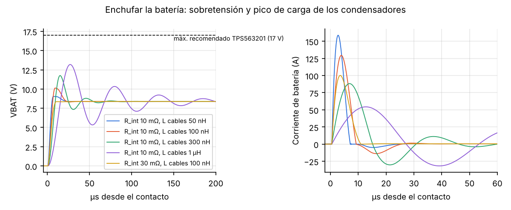

| R interna | 50 nH | 100 nH | 300 nH | 1 µH |
|---|---|---|---|---|
| 10 mΩ (batería nueva) | 9,1 V | 10,1 V | 11,8 V | **13,2 V** |
| 30 mΩ | 8,4 V | 8,4 V | 10,0 V | 11,9 V |
| 50 mΩ | 8,4 V | 8,4 V | 8,9 V | 10,9 V |

El peor caso (13,2 V) queda por debajo de los 17 V que admite el TPS563201 y de los 37 V del DRV8874. No hace falta un TVS. El pico de corriente (50–160 A durante 5–20 µs) es la chispa normal del XT30; el fusible no se entera (I²t del pico ≪ el de fusión).

**Batería al revés:** Q1 no conduce, la corriente es prácticamente cero y VBAT se queda en 0 V. ✅

### 2.2 Arranque a fondo, inversión y freno

Robot parado, los 4 motores a fondo hacia delante, a los 50 ms marcha atrás a fondo y a los 90 ms freno. El modelo incluye la adherencia de las ruedas (μ = 0,8), así que las ruedas patinan al arrancar como en la realidad.

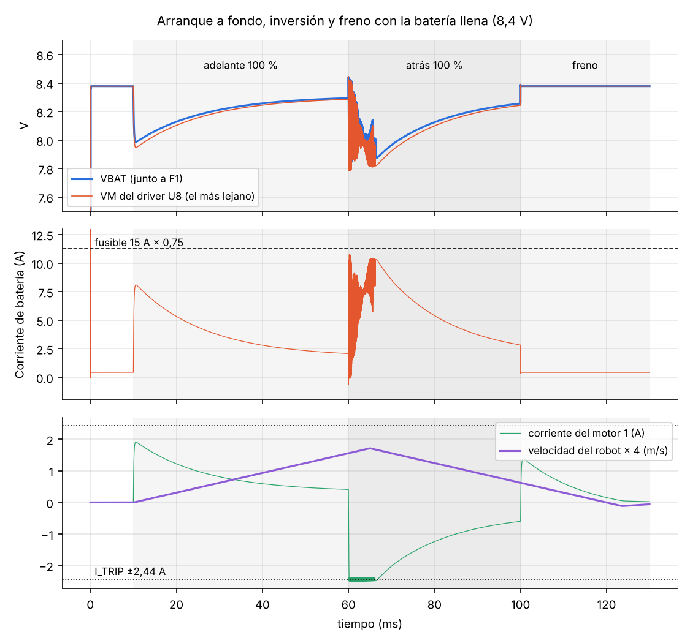

- Arrancar desde parado: 8,1 A de pico. El motor no llega a I_TRIP porque la rueda patina y el motor coge vueltas enseguida.
- **Invertir a fondo es el peor caso:** el motor suma la tensión de la batería y su propia fuerza contraelectromotriz, y el driver corta en I_TRIP. La batería da **10,8 A** durante unos 6 ms. Está por debajo de los 11,25 A útiles del fusible de 15 A, pero con poco margen (4 %). Un fusible rápido no salta por 6 ms a 10,8 A, pero conviene que el firmware **no invierta a fondo sin pasar por freno** (bastan 20–30 ms de freno).
- VBAT en el driver más lejano (U8) baja como mucho a **7,79 V**.

### 2.3 Cuatro motores bloqueados y rizado del PWM

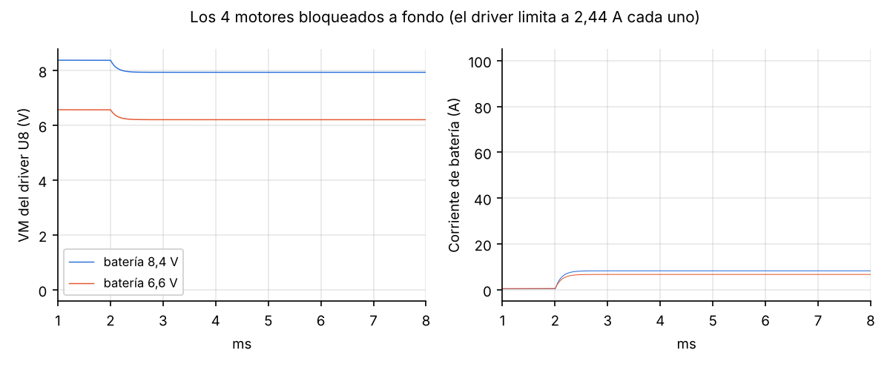

Con el motor estimado (3,75 Ω) la corriente de bloqueo es 1,96 A por motor a 8,4 V, por debajo de I_TRIP: la batería da 8,3 A y a los drivers les llegan 7,94 V. Q1 disipa 0,9 W.

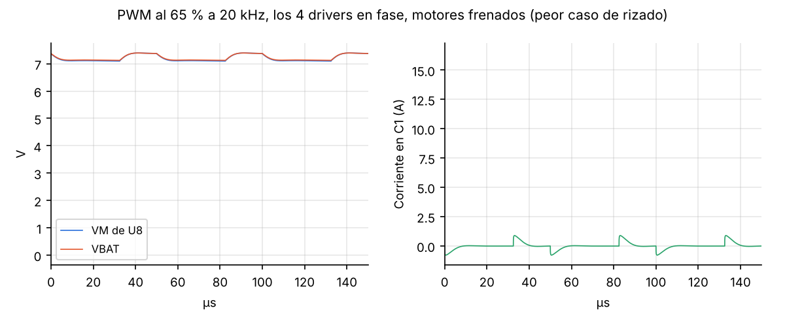

Con PWM al 65 % y los 4 drivers en fase (el peor caso, porque el ESP32 los saca a la vez), el rizado en el driver más lejano es de **300 mVpp** (4 %) y cada condensador de 22 µF lleva 0,28 A eficaces, muy lejos de su límite (~2 A).

---

## 3. Buck TPS563201 a 5,3 V

**Modelo:** control de tiempo de encendido constante (D-CAP2) ajustado a la hoja de datos: 580 kHz, t_OFF mínimo 310 ns (peor caso) o 220 ns (típico), arranque suave de 1 ms y modo Eco a poca carga. Después, D1, el LDO de la DevKit (modelado como un AMS1117, el más desfavorable de los clones) y las cargas de 3,3 V. Netlist: [`spice/buck_tps563201.lib`](../simulacion/spice/buck_tps563201.lib) y [`spice/buck_base.inc`](../simulacion/spice/buck_base.inc).

### 3.1 Escalón de carga

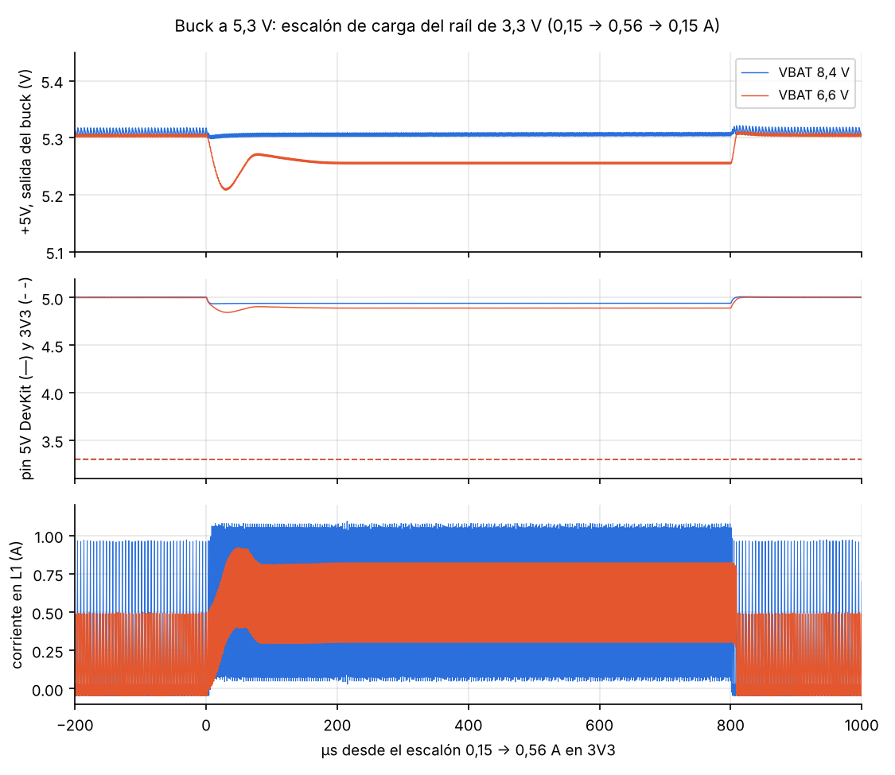

| VBAT | +5V con 0,15 A | +5V con 0,56 A | Bajada en el escalón | Pin 5V DevKit | 3V3 |
|---|---|---|---|---|---|
| 8,4 V | 5,31 V | 5,31 V | 10 mV | 4,94 V | 3,30 V |
| 6,6 V | 5,30 V | 5,26 V | 100 mV | 4,89 V | 3,30 V |

Estable, sin oscilaciones. Rizado de +5V < 20 mVpp. Con poca carga el buck baja la frecuencia (modo Eco), que es lo esperado.

### 3.2 Batería baja

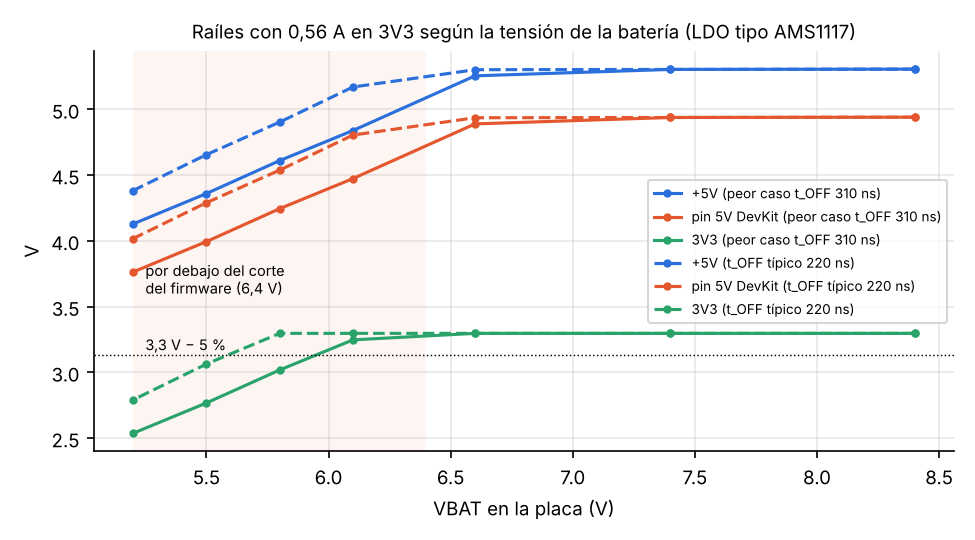

Con 0,56 A en 3V3 (todo encendido):

| VBAT en la placa | +5V (peor / típico) | Pin 5V DevKit | 3V3 (peor / típico) |
|---|---|---|---|
| 7,4 V | 5,28 V | 4,91 V | 3,30 V |
| 6,6 V | 5,26 / 5,28 V | 4,89 V | 3,30 V |
| 6,1 V (batería baja empujando) | 4,84 / 5,17 V | 4,47 / 4,81 V | **3,25** / 3,30 V |
| 5,8 V | 4,61 / 4,90 V | 4,24 / 4,54 V | 3,02 / 3,30 V |
| 5,5 V | 4,36 / 4,66 V | 3,99 / 4,29 V | 2,77 / 3,06 V |

Coincide con el cálculo de docs/08 §5.2: con 6,1 V en la placa y el peor buck el pin 5V queda en 4,47 V y el 3V3 empieza a caer (3,25 V, todavía bien para el ESP32). Con 300 mVpp de rizado de los motores encima, el 3V3 baja a 3,24 V. **Por debajo de ~5,8 V en la placa el 3V3 cae de verdad**; el firmware ya limita la potencia a 6,4 V, así que no debería llegarse ahí. Lo que hay que medir sigue siendo lo de docs/08: el pin 5V con la batería a 6,6 V y los motores bloqueados.

### 3.3 Arranque de la placa al enchufar

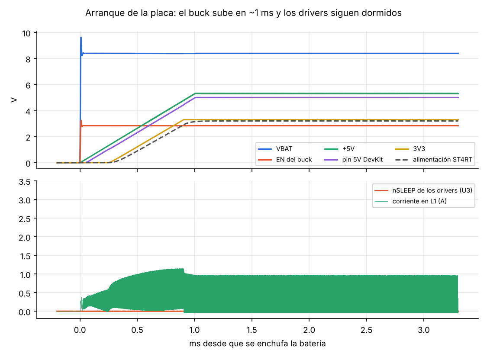

- EN del buck sube con VBAT (divisor R5/R6) y el buck arranca enseguida.
- +5V llega al 90 % en 0,9 ms, sin pasarse (máx. 5,32 V). 3V3 llega en 0,84 ms. La alimentación del ST4RT (R62/C62) sigue al 3V3 con un pequeño retraso.
- **nSLEEP se queda a 0 todo el rato:** R17 mantiene DRV_EN a 0 mientras el ESP32 arranca y R66 mantiene KILL a 0 hasta que el módulo lo levanta. Los motores no pueden moverse al enchufar. ✅

---

## 4. Medidas analógicas

### 4.1 VBAT_SENSE (R3 100 k / R4 33 k / C3 100 nF)

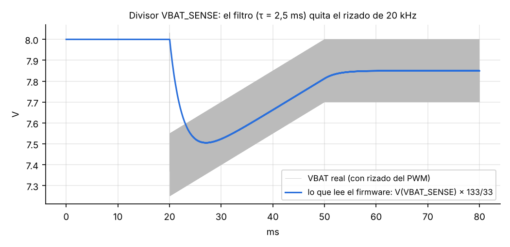

- Constante de tiempo 2,5 ms (corte a 64 Hz): el rizado de 20 kHz desaparece (queda < 1 mV en la lectura) y una caída de VBAT se ve en ~2–3 ms, suficiente para el firmware.
- Tensión en el pin: 2,08 V a 8,4 V y 1,59 V a 6,4 V, dentro del rango del ADC.
- Con resistencias al 1 % y ±10 mV de error del ADC (🔶), la lectura de VBAT puede estar mal en **±0,13 V**. Para el corte de 6,4 V es poco, pero conviene **calibrar una vez con un polímetro** y corregir `DIVISOR_VBAT` en `config.h`.

### 4.2 IPROPI (corriente de los motores)

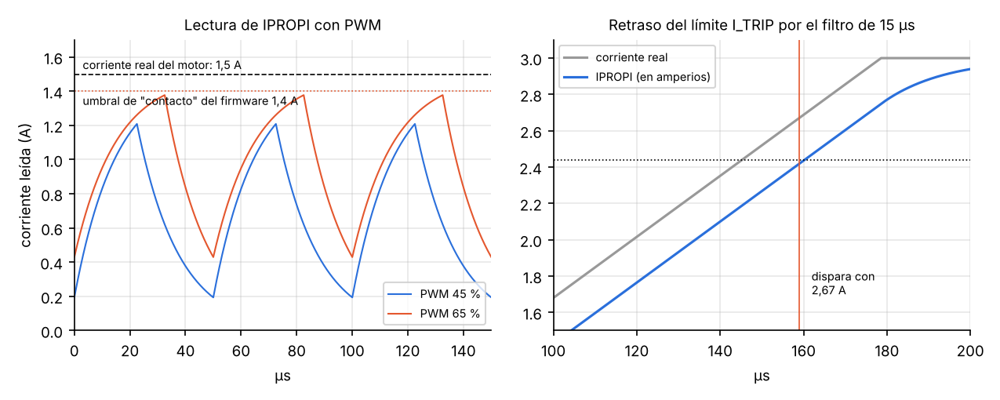

El DRV8874 da en IPROPI una corriente proporcional a la que pasa por sus transistores **altos**. El firmware mueve los motores con IN1 = 1 e IN2 = PWM: en la parte "apagada" del PWM el motor está en freno por los transistores bajos y IPROPI vale 0. Resultado, con 1,5 A reales en el motor:

| PWM | Lectura media | Lectura (mín – máx) |
|---|---|---|
| 45 % | 0,68 A | 0,19 – 1,21 A |
| 65 % | 0,98 A | 0,43 – 1,38 A |
| 100 % | 1,50 A | 1,50 A |

**Fallo del firmware:** `corriente_motor_A()` lee una sola muestra y no divide por el ciclo de trabajo. Con el umbral de contacto de 1,4 A (`I_CONTACTO_A`), **el contacto solo se detecta cuando ya se va al 100 %**. Arreglo propuesto (no aplicado, a decidir por el equipo): promediar varias lecturas y dividir por el ciclo de trabajo del motor, o comparar con `I_CONTACTO_A × ciclo`. Conviene confirmar en la hoja de TI que IPROPI vale 0 en freno (es lo que se ha supuesto).

**Retraso del límite de corriente:** C20 (10 nF con R20 1,5 kΩ, 15 µs) retrasa el corte de I_TRIP unos 14 µs: con el motor bloqueado la corriente llega a **2,67 A** antes de cortar (+9 %). No es peligroso (la protección del driver salta a 6 A), pero suma corriente en el fusible. Si se quiere afinar, C20 = 2,2 nF lo deja en +2 %.

---

## 5. Caída de tensión en el cobre

**Método:** diferencias finitas sobre el cobre real de la placa (zonas rellenas, pistas, pads y vías de KiCad), rejilla de 0,1 mm, 1 oz, 4 drivers a 2,44 A. Script: [`scripts/cobre.py`](../simulacion/scripts/cobre.py) (versión mejorada del `solve.py` del PR #6: ahora también une las dos caras en los pads pasantes; sin eso, parte del GND salía desconectada en el cálculo).

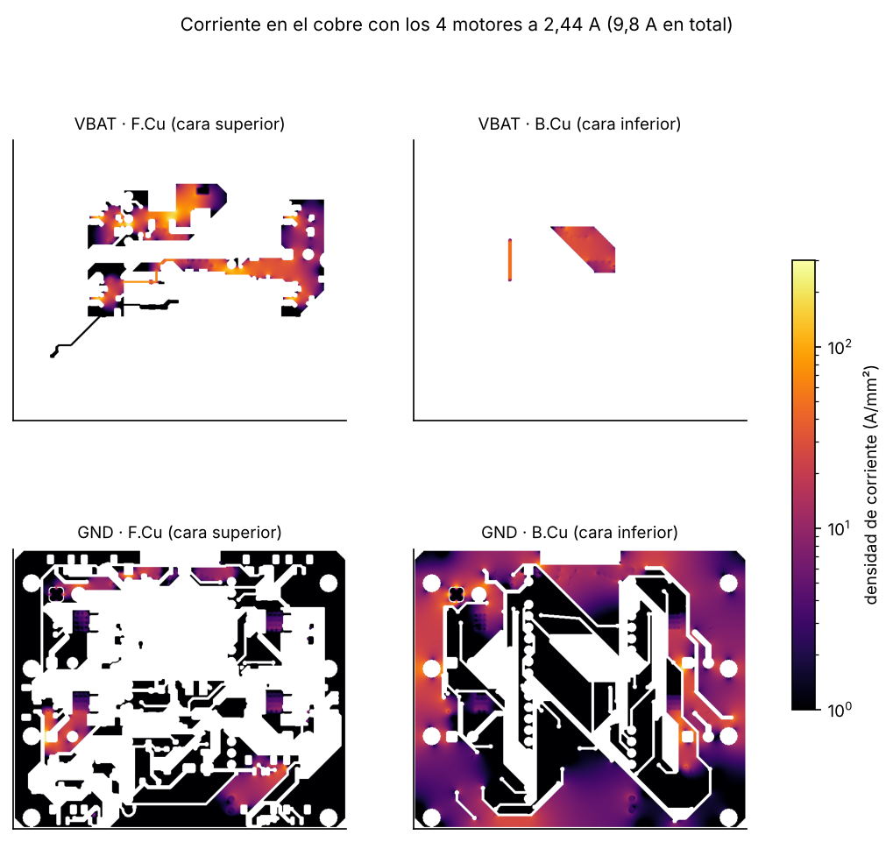

| Driver | Caída VBAT (F1 → driver) | Caída GND (driver → XT30) |
|---|---|---|
| U5 (M1) | 37 mV | 8 mV |
| U6 (M2) | 46 mV | 36 mV |
| U7 (M3) | 51 mV | 41 mV |
| U8 (M4) | 50 mV | 40 mV |

Peor caso VBAT + GND: **~92 mV** (1 % de la batería). Pérdidas en el cobre: 0,74 W en total. ✅

Hay tres "cuellos" estrechos (~0,5 mm) con mucha densidad de corriente (250–300 A/mm²): VBAT entre los pines de la DevKit en (138,6; 98,5), GND junto al borde izquierdo en (120,2; 122,6) y GND inferior en (172,6; 106,2). Son tramos cortos y no se calientan (ver §5.1), así que no hace falta tocarlos para la v1.2. Si se hace una v1.3, ensancharlos un poco y añadir vías de GND en la mitad derecha (ahora parte del retorno cambia de cara por los agujeros de la DevKit).

### 5.1 Calentamiento

**Modelo:** placa de 2 capas con el cobre real, FR4, vías, y aire quieto a 25 °C por las dos caras (sin la caja del robot). Fuentes de calor: el cobre (de §5), los 4 DRV8874 (1,8 W cada uno), Q1 (1,6 W), F1, buck y D1. Peor caso: los 4 motores en I_TRIP. Script: [`scripts/termico.py`](../simulacion/scripts/termico.py).

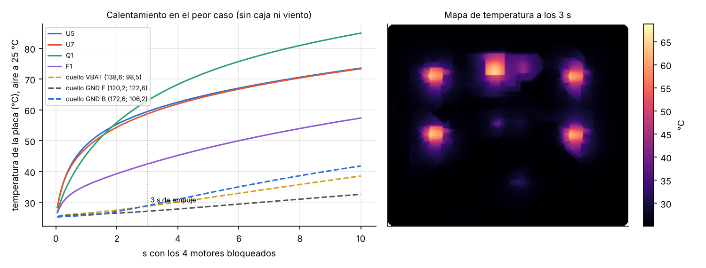

| Punto | Tras 3 s | Tras 10 s |
|---|---|---|
| Drivers (bajo el pad) | +35 °C | +49 °C |
| Q1 | +38 °C | +60 °C |
| F1 | +17 °C | +32 °C |
| Cuellos de cobre | +2 a +4 °C | +8 a +17 °C |

Un empuje de 3 s calienta la placa sin problema. Lo que más se calienta son los drivers y Q1, no las pistas. Empujes de más de 10 s seguidos llevarían los drivers hacia 100 °C de unión: el firmware debería limitar el empuje largo (ya está anotado como pendiente en docs/08 §4).

---

## 6. Firmware: lógica de arranque y parada

**Modelo:** [`firmware/sim_combate.cpp`](../simulacion/firmware/sim_combate.cpp) compila **sin cambios** `arranque.h`, `estrategia.h` y `config.h` del firmware y repite el `loop()` de `principal.cpp` sobre un dohyo virtual: robot con sus medidas reales, sensores de línea y ToF en su sitio, motores con su retardo y la adherencia limitada (μ·g), módulo ST4RT con el comportamiento de referencia del start module de p1r.se, y U3 (nSLEEP = DRV_EN · KILL).

### 6.1 Arranque, ruido y reinicio

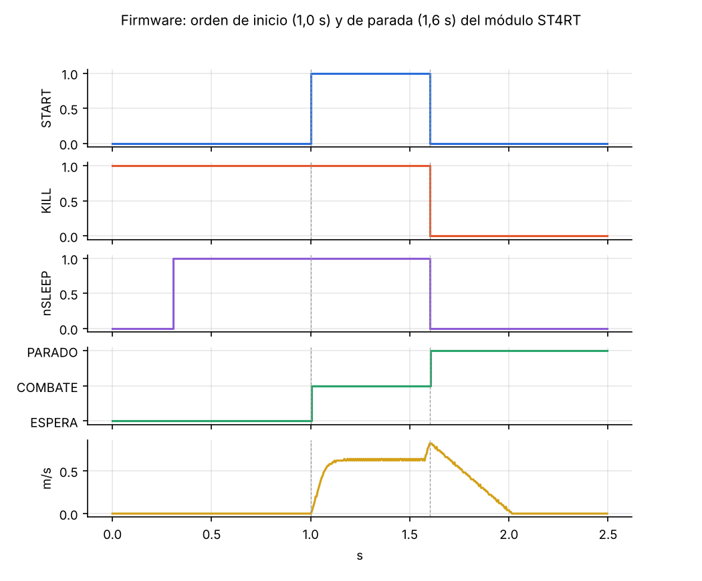

- El robot empieza a moverse **1 ms** después de que START sube (2 lecturas seguidas). ✅
- Pulsos de ruido de 1 ms en START: **0 arranques falsos** en 200 pruebas. Pulsos de 2 ms o más sí lo arrancan (es lo esperado con el filtro de 2 muestras). ✅
- Si el ESP32 se reinicia en pleno combate, al volver ve START = 1 y sigue luchando. ✅

### 6.2 Parada ⚠️

Cuando llega la orden de parada, el módulo baja START y KILL a la vez. KILL duerme los drivers **al instante** por hardware (U3), así que el freno activo de 300 ms del firmware no llega a actuar: los motores quedan sueltos y **el robot sigue rodando** hasta pararse por el rozamiento de la reductora. En la simulación (rozamiento supuesto 2 m/s²) recorre **17 cm** desde 0,83 m/s; con una reductora más dura serían 2–5 cm. No se conoce el rozamiento real del N20.

Esto no es un fallo de seguridad (los motores se apagan seguro), pero el robot podría empujar al rival después de la parada. Opciones, a decidir por el equipo:
1. Medir cuánto rueda el robot al pararse cuando esté montado. Si es poco, no hacer nada.
2. Si rueda mucho: que el firmware frene en cuanto START baja y retrasar KILL unos 0,3 s (por ejemplo con un RC antes de U3; habría que cambiar U3 por una puerta con entrada Schmitt, como el 74LVC1G08 no lo es), o leer K también desde el ESP32.

Comprobar además con el módulo real **en qué orden bajan START y KILL** (docs/06).

---

## 7. Firmware: bordes y rival

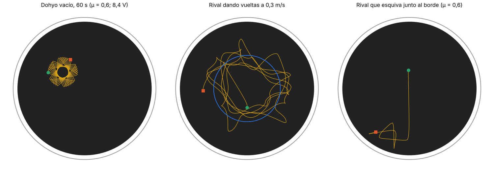

| Prueba | Resultado |
|---|---|
| Dohyo vacío, 60 s, 100 salidas al azar por caso (μ = 0,6 / 0,8 / 1,0; 7,4 / 8,4 V) | **0 salidas** en 600 combates; nunca se queda quieto (regla de los 5 s) ✅ |
| Rival quieto, 200 salidas al azar | Lo encuentra siempre; mediana 0,7 s hasta el contacto ✅ |
| Rival dando vueltas a 0,3 y 0,6 m/s | Lo encuentra siempre; mediana 0,2–0,6 s; 0 salidas ✅ |
| Rival que se aparta en el último momento junto al borde | 0 salidas con μ ≥ 0,8; **2 de 200 con μ = 0,6** ⚠️ |

El último caso es el riesgo ya aceptado en docs/08 §6.3 (ataque a fondo a menos de 15 cm del rival). Con buen agarre no pasa. Si en pista el agarre resulta bajo, bajar `POT_ATAQUE` cuando el robot está cerca del borde.

Nota: en el dohyo vacío el robot busca en círculos cerca de donde empieza (gira 1,5 s y avanza 0,35 s). Como los ToF ven hasta 65 cm, encuentra al rival igual, pero se puede mejorar la búsqueda más adelante.

---

## 8. Qué hacer con esto

**Para la PCB v1.2:** nada bloquea el pedido. Ningún resultado pide cambiar la placa.

**Para el firmware (antes del primer combate):**
1. Corregir la lectura de corriente con PWM (§4.2).
2. Decidir qué hacer con la parada (§6.2) cuando llegue el módulo.
3. Pasar por freno 20–30 ms antes de invertir a fondo (§2.2), para no acercarse al límite del fusible.

**Para medir cuando exista el robot** (además de la lista de docs/08 §8): cuánto rueda el robot tras la parada, el pin 5V con batería baja y motores bloqueados, y la temperatura de Q1 y los drivers tras 3 s de empuje.

---

## 9. Modelos y sus límites

Ninguno de los modelos es del fabricante: las webs de TI, AOS y Sobotz no se pueden abrir desde el entorno de trabajo. Cada modelo se ha ajustado a los datos de la hoja de datos que ya recogía docs/08.

| Pieza | Modelo usado | Qué no tiene |
|---|---|---|
| TPS563201 | Control D-CAP2 de comportamiento (tiempo de encendido, t_OFF mínimo, arranque suave, modo Eco) | El lazo interno real de TI; umbral de EN, UVLO y límite de corriente supuestos |
| DRV8874 | Puente en H con R_DS(on) 150 mΩ, límite de corriente con histéresis | El tiempo de apagado fijo real (el rizado de corriente real es mayor) |
| AOD4185 (Q1) | MOSFET P ajustado a R_DS(on), V_th y capacidades de la hoja | Efectos térmicos |
| Motor N20 | R = 3,75 Ω, L = 0,5 mH 🔶, constantes sacadas de 500 rpm y 1,6 A 🔶 | Medidas reales (pendientes, docs/08 §8) |
| LDO de la DevKit | AMS1117 (caída 1,0 V + 0,4 Ω·I), el peor caso | El LDO real de la DevKit original (más bueno) |
| Batería | Fuente + 30 mΩ 🔶 + cables 100 nH 🔶 | Caída de tensión con la carga |
| Placa (térmico) | 2 capas, aire quieto, h = 10 W/m²K | La caja del robot, cables y convección real |
| Firmware | Código real de arranque y estrategia; robot, sensores y rival simplificados | Empuje entre robots, I²C, tiempos reales del ESP32 |
| ST4RT | Comportamiento del start module de p1r.se | El módulo real (llega en diciembre) |
