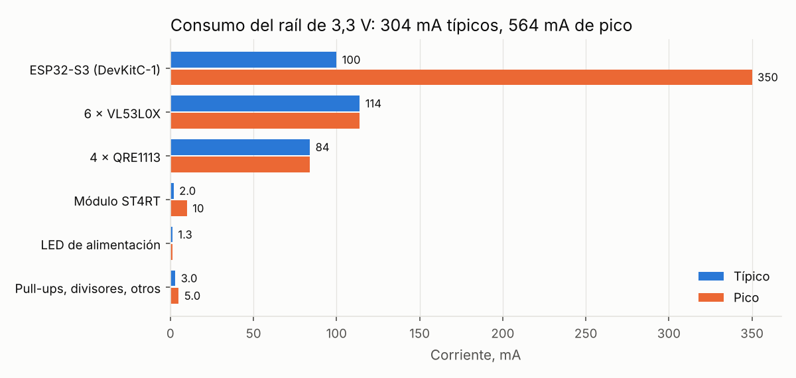
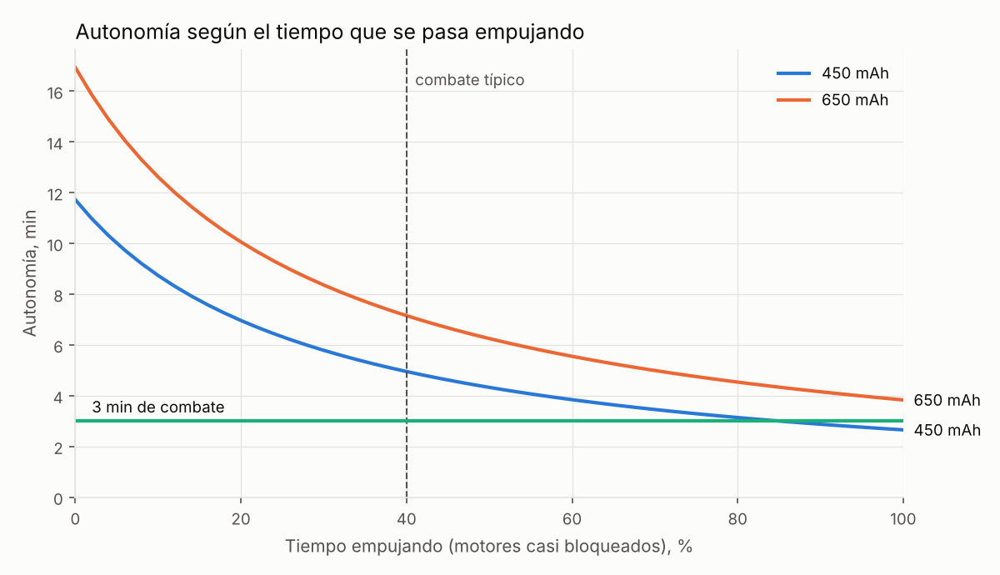

# Anexo: cálculos de la ficha técnica

> ⚠️ **Documento de la v1.1 (octubre de 2026).** El diseño actual es la **v1.2**: el receptor VS1838B se sustituye por el módulo **Sobotz ST4RT** (J17, con parada por hardware mediante U3), se elimina D2 y el buck pasa a 5,3 V, el fusible pasa a 15 A, J17 y J12 cambian de sitio y GPIO21 se llama DRV_EN. Ver [CHANGELOG](../CHANGELOG.md), [08 · Cálculos v1.2](08-Calculos-v1.2.md) y [12 · Memoria](12-Memoria-rediseno-v1.2.md).

**Equipo:** Hombres De Las Tabernas · **Robot:** mini sumo 4WD con ESP32-S3

Este documento es el **anexo de cálculos del informe de entrega de la ficha técnica**. La entrega es un único PDF con este orden:

1. Portada: nombre del equipo, componentes, logo y croquis actualizado con las correcciones de la tarea anterior (`croquis_2`).
2. Ficha técnica del robot rellenada según la plantilla (`ficha_técnica_robot.docx`).
3. **Este anexo**, con los cálculos matemáticos que justifican cada valor de la ficha.

Cada dato de entrada lleva su referencia entre corchetes, **[n]**, a la lista del final. Los números salen del script [18], que se puede volver a ejecutar cuando se midan las piezas reales. Los datos marcados 🔶 no tienen hoja oficial (componentes genéricos) o dependen del montaje y quedan pendientes de medir.

---

## 1. Datos de partida

| Magnitud | Valor | Ref. |
|---|---|---|
| Batería LiPo 2S: tensión por celda nominal / llena / mínima de uso | 3,7 / 4,2 / 3,3 V | 🔶 química LiPo estándar |
| Capacidad y tasa de descarga | 450 mAh (alternativa 650 mAh), 30 C | 🔶 vendedor |
| Resistencia interna del pack | ≈ 30 mΩ | 🔶 estimado, a medir con el cargador |
| Motor N20 6 V: corriente de bloqueo a 6 V | 1,6 A | 🔶 referencia Pololu HP 6 V [15], a medir |
| Motor N20: velocidad a 6 V / corriente maniobrando | 500 rpm / 0,4 A | 🔶 vendedor / estimado |
| DRV8874: R_DS(on) alto + bajo | 100 + 100 mΩ típ., 120 + 120 mΩ máx. a 25 °C | [1] |
| DRV8874: A_IPROPI / consumo VM activo / t_RETRY | 450 µA/A / 3 mA típ. (7 mA máx.) / 2 ms | [1] |
| DRV8874: tensión de VM / corriente de pico | 4,5–37 V / 6 A | [1] |
| TPS563201: V_FB / frecuencia | 768 mV (749–787 mV) / 580 kHz | [2] |
| TPS563201: tiempo mínimo de apagado t_OFF(min) | 220 ns típ. / 310 ns máx. | [2] |
| TPS563201: consumo propio | 120 µA típ. / 200 µA máx. | [2] |
| ESP32-S3: pico en TX Wi-Fi / uso típico en el robot | 350 mA / ≈ 100 mA 🔶 | [3] |
| ADC del ESP32-S3 a 11/12 dB | 0–3,1 V, 12 bits | [5] |
| VL53L0X midiendo (media) | 19 mA (Pololu da 10 mA de media y 40 mA de pico) | [6], [7] |
| QRE1113: caída del LED / resistencia del módulo | 1,2 V típ. (1,6 V máx.) / 100 Ω | [8], [9] |
| TSOP38238 | 0,45 mA | [10] |
| AOD4185: R_DS(on) | ≤ 15 mΩ | [11] |
| XT30UPB: corriente / resistencia de contacto | 15 A continuos / 1,2 mΩ | [12] |
| SS34: caída directa V_F | 0,40 V (0,3 A) … 0,55 V (3 A) | [13] |
| Bobina SRN4018 | 3,3 µH | [14] |
| Masa del modelo 3D con batería | 403,8 g | [17] |
| Dohyo: diámetro / borde blanco | 77 cm / 2,5 cm | [19] |
| Coeficiente de rozamiento goma/MDF | 0,8–1,0 | 🔶 estimado |

---

## 2. Mecánica

**Dimensiones** (modelo 3D [17]): 98 × 98 × 55,1 mm → **9,8 × 9,8 × 5,5 cm**, dentro de los 10 × 10 cm del reglamento [19].

**Masa.** Modelo 3D con batería 403,8 g [17] + cables y tornillería (15–20 g, estimado) → **≈ 420 g**. Si se cambia el lastre de acero (173 g) por plomo del mismo volumen:

$$m_{plomo} = 173\ \text{g} \cdot \frac{11{,}3\ \text{g/cm}^3}{7{,}85\ \text{g/cm}^3} \approx 249\ \text{g} \;\Rightarrow\; 420 + 76 \approx 496\ \text{g} < 500\ \text{g}$$

Quedan solo 4 g de margen con cables estimados: hay que pesar el robot montado antes de poner todo el plomo.

**Fuerza de empuje máxima.** La limita el agarre de las ruedas, no el par del motor (m = 0,495 kg):

$$F = \mu\, m\, g = (0{,}8 \ldots 1{,}0) \cdot 0{,}495 \cdot 9{,}81 = 3{,}9 \ldots 4{,}9\ \text{N}$$

**Par necesario por rueda** (4 ruedas motrices, r = 15 mm):

$$\tau = \frac{F}{4}\, r = \frac{4{,}9}{4} \cdot 0{,}015 = 0{,}018\ \text{N·m} \approx 0{,}19\ \text{kg·cm}$$

**Velocidad** (sin carga, proporcional a la tensión; D = 30 mm):

$$\text{rpm}(V) = 500 \cdot \frac{V}{6\ \text{V}} \qquad v = \frac{\text{rpm} \cdot \pi D}{60}$$

| Tensión | rpm | Velocidad | Cruzar el dohyo (77 cm) | Cruzar el borde blanco (25 mm) |
|---|---|---|---|---|
| 6,0 V | 500 | 0,79 m/s | 0,98 s | 32 ms |
| 7,4 V | 617 | 0,97 m/s | 0,79 s | 26 ms |
| 8,4 V | 700 | 1,10 m/s | 0,70 s | 23 ms |

Los sensores de línea se deben leer a 1 kHz o más para ver el borde con margen.

---

## 3. Batería

| Magnitud | Cálculo | Resultado |
|---|---|---|
| Tensión nominal | 2 × 3,7 V | **7,4 V** |
| Tensión máxima | 2 × 4,2 V | **8,4 V** |
| Tensión mínima de uso | 2 × 3,3 V | 6,6 V |
| Energía (450 mAh) | 7,4 V × 0,45 Ah | 3,33 Wh |
| Corriente que da (450 mAh, 30 C) | 0,45 Ah × 30 | 13,5 A |
| C mínimo necesario | 9,37 A / 0,45 Ah (apartado 5) | 20,8 C → con 30 C sobra un 44 % |
| C mínimo con 650 mAh | 9,37 A / 0,65 Ah | 14,4 C |

**Aviso de batería baja** (divisor 100 kΩ / 33 kΩ al ADC):

$$V_{ADC} = V_{BAT}\,\frac{33}{100+33}$$

| V_BAT | V_ADC |
|---|---|
| 8,4 V (llena) | 2,08 V |
| 7,4 V (nominal) | 1,84 V |
| 6,6 V (3,3 V por celda, aviso) | 1,64 V |

- Todas por debajo del fondo de escala del ADC, 3,1 V [5].
- Resolución: 3,1 V / 4096 × 133/33 = **3 mV** de batería por cuenta.
- Constante de tiempo con 100 nF: (100 k ∥ 33 k) × 100 nF = **2,5 ms**.
- Consumo del divisor: 8,4 V / 133 kΩ = 63 µA.

---

## 4. Motores y drivers

**Corriente de bloqueo.** Con el motor parado no hay fuerza contraelectromotriz y solo limita la resistencia del bobinado:

$$R = \frac{6\ \text{V}}{1{,}6\ \text{A}} = 3{,}75\ \Omega \qquad I_{stall} = \frac{V}{R}$$

| Tensión | Corriente de bloqueo | Potencia en el bobinado |
|---|---|---|
| 6,0 V | 1,60 A | 9,6 W |
| 7,4 V | 1,97 A | 14,6 W |
| 8,4 V | **2,24 A** | **18,8 W** |
| PWM al 75 % de 8,4 V (6,3 V) | 1,68 A | 10,6 W |

Sobretensión con la batería llena: 8,4 / 6 = 1,4. Por eso se usa PWM al 75 % en marcha normal y 100 % solo al atacar. Un N20 bloqueado a 8,4 V disipa ≈ 19 W: el firmware debe bajar el PWM si IPROPI indica bloqueo durante más de 2–3 s.

**Límite de corriente ITRIP** del DRV8874 [1]:

$$V_{REF} = 3{,}3 \cdot \frac{10\ \text{k}}{10\ \text{k}+10\ \text{k}} = 1{,}65\ \text{V} \qquad I_{TRIP} = \frac{V_{REF}}{A_{IPROPI}\, R_{IPROPI}} = \frac{1{,}65}{450\cdot10^{-6} \cdot 1500} = \mathbf{2{,}44\ A}$$

Margen sobre el bloqueo estimado a 8,4 V: 2,44 / 2,24 − 1 = **9 %**. ITRIP protege el driver; al motor lo protege el firmware.

**Pérdidas y temperatura del driver** (corregido, ver apartado 9). Se usa la R_DS(on) máxima [1] corregida en caliente (×1,45 → ≈ 0,35 Ω) y una R_θJA de 40–50 °C/W, porque los 30–40 °C/W de la hoja son de placa JEDEC de 4 capas y la nuestra es de 2:

$$P = I^2 R_{DS(on)} = 2{,}24^2 \cdot 0{,}35 = 1{,}76\ \text{W} \qquad \Delta T = P\, R_{\theta JA} = 1{,}76 \cdot (40 \ldots 50) = 70 \ldots 88\ ^\circ\text{C}$$

Con 25 °C de ambiente la unión llega a **95–113 °C** con el motor bloqueado. En el caso límite en que el driver deja pasar justo ITRIP (2,44 A): P = 2,09 W y T_J = 109–130 °C. En ambos casos por debajo de los 150 °C máximos de unión [1], pero con mucho menos margen del que daba el cálculo anterior (55–65 °C). La corriente de bloqueo a 8,4 V (2,24 A) **supera** los ≈ 2,1 A continuos del driver: es aceptable solo de forma intermitente.

**Medida de corriente por IPROPI** (al ADC):

| Magnitud | Cálculo | Resultado |
|---|---|---|
| Sensibilidad | 450 µA/A × 1,5 kΩ | 0,675 V/A |
| Tensión con el motor bloqueado | 2,24 A × 0,675 V/A | 1,51 V (< 3,1 V) |
| Resolución | (3,1 V / 4096) / 0,675 V/A | 1,1 mA por cuenta |
| Corte del filtro RC (1,5 kΩ, 10 nF) | 1 / (2π · 1,5 k · 10 n) | 10,6 kHz |
| Atenuación del PWM a 20 kHz | −10 log(1 + (f/f_c)²) | −6,6 dB (se promedia por firmware) |

---

## 5. Potencia máxima y protecciones

**Potencia máxima con los motores estimados:**

| Carga | Cálculo | Potencia |
|---|---|---|
| 4 motores bloqueados, batería llena | 4 × 8,4 V × 2,24 A | 75,3 W |
| Electrónica en pico (desde la batería) | 5,53 V × 0,555 A / 0,90 | 3,4 W |
| **Potencia máxima** | | **78,7 W ≈ 79 W** |
| Ídem a tensión nominal | 4 × 7,4 V × 1,97 A + 3,4 W | 61,8 W |

$$I_{bat,pico} = \frac{75{,}3 + 3{,}4}{8{,}4} = 9{,}37\ \text{A}$$

**Techo absoluto que imponen los drivers** (corregido, ver apartado 9). La corriente de bloqueo de 1,6 A a 6 V es una estimación; lo que de verdad limita es ITRIP: un motor que consuma justo 2,44 A no se recorta. Entonces:

$$I_{bat,max} = 4 \cdot 2{,}44 + \frac{3{,}4}{8{,}4} = 10{,}2\ \text{A} \qquad P_{max} = 4 \cdot 2{,}44 \cdot 8{,}4 + 3{,}4 = 85{,}5\ \text{W}$$

**Dimensionado de las protecciones.** Un fusible SMD se usa como máximo al 75 % de su corriente nominal (criterio de diseño habitual):

| Elemento | Límite útil | Frente a 9,37 A | Frente a 10,2 A (techo ITRIP) |
|---|---|---|---|
| Batería 450 mAh 30 C | 13,5 A | +44 % | +33 % |
| Fusible de 10 A (montado) | 7,5 A (75 %) | ✘ | **−26 %** ✘ |
| **Fusible de 15 A (propuesto)** | 11,25 A (75 %) | +20 % | **+10 %** ✔ |
| XT30UPB [12] | 15 A | +60 % | +47 % |

**Conclusión:** el fusible de 10 A se queda corto; se recomienda **15 A**, el mismo valor que el conector XT30.

**Caídas de tensión en el pico de 9,37 A:**

- Batería (≈ 30 mΩ): 9,37 × 0,030 = 0,28 V.
- XT30 (2 × 1,2 mΩ) + AOD4185 (15 mΩ) + fusible (≈ 5 mΩ) = 22 mΩ → 0,21 V.
- Los motores ven ≈ 7,9 V y la batería, en bornes, ≈ **6,1 V** cuando está baja (6,6 − 0,49 V). Este valor se usa en el apartado 6.
- El AOD4185 disipa 9,37² × 0,015 = 1,3 W en el pico (puntual).

---

## 6. Electrónica y cadena de alimentación

| Carga (3,3 V) | Cálculo | Típica | Pico |
|---|---|---|---|
| ESP32-S3 (DevKitC-1) [3] | | 100 mA | 350 mA |
| 6 × VL53L0X [6] | 6 × 19 mA | 114 mA | 114 mA |
| 4 × QRE1113 [8], [9] | 4 × (3,3 − 1,2) / 100 Ω | 84 mA | 84 mA |
| Receptor IR [10] | | 0,45 mA | 0,45 mA |
| LED de alimentación | (3,3 − 2,0) / 1 kΩ | 1,3 mA | 1,3 mA |
| Pull-ups, divisores, otros | | 3 mA | 5 mA |
| **Total** | | **303 mA (1,0 W)** | **555 mA (1,8 W)** |

Si el LED del QRE1113 cae 1,6 V (máximo [8]), cada sensor consume 17 mA en lugar de 21 mA: el valor usado queda del lado seguro.

**Salida del regulador TPS563201** [2]:

$$V_{OUT} = V_{FB}\left(1 + \frac{R_7}{R_8}\right) = 0{,}768 \cdot \left(1 + \frac{62\ \text{k}}{10\ \text{k}}\right) = 5{,}53\ \text{V} \quad (5{,}39 \ldots 5{,}67\ \text{V con la tolerancia de } V_{FB})$$

**Límite del ciclo de trabajo** (cálculo nuevo, ver apartado 9). El TPS563201 necesita estar apagado al menos t_OFF(min) en cada ciclo [2], lo que limita el ciclo de trabajo máximo:

$$D_{max} = 1 - t_{OFF(min)}\, f = 1 - 220\ \text{ns} \cdot 580\ \text{kHz} = 87{,}2\ \% \quad (82{,}0\ \%\ \text{con 310 ns})$$

| Tensión de entrada | D necesario (5,53 V / V_IN) | Salida alcanzable (típ. / peor) |
|---|---|---|
| 6,6 V (batería baja, en reposo) | 84 % | 5,53 V / **5,41 V** |
| 6,1 V (batería baja, en el pico de corriente) | **91 %** | **5,33 V / 5,01 V** |
| 7,4 V (nominal) | 75 % | 5,53 V |
| 8,4 V (llena) | 66 % | 5,53 V |

Con la batería baja y los motores empujando, el buck deja de regular y su salida cae hasta ≈ 5,0 V en el peor caso.

**Rizado de la bobina** (L = 3,3 µH [14]): ΔI = (V_IN − V_OUT)·D / (L·f) = 0,73 A a 7,4 V y 0,99 A a 8,4 V pico a pico. La bobina debe aguantar ≈ 0,6 + 0,5 = 1,1 A sin saturar.

**Tensiones a lo largo de la cadena** (dos diodos SS34 en serie hasta la DevKit, V_F 0,40–0,55 V [13]):

| Punto | Cálculo | Tensión |
|---|---|---|
| Raíl +5V (tras D2) | 5,53 − V_F | 4,98–5,13 V |
| Pin 5V de la DevKit (tras D1), batería normal | 5,53 − 2·V_F | 4,43–4,73 V |
| Ídem, V_FB mínima y V_F máxima | 5,39 − 2 · 0,55 | 4,29 V |
| Ídem, batería baja en el pico (peor caso) | 5,01 − 2 · 0,55 | **3,91 V** |

**Margen del LDO de la DevKit** (corregido, ver apartado 9). El modelo del LDO de la DevKitC-1 no está confirmado [4]; si fuese un AMS1117 (1,1 V de caída, habitual en clones):

| Caso | Cálculo | Margen |
|---|---|---|
| Valores típicos | 4,73 − 3,3 − 1,1 | +0,33 V |
| V_FB mínima y V_F máxima | 4,29 − 3,3 − 1,1 | **−0,11 V** ✘ |
| Además, batería baja en el pico | 3,91 − 3,3 − 1,1 | **−0,49 V** ✘ |

Con un LDO de 1,1 V de caída el ESP32-S3 podría reiniciarse al empujar con la batería baja. Soluciones: quitar uno de los dos diodos o usar Schottky de menor caída, bajar la consigna del buck (R7 = 56 k → 5,07 V, que el buck sí mantiene) o subir el aviso de batería baja a 3,5 V por celda. Hay que comprobar el LDO real en el esquema de la DevKitC-1 [4] y medir el pin 5V en el primer montaje.

**Potencia que pide la electrónica a la batería:**

$$P_{bat} = \frac{V_{buck}\, I_{3V3}}{\eta} = \frac{5{,}53 \cdot 0{,}303}{0{,}90} = 1{,}86\ \text{W} \;\Rightarrow\; I = \frac{1{,}86}{7{,}4} = 0{,}25\ \text{A}$$

En el pico: 3,4 W → 0,46 A. El consumo propio del buck (120 µA [2]) es despreciable.

---

## 7. Autonomía

Este apartado es el **fundamento del cálculo de autonomía** que pide la ficha.

1. **Capacidad útil:** se usa el 80 % de la batería para no bajar de 3,3 V por celda: 0,8 × 450 mAh = **360 mAh**.
2. **Perfil de combate:** una fracción *f* del tiempo empujando (motores casi bloqueados, 4 × 1,97 A a 7,4 V) y el resto maniobrando (4 × 0,4 A), más la electrónica (0,25 A, apartado 6):

$$I_{media} = f \cdot 4 \cdot 1{,}97 + (1-f)\cdot 4 \cdot 0{,}4 + 0{,}25$$

3. **Autonomía:**

$$t = \frac{0{,}8\, C}{I_{media}} \cdot 60\ \text{min}$$

Para el combate típico (f = 40 %): I_media = 0,4 · 7,88 + 0,6 · 1,6 + 0,25 = 4,37 A → t = 0,36 / 4,37 · 60 = **4,9 min ≈ 5 min**.

| Escenario | f | Corriente media | 450 mAh | 650 mAh |
|---|---|---|---|---|
| Empujando todo el tiempo | 100 % | 8,14 A | 2,7 min | 3,8 min |
| **Combate típico** | **40 %** | **4,37 A** | **4,9 min** | **7,1 min** |
| Solo buscando | 0 % | 1,85 A | 11,7 min | 16,9 min |

**Sensibilidad a la corriente de bloqueo** (el dato más incierto), combate típico con 450 mAh:

| Bloqueo del N20 a 6 V | 0,7 A | 1,0 A | **1,6 A** (supuesto) | 2,0 A |
|---|---|---|---|---|
| Autonomía | 8,3 min | 6,8 min | **4,9 min** | 4,2 min |

Es una estimación conservadora: supone que la corriente de los motores sale tal cual de la batería, cuando con PWM por debajo del 100 % la corriente media de batería es menor. En cambio, una LiPo descargada a ≈ 10 C entrega algo menos de su capacidad nominal. Una batería de 450 mAh cubre un combate de 3 min en todos los casos salvo empujar el 100 % del tiempo; conviene llevar dos baterías.

---

## 8. Señales de control

| Comprobación | Cálculo | Resultado |
|---|---|---|
| Niveles lógicos | Todo lo que llega al ESP32-S3 va a 3,3 V; el DRV8874 acepta 3,3 V como nivel alto [1] | ✔ Sin adaptadores |
| ADC de batería e IPROPI | 2,08 V y 1,51 V máximos | ✔ < 3,1 V [5] |
| I²C 400 kHz, solo pull-ups de la placa (2,2 kΩ) | t_r = 0,8473 · R · C = 0,8473 · 2,2 k · 150 pF 🔶 | 280 ns ≤ 300 ns [16] ✔ |
| | I = 3,3 V / 2,2 kΩ | 1,5 mA ≤ 3 mA [16] ✔ |
| I²C con las pull-ups de 10 kΩ de los 6 módulos (corregido) | R = 2,2 k ∥ (10 k / 6) = 0,95 kΩ | t_r = 121 ns ✔ |
| | I = 3,3 V / 0,95 kΩ | **3,5 mA > 3 mA** [16] ✘ |

Si los módulos GY-VL53L0XV2 llevan sus propias pull-ups, hay que quitar las de 2,2 kΩ de la placa (quedarían 1,67 kΩ: 2,0 mA ✔ y t_r = 212 ns ✔) o las de los módulos.

---

## 9. Correcciones respecto a la versión anterior de los cálculos

Tras revisar los cálculos usados para la primera versión de la ficha se han cambiado estos puntos:

| # | Apartado | Antes | Ahora | Afecta a la ficha |
|---|---|---|---|---|
| 1 | 6 · Buck | No se comprobaba el ciclo de trabajo máximo | Con t_OFF(min) = 220–310 ns el buck no llega a 5,53 V con la batería baja: 5,0–5,3 V | No (recomendación de diseño) |
| 2 | 6 · LDO | Margen +0,03 V en el peor caso (mezclaba V_FB típica con V_F máxima) | −0,11 V (V_FB mínima) y −0,49 V con la batería baja | No (recomendación de diseño) |
| 3 | 5 · Fusible | Pico 9,37 A frente a 10 A: +7 % | Techo ITRIP 10,2 A; fusible útil al 75 % → 10 A insuficiente, **15 A recomendado** | Sí: "Protección eléctrica" debería decir fusible de 15 A cuando se cambie |
| 4 | 4 · Driver | R_DS(on) 0,2 Ω típica y 30–40 °C/W → ΔT 30–40 °C | 0,35 Ω máx. en caliente y 40–50 °C/W → ΔT 70–88 °C (T_J ≤ 130 °C con ITRIP); 2,24 A supera los 2,1 A continuos | No |
| 5 | 8 · I²C | No contaba las pull-ups de los módulos | 3,5 mA > 3 mA si los módulos llevan 10 kΩ | No (comprobar los módulos) |
| 6 | 1 · TPS563201 | Consumo propio 380 µA | 120 µA típ. / 200 µA máx. [2] | No (despreciable) |
| 7 | 5 · Potencia | Solo 79 W con el bloqueo estimado | 79 W estimados; techo de 85,5 W limitado por ITRIP | No (79 W sigue siendo el valor estimado) |

No cambian: dimensiones, masa, tensiones de batería, corriente de bloqueo, consumos de los sensores, potencia máxima estimada (79 W) ni autonomía (≈ 5 min).

---

## 10. Correspondencia con la ficha técnica

| Campo de la ficha | Valor en la ficha | Apartado |
|---|---|---|
| Dimensiones | 9,8 × 9,8 × 5,5 cm | 2 |
| Masa total con batería | 420 g | 2 |
| Tensión nominal / máxima | 7,4 V / 8,4 V | 3 |
| Capacidad / tasa de descarga | 450 mAh / 30 C | 3 |
| Protección eléctrica (fusible, ITRIP ≈ 2,4 A, divisor de batería) | | 4, 5 y 3 |
| Tensión de trabajo de los motores | 6,6–8,4 V | 3 y 4 |
| Corriente de bloqueo | 2,2 A a 8,4 V | 4 |
| Driver: tensiones y corriente por canal | 4,5–37 V; 2,1 A cont. / 6 A pico | 1 [1] |
| Potencia máxima calculada | 79 W | 5 |
| Autonomía y su fundamento | 5 min | 7 |
| Consumos de control y sensado (100 / 1 / 21 / 19 mA) | | 6 |

---

## Referencias

1. Texas Instruments, *DRV8874 PWM-Controlled H-Bridge Motor Driver with Current Sense and Regulation*, hoja de datos. <https://www.ti.com/lit/ds/symlink/drv8874.pdf> · características eléctricas: <https://www.ti.com/document-viewer/DRV8874/datasheet/electrical-characteristics-md-electchar>
2. Texas Instruments, *TPS563201 / TPS563208 4,5 V–17 V 3 A Synchronous Step-Down Converter*, SLVSD90B. <https://www.ti.com/lit/ds/symlink/tps563201.pdf>
3. Espressif Systems, *ESP32-S3 Series Datasheet* v2.2. <https://www.espressif.com/sites/default/files/documentation/esp32-s3_datasheet_en.pdf>
4. Espressif Systems, *ESP32-S3-DevKitC-1 v1.1 User Guide* y esquema v1.1. <https://docs.espressif.com/projects/esp-dev-kits/en/latest/esp32s3/esp32-s3-devkitc-1/user_guide_v1.1.html> · <https://dl.espressif.com/dl/schematics/SCH_ESP32-S3-DevKitC-1_V1.1_20221130.pdf>
5. Espressif Systems, *ESP-IDF v4.4.6, ESP32-S3 ADC* (rangos de atenuación). <https://docs.espressif.com/projects/esp-idf/en/v4.4.6/esp32s3/api-reference/peripherals/adc.html>
6. STMicroelectronics, *VL53L0X Time-of-Flight ranging sensor*, hoja de datos. <https://www.st.com/resource/en/datasheet/vl53l0x.pdf>
7. Pololu, *VL53L0X Time-of-Flight Distance Sensor Carrier*. <https://www.pololu.com/product/2490>
8. onsemi, *QRE1113 Miniature Reflective Object Sensor*, hoja de datos. <https://www.onsemi.com/pdf/datasheet/qre1113-d.pdf>
9. SparkFun, *Line Sensor Breakout – QRE1113 (Analog)*. <https://www.sparkfun.com/sparkfun-line-sensor-breakout-qre1113-analog.html>
10. Vishay, *TSOP382, TSOP384 IR Receiver Modules*, hoja de datos. <https://www.vishay.com/docs/82491/tsop382.pdf>
11. Alpha & Omega Semiconductor, *AOD4185 P-Channel MOSFET*, hoja de datos. <https://www.aosmd.com/res/datasheets/AOD4185.pdf>
12. Amass, *XT30UPB specification*. <https://atta.szlcsc.com/upload/public/pdf/source/20230412/7B5DFEF57C9EA5273853390C734B3AC5.pdf>
13. Multicomp Pro, *SS34 Schottky rectifier 3 A 40 V*. <https://cpc.farnell.com/multicomp-pro/ss34/schottky-rectifier-3a-40v-do-214ab/dp/SC21401>
14. Bourns, *SRN4018 Series Semi-shielded Power Inductors*. <https://www.bourns.com/docs/Product-Datasheets/SRN4018.pdf>
15. Pololu, *Micro Metal Gearmotor HP 6V* (referencia para el N20). <https://www.pololu.com/product/998>
16. NXP, *UM10204 I²C-bus specification and user manual* (tiempo de subida 300 ns y 3 mA en Fast-mode; t_r = 0,8473 RC). <https://www.nxp.com/docs/en/user-guide/UM10204.pdf>
17. Modelo 3D del robot: masas y dimensiones, `hardware/mecanica/cad/informe_3d.json`. <https://github.com/Mateosmerodes/Mini_Sumo_Robot_LHDLT/blob/main/Robot_Mini-Sumo/hardware/mecanica/cad/informe_3d.json>
18. Script de cálculo y resultados: `hardware/calculos/calculos_electricos.py` y `resultados.json`. <https://github.com/Mateosmerodes/Mini_Sumo_Robot_LHDLT/tree/main/Robot_Mini-Sumo/hardware/calculos>
19. OSHWDem, *Reglamento Mini Sumo* rev. 7 (2026), resumido en `docs/00-Requisitos-y-reglamento.md`. <https://github.com/Mateosmerodes/Mini_Sumo_Robot_LHDLT/blob/main/Robot_Mini-Sumo/docs/00-Requisitos-y-reglamento.md>
