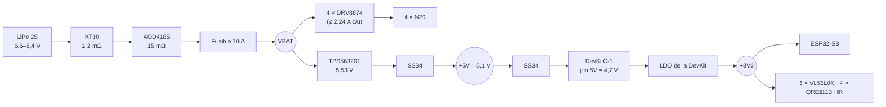
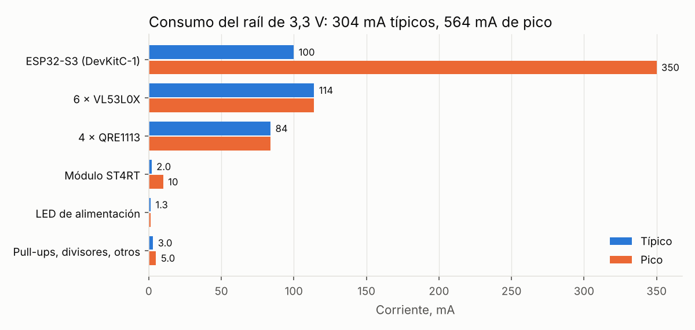
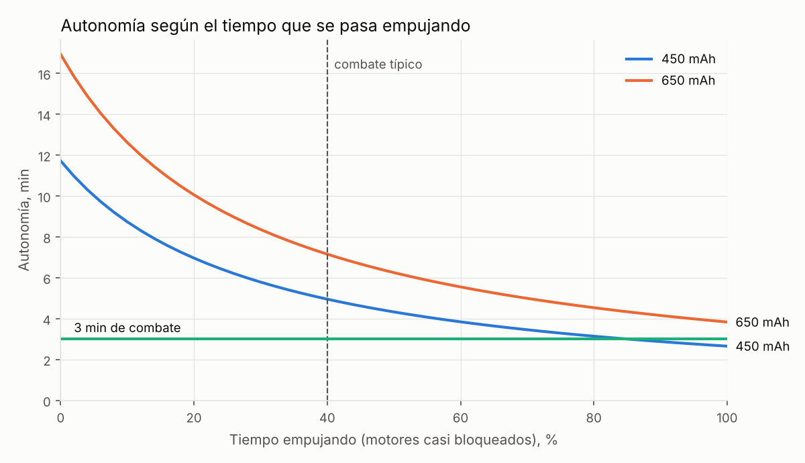

# Informe de consumos y cálculos

> ⚠️ **Documento de la v1.1 (octubre de 2026).** El diseño actual es la **v1.2**: el receptor VS1838B se sustituye por el módulo **Sobotz ST4RT** (J17, con parada por hardware mediante U3), se elimina D2 y el buck pasa a 5,3 V, el fusible pasa a 15 A, J17 y J12 cambian de sitio y GPIO21 se llama DRV_EN. Ver [CHANGELOG](../CHANGELOG.md), [08 · Cálculos v1.2](08-Calculos-v1.2.md) y [12 · Memoria](12-Memoria-rediseno-v1.2.md).

Informe pieza a pieza con los datos de consumo de cada componente, sus fuentes oficiales y los cálculos completos de todo lo que pide la [ficha técnica](Ficha-tecnica.md).

> **Versión corregida para la entrega:** el [Anexo de cálculos de la ficha técnica](Anexo-calculos-ficha-tecnica.md) recoge solo los cálculos, con referencias numeradas, y corrige el fusible, el margen del LDO, la temperatura del driver, el límite del buck y el I²C (apartado 9 del anexo). Donde no coincidan, vale el anexo.

> **Los números salen de un script**, no de una calculadora a mano: [`hardware/calculos/calculos_electricos.py`](../hardware/calculos/calculos_electricos.py). Todos los datos de entrada están arriba del script, cada uno con su fuente; los resultados se guardan en [`resultados.json`](../hardware/calculos/resultados.json) y las gráficas en `docs/img/calc_*.png`. **Cuando midáis algo (sobre todo la corriente de bloqueo de los motores), se cambia el dato en el script y se ejecuta otra vez:**
>
> ```bash
> python3 hardware/calculos/calculos_electricos.py
> ```

**Cómo leer la columna "Dato":**
- ✅ **Oficial:** sacado de la hoja de datos o la página del fabricante.
- 🟡 **Típico:** valor habitual del fabricante que no he podido comprobar en la tabla exacta de la hoja (las webs de fabricantes estaban bloqueadas desde el entorno de trabajo). Comprobadlo en el PDF enlazado.
- 🔶 **Estimado / a medir:** no hay hoja oficial (componente genérico) o depende de nuestro montaje.

---

## 1. Resumen

| Magnitud | Valor | Apartado |
|---|---|---|
| Consumo del raíl de 3,3 V | **303 mA** típicos, **555 mA** de pico | [4.5](#45-electrónica-y-cadena-de-alimentación) |
| Consumo de la electrónica visto desde la batería | 1,9 W (0,25 A) típicos, 3,4 W de pico | [4.5](#45-electrónica-y-cadena-de-alimentación) |
| Corriente de bloqueo por motor | 1,97 A a 7,4 V; **2,24 A** a 8,4 V 🔶 | [4.3](#43-motores-y-drivers) |
| Límite de corriente de cada driver (ITRIP) | **2,44 A** | [4.3](#43-motores-y-drivers) |
| Potencia máxima | **79 W** (batería llena), 62 W (nominal) | [4.4](#44-potencia-máxima-y-protecciones) |
| Corriente máxima de batería | **9,4 A** | [4.4](#44-potencia-máxima-y-protecciones) |
| Tasa de descarga mínima de la batería | 21 C (450 mAh) / 14 C (650 mAh) | [4.2](#42-batería) |
| Autonomía en combate típico | **4,9 min** (450 mAh) / 7,1 min (650 mAh) | [4.6](#46-autonomía) |
| Fuerza de empuje máxima (límite de agarre) | 3,9–4,9 N | [4.1](#41-mecánica) |
| Velocidad máxima | 0,97 m/s a 7,4 V | [4.1](#41-mecánica) |

### Lo que han destapado los cálculos

| # | Hallazgo | Gravedad | Qué hacer |
|---|---|---|---|
| 1 | **Fusible de 10 A con solo un 7 % de margen** sobre el pico teórico (9,4 A con los 4 motores bloqueados y la batería llena). | 🟡 | Subir a **12–15 A** (el XT30 aguanta 15 A), o limitar por firmware que los 4 motores estén al 100 % bloqueados a la vez. |
| 2 | **Un N20 bloqueado a 8,4 V convierte ~19 W en calor** en un motor de 10 g. Aguanta segundos, no minutos. | 🔴 | Firmware: si IPROPI marca bloqueo más de ~2–3 s, bajar el PWM. El ITRIP protege el driver, **no** el motor (2,44 A > 2,24 A). |
| 3 | **Margen del LDO de la DevKit casi nulo en el peor caso** (clon con AMS1117, diodos con 0,55 V de caída): sobran 0,03 V. Con los valores típicos sobran ~0,3 V. | 🟡 | Usar un Schottky de baja caída en D1/D2 (VF ≤ 0,35 V a 0,5 A) o comprar la DevKitC-1 original de Espressif. Medir el pin 5V de la DevKit en el primer montaje. |
| 4 | **El filtro de IPROPI (1,5 kΩ + 10 nF) solo atenúa 6,6 dB** el rizado del PWM a 20 kHz. | 🟢 | Promediar por firmware, o subir el condensador a 100 nF (corte a 1 kHz, −26 dB). |
| 5 | **ITRIP solo un 9 % por encima** del bloqueo estimado: si los N20 consumen algo más de 1,6 A a 6 V, el driver recortará en cada empujón. | 🟢 | Medir el bloqueo real y ajustar R_IPROPI. |
| 6 | **A 8,4 V el robot cruza el borde blanco en 23 ms.** | 🟢 | Leer los sensores de línea a ≥ 1 kHz (el ADC del S3 sobra). |

---

## 2. Árbol de alimentación



---

## 3. Pieza a pieza

### 3.1 Batería LiPo 2S 450–650 mAh 30 C (×1)

| Dato | Valor | Fuente |
|---|---|---|
| Tensión por celda: nominal / llena / mínima de uso | 3,7 / 4,2 / 3,3 V | 🔶 Química LiPo estándar (sin hoja: batería genérica) |
| Tensión del pack (2S) | **7,4 V** nominal, **8,4 V** llena, 6,6 V mínima | Cálculo: 2 × celda |
| Energía | 3,33 Wh (450 mAh) · 4,81 Wh (650 mAh) | E = V_nom × C |
| Corriente máxima | 13,5 A (450 mAh) · 19,5 A (650 mAh) | I = C × tasa = 0,45 Ah × 30 C |
| Resistencia interna | ~30 mΩ el pack | 🔶 Estimado (~15 mΩ por celda en 2S 450 mAh 30 C); medir con el cargador |

### 3.2 Motores N20 6 V ~500 rpm (×4)

| Dato | Valor | Fuente |
|---|---|---|
| Tensión nominal | 6 V | 🔶 Vendedor (genérico) |
| Corriente de bloqueo a 6 V | **1,6 A** | 🔶 **A medir.** Referencia: el Pololu *HP 6V* (mismo formato N20) da 1,6 A de bloqueo (120 mA en vacío en la versión 5:1); el *HPCB 6V*, 1,5 A; el *LP 6V*, 0,36 A ([Pololu, 6V HP/HPCB](https://www.pololu.com/product/998), [6V LP](https://www.pololu.com/category/171/6v-low-power-lp-micro-metal-gearmotors)) |
| Resistencia del bobinado | 3,75 Ω | R = 6 V / 1,6 A |
| Corriente en marcha (con aceleraciones) | ~0,4 A | 🔶 Estimado (en vacío, 0,12 A según Pololu HP) |
| Velocidad | 500 rpm a 6 V | 🔶 Vendedor |

### 3.3 Driver de motor TI DRV8874 (×4)

| Dato | Valor | Fuente |
|---|---|---|
| Tensión de potencia (VM) | **4,5–37 V** | ✅ [TI DRV8874](https://www.ti.com/product/DRV8874) |
| Corriente de pico | **6 A** | ✅ [Hoja de datos](https://www.ti.com/lit/ds/symlink/drv8874.pdf) |
| Corriente continua | ~2,1 A (depende del cobre de la placa) | 🟡 Hoja de datos (tabla térmica) |
| R_DS(on) lado alto + lado bajo | **200 mΩ** | ✅ [TI DRV8874](https://www.ti.com/product/DRV8874) |
| Factor de IPROPI (A_IPROPI) | **450 µA/A** (error ±5,5 % entre 2 y 4 A) | ✅ [Características eléctricas](https://www.ti.com/document-viewer/DRV8874/datasheet/electrical-characteristics-md-electchar) |
| Consumo de VM activo, salidas paradas | ~3 mA | 🟡 Hoja de datos (típico a 24 V) |
| Consumo dormido | < 1 µA | ✅ [TI DRV8874](https://www.ti.com/product/DRV8874) |
| Tiempo de reintento tras fallo | 2 ms | 🟡 Hoja de datos |
| **En el robot** | 4 × 3 mA = 12 mA de VBAT con los motores parados | Cálculo |

### 3.4 Placa de control Espressif ESP32-S3-DevKitC-1 (×1)

| Dato | Valor | Fuente |
|---|---|---|
| Alimentación | 5 V por USB o por el pin 5V (o 3,3 V por el pin 3V3; son excluyentes) | ✅ [Guía de usuario v1.1](https://docs.espressif.com/projects/esp-dev-kits/en/latest/esp32s3/esp32-s3-devkitc-1/user_guide_v1.1.html) |
| Regulador | LDO de 5 V a 3,3 V en la propia placa | ✅ Guía de usuario. ⚠️ El modelo exacto del LDO hay que leerlo en el [esquema v1.1](https://dl.espressif.com/dl/schematics/SCH_ESP32-S3-DevKitC-1_V1.1_20221130.pdf); los clones suelen llevar AMS1117 |
| Tensión del chip | 3,0–3,6 V (3,3 V) | 🟡 [ESP32-S3 datasheet](https://www.espressif.com/sites/default/files/documentation/esp32-s3_datasheet_en.pdf) |
| Pico de corriente en TX Wi-Fi (802.11b, 1 Mbps, 20 dBm) | **350 mA** | ✅ ESP32-S3 datasheet v2.2, tabla de consumo en TX |
| Corriente en RX Wi-Fi | ~100 mA (HT20) / 105 mA (HT40) | ✅ ESP32-S3 datasheet v2.2 |
| Corriente típica en el robot (240 MHz, Wi-Fi a ratos) | ~100 mA | 🔶 Estimado (CPU a tope + recepción Wi-Fi intermitente). La tabla "Modem-sleep" del datasheet da el consumo sin radio |
| ADC | 12 bits, ~0–3,1 V con atenuación máxima | 🟡 ESP32-S3 datasheet |

### 3.5 Sensor de distancia ST VL53L0X (módulo GY-VL53L0XV2, ×6)

| Dato | Valor | Fuente |
|---|---|---|
| Tensión del sensor | 2,6–3,5 V (el módulo lleva regulador de 2,8 V y admite 3,3–5 V) | ✅ [ST VL53L0X datasheet](https://www.st.com/resource/en/datasheet/vl53l0x.pdf) |
| Consumo midiendo (media, con el láser) | **19 mA** | 🟡 Hoja de ST, tabla de consumo ("active ranging average"); confirmado por ST en su [foro](https://community.st.com/imaging-sensors-49/current-consumption-in-vl53l0x-in-single-ranging-135319) |
| Pico | ~40 mA (pulsos del láser, cubiertos por los condensadores del módulo) | 🟡 Pololu, ficha de su módulo VL53L0X |
| En reposo hardware (XSHUT a 0) | ~5 µA | 🟡 Hoja de ST |
| Láser | 940 nm, clase 1 | ✅ [ST VL53L0X](https://www.st.com/en/imaging-and-photonics-solutions/vl53l0x.html) |
| **En el robot** | 6 × 19 = **114 mA** | Cálculo |

### 3.6 Sensor de línea onsemi QRE1113 (módulo analógico, ×4)

| Dato | Valor | Fuente |
|---|---|---|
| Corriente máxima del LED IR | 50 mA | ✅ [onsemi QRE1113](https://www.onsemi.com/download/data-sheet/pdf/qre1113-d.pdf) (vía DigiKey) |
| Caída del LED | ~1,2 V a 20 mA | 🟡 Hoja de onsemi |
| Corriente máxima del fototransistor | 20 mA | ✅ Hoja de onsemi (vía DigiKey) |
| Resistencia del LED en el módulo | 100 Ω | 🔶 Esquema del módulo tipo SparkFun; **comprobar en el que compréis** |
| **En el robot** | (3,3 − 1,2) / 100 Ω = **21 mA** cada uno → **84 mA** los 4 | Cálculo |

### 3.7 Receptor IR Vishay TSOP38238 / VS1838B (×1)

| Dato | Valor | Fuente |
|---|---|---|
| Tensión | 2,5–5,5 V | ✅ [Vishay TSOP382](https://www.vishay.com/docs/82491/tsop382.pdf) |
| Consumo | **0,35 mA** típicos / 0,45 mA | 🟡 Hoja de Vishay (los distribuidores dan una u otra cifra). El VS1838B es un clon sin hoja oficial: tomamos el del TSOP |
| **En el robot** | < 0,5 mA (despreciable) | |

### 3.8 Regulador conmutado TI TPS563201 (×1)

| Dato | Valor | Fuente |
|---|---|---|
| Tensión de entrada | **4,5–17 V** | ✅ [TI TPS563201](https://www.ti.com/lit/ds/symlink/tps563201.pdf) |
| Corriente de salida | 3 A | ✅ Hoja de TI |
| Tensión de referencia (V_FB) | **768 mV** típicos (749–787 mV) | ✅ Hoja de TI (SLVSD90B) |
| Frecuencia | ~580 kHz | ✅ Hoja de TI |
| Consumo propio sin conmutar | ~380 µA | 🟡 Hoja de TI (revisión anterior) |
| Rendimiento a nuestra carga | ~90 % | 🔶 Estimado de las curvas de la hoja (5 V de salida) |

### 3.9 Protección y conexión de la batería

| Pieza | Dato | Valor | Fuente |
|---|---|---|---|
| MOSFET P **AOD4185** | V_DS / I_D | −40 V / −40 A | ✅ [AOS AOD4185](https://www.aosmd.com/res/datasheets/AOD4185.pdf) (vía DigiKey) |
| | R_DS(on) | ≤ 15 mΩ a V_GS = −10 V | ✅ Ídem (a −7,4 V será algo mayor) |
| | V_GS máx. | ±20 V (la batería llena da 8,4 V) | ✅ Ídem |
| Fusible 2512 10 A | Resistencia | ~5 mΩ | 🔶 Típico de fusibles SMD de 10 A |
| Conector **AMASS XT30UPB** | Corriente | **15 A** continuos (30 A durante 1 min) | ✅ [Especificación de Amass](https://atta.szlcsc.com/upload/public/pdf/source/20230412/7B5DFEF57C9EA5273853390C734B3AC5.pdf) |
| | Resistencia de contacto | 1,2 mΩ | ✅ Ídem |
| Diodos **SS34** (D1, D2) | V_F | ≤ 0,55 V a 3 A (~0,4 V a 0,3 A) | ✅ [Multicomp SS34](https://cpc.farnell.com/multicomp-pro/ss34/schottky-rectifier-3a-40v-do-214ab/dp/SC21401) (varios fabricantes) |

### 3.10 Componentes pasivos con consumo

| Pieza | Cálculo | Consumo |
|---|---|---|
| LED verde de alimentación + 1 kΩ | (3,3 − 2,0) / 1 kΩ | 1,3 mA |
| Divisor de batería 100 k + 33 k | 8,4 V / 133 kΩ | 63 µA |
| Divisor de V_REF 10 k + 10 k | 3,3 V / 20 kΩ | 165 µA |
| Pull-ups I²C 2,2 k (×2) | 3,3 V / 2,2 kΩ, solo con la línea a 0 | ≤ 1,5 mA c/u |
| Pull-up de nFAULT 10 k | Solo si hay fallo | 0,33 mA |
| R17 (pull-down de nSLEEP) 100 k | Con nSLEEP a 1 | 33 µA |

---

## 4. Cálculos de la ficha técnica

### 4.1 Mecánica

**Dimensiones:** el modelo 3D mide 98 × 98 × 55,1 mm → **9,8 × 9,8 × 5,5 cm**. El reglamento pide ≤ 10 × 10 cm en planta y no limita la altura.

**Masa:** el modelo suma **403,8 g** con batería ([`informe_3d.json`](../hardware/mecanica/cad/informe_3d.json)); con cables y tornillería (15–20 g), **≈ 420 g**. Cambiando el lastre de acero (173 g) por plomo:

$$m_{plomo} = 173\ \text{g} \cdot \frac{11{,}3\ \text{g/cm}^3}{7{,}85\ \text{g/cm}^3} \approx 249\ \text{g} \;\Rightarrow\; +76\ \text{g} \;\Rightarrow\; \approx 496\ \text{g}$$

**Fuerza de empuje máxima.** La pone el agarre, no el motor (con μ goma/MDF ≈ 0,8–1,0, estimado, y m = 0,495 kg):

$$F = \mu\, m\, g = (0{,}8 \ldots 1{,}0) \cdot 0{,}495 \cdot 9{,}81 = 3{,}9 \ldots 4{,}9\ \text{N}$$

Por rueda (4WD): 0,97–1,21 N. **Par necesario en cada rueda** (r = 15 mm):

$$\tau = \frac{F}{4}\, r = 1{,}21 \cdot 0{,}015 = 0{,}018\ \text{N·m} \approx 0{,}19\ \text{kg·cm}$$

Cualquier N20 de ~500 rpm da varias veces eso bloqueado: el límite es el agarre. **Más masa = más empuje.**

**Velocidad** (sin carga, proporcional a la tensión; D = 30 mm):

$$v = \frac{\text{rpm} \cdot \pi D}{60}$$

| Tensión | rpm | Velocidad | Cruzar el dohyo (77 cm) | Cruzar el borde blanco (25 mm) |
|---|---|---|---|---|
| 6,0 V | 500 | 0,79 m/s | 0,98 s | 32 ms |
| 7,4 V | 617 | 0,97 m/s | 0,79 s | 26 ms |
| 8,4 V | 700 | 1,10 m/s | 0,70 s | **23 ms** |

→ Los sensores de línea tienen que leerse **a 1 kHz o más** para ver el borde con margen.

### 4.2 Batería

| Magnitud | Cálculo | Resultado |
|---|---|---|
| Tensión nominal | 2 × 3,7 V | **7,4 V** |
| Tensión máxima | 2 × 4,2 V | **8,4 V** |
| Tensión mínima de uso | 2 × 3,3 V | 6,6 V |
| Energía (450 mAh) | 7,4 V × 0,45 Ah | 3,33 Wh |
| Corriente que da (450 mAh, 30 C) | 0,45 Ah × 30 | 13,5 A |
| **C mínimo necesario** | 9,37 A / 0,45 Ah | **20,8 C** → con 30 C sobra un 44 % |
| C mínimo con 650 mAh | 9,37 A / 0,65 Ah | 14,4 C |
| Caída interna en el pico | 9,37 A × 30 mΩ | 0,28 V |
| Carga a 1 C | 450 mA, CC-CV | ~1 h desde vacía |

**Aviso de batería baja** (divisor 100 k / 33 k al ADC):

$$V_{ADC} = V_{BAT}\,\frac{33}{100+33}$$

| V_BAT | V_ADC |
|---|---|
| 8,4 V (llena) | 2,08 V |
| 7,4 V (nominal) | 1,84 V |
| 6,6 V (3,3 V por celda → **avisar**) | 1,64 V |

- Resolución: 3,1 V / 4096 × 133/33 = **3 mV** de batería por cuenta del ADC.
- Constante de tiempo con C3 = 100 nF: (100 k ∥ 33 k) × 100 nF = **2,5 ms**: filtra el ruido de los motores sin retrasar el aviso.
- Lo que gasta el divisor: 8,4 V / 133 kΩ = 63 µA (despreciable; igualmente, **desenchufar el XT30 al guardar el robot**).

### 4.3 Motores y drivers

**Corriente de bloqueo.** Parado no hay fuerza contraelectromotriz, solo frena el bobinado:

$$R = \frac{6\ \text{V}}{1{,}6\ \text{A}} = 3{,}75\ \Omega \qquad I_{stall} = \frac{V}{R}$$

| Tensión | Corriente de bloqueo | Potencia en el bobinado (todo calor) |
|---|---|---|
| 6,0 V | 1,60 A | 9,6 W |
| 7,4 V | 1,97 A | 14,6 W |
| 8,4 V | **2,24 A** | **18,8 W** ⚠️ |
| PWM al 75 % de 8,4 V (6,3 V eficaces) | 1,68 A | 10,6 W |

Sobretensión con la batería llena: 8,4 / 6 = **1,4** (40 % por encima del nominal) → PWM al 75 % en marcha normal y 100 % solo en el ataque.

**Límite de corriente ITRIP** (de la hoja de TI: I_TRIP · A_IPROPI = V_REF / R_IPROPI):

$$V_{REF} = 3{,}3 \cdot \frac{10\text{k}}{10\text{k}+10\text{k}} = 1{,}65\ \text{V} \qquad I_{TRIP} = \frac{1{,}65}{450\cdot10^{-6} \cdot 1500} = \mathbf{2{,}44\ A}$$

Margen sobre el bloqueo estimado a 8,4 V: 2,44 / 2,24 − 1 = **9 %**. El driver no recorta en uso normal, pero sí si un motor sale con más consumo. **El ITRIP protege el driver; el motor lo tiene que proteger el firmware** (ver hallazgo 2).

**Pérdidas y temperatura del driver** (R_DS(on) total de 0,2 Ω):

$$P = I^2 R_{DS(on)} = 2{,}24^2 \cdot 0{,}2 = 1{,}0\ \text{W} \qquad \Delta T = P \cdot R_{\theta JA} \approx 1{,}0 \cdot (30 \ldots 40) = 30 \ldots 40\ ^\circ\text{C}$$

A 25 °C de ambiente el chip se queda en ~55–65 °C con el motor bloqueado: lejos de su apagado térmico. (R_θJA depende del cobre; con el plano de GND y las 12 vías estamos en la zona buena.)

**Medida de corriente por IPROPI** (al ADC):

| Magnitud | Cálculo | Resultado |
|---|---|---|
| Sensibilidad | 450 µA/A × 1,5 kΩ | **0,675 V/A** |
| Tensión con el motor bloqueado | 2,24 A × 0,675 | 1,51 V (dentro del ADC) |
| Resolución | (3,1 V / 4096) / 0,675 V/A | **1,1 mA** por cuenta |
| Corte del filtro RC (1,5 kΩ, 10 nF) | 1 / (2π · 1,5k · 10n) | 10,6 kHz |
| Atenuación del rizado del PWM a 20 kHz | | solo **−6,6 dB** (ver hallazgo 4) |

### 4.4 Potencia máxima y protecciones

| Carga | Cálculo | Potencia |
|---|---|---|
| 4 motores bloqueados, batería llena | 4 × 8,4 V × 2,24 A | 75,3 W |
| Electrónica en pico (desde batería) | 5,53 V × 0,555 A / 0,90 | 3,4 W |
| **Potencia máxima** | | **78,7 W** |
| Ídem a tensión nominal | 4 × 7,4 × 1,97 + 3,4 | 61,8 W |

**Corriente de pico de la batería:** 75,3 W / 8,4 V + 3,4 W / 8,4 V = **9,37 A**.

| Elemento | Límite | Margen |
|---|---|---|
| Batería 450 mAh 30 C | 13,5 A | +44 % |
| Fusible | 10 A | **+7 %** ⚠️ (hallazgo 1) |
| XT30 | 15 A | +60 % |
| DRV8874 (por canal) | 2,1 A cont. / 6 A pico | 2,24 A ✔ (con ITRIP a 2,44 A) |

**Caídas de tensión en el pico de 9,37 A:**
- Batería (~30 mΩ): 0,28 V.
- XT30 (2 × 1,2 mΩ) + AOD4185 (15 mΩ) + fusible (~5 mΩ) = 22 mΩ → 0,21 V.
- Los motores ven ≈ **7,9 V** en vez de 8,4 V, así que el pico real queda por debajo de los 79 W teóricos.
- El AOD4185 disipa 9,37² × 0,015 = **1,3 W** en el pico (puntual, el TO-252 lo aguanta); en un combate típico (4,4 A) son 0,3 W.

### 4.5 Electrónica y cadena de alimentación



| Carga (3,3 V) | Típica | Pico |
|---|---|---|
| ESP32-S3 (DevKitC-1) | 100 mA | 350 mA |
| 6 × VL53L0X | 114 mA | 114 mA |
| 4 × QRE1113 | 84 mA | 84 mA |
| Receptor IR | 0,4 mA | 0,4 mA |
| LED de alimentación | 1,3 mA | 1,3 mA |
| Pull-ups, divisores, otros | 3 mA | 5 mA |
| **Total** | **303 mA (1,0 W)** | **555 mA (1,8 W)** |

**Buck TPS563201:**

$$V_{OUT} = V_{FB}\left(1 + \frac{R_7}{R_8}\right) = 0{,}768 \cdot \left(1 + \frac{62\text{k}}{10\text{k}}\right) = 5{,}53\ \text{V} \quad (5{,}39 \ldots 5{,}67\ \text{V con la tolerancia de } V_{FB})$$

| Batería | Ciclo de trabajo (V_OUT / V_IN) | Rizado de la bobina ΔI = (V_IN − V_OUT)·D / (L·f) |
|---|---|---|
| 6,6 V | 84 % | — |
| 7,4 V | 75 % | 0,73 A pico a pico |
| 8,4 V | 66 % | 0,99 A pico a pico |

Con ~0,3 A de carga, el rizado es mayor que la corriente media: el TPS563201 pasa a modo de salto de pulsos y mantiene buen rendimiento con poca carga. La bobina tiene que aguantar I_carga + ΔI/2 ≈ 0,6 + 0,5 = 1,1 A sin saturar (SRN4018 de 3,3 µH: comprobar su I_sat en la [hoja de Bourns](https://www.bourns.com/docs/Product-Datasheets/SRN4018.pdf)).

**Tensiones a lo largo de la cadena** (V_F de los SS34 entre 0,40 y 0,55 V):

| Punto | Cálculo | Tensión |
|---|---|---|
| Salida del buck | | 5,53 V |
| Raíl +5V (tras D2) | 5,53 − V_F | 4,98–5,13 V |
| Pin 5V de la DevKit (tras D1) | 5,53 − 2·V_F | **4,43–4,73 V** |
| Margen del LDO si es un AMS1117 (caída 1,1 V) | 4,43 − 3,3 − 1,1 | **0,03 V** en el peor caso ⚠️ (hallazgo 3); 0,33 V con valores típicos |

**Potencia del LDO de la DevKit:** (4,73 − 3,3) × 0,303 A = **0,43 W** típicos; 0,79 W de pico.

**La electrónica vista desde la batería:**

$$P_{bat} = \frac{V_{buck} \cdot I_{3V3}}{\eta} = \frac{5{,}53 \cdot 0{,}303}{0{,}90} = 1{,}86\ \text{W} \;\Rightarrow\; I = \frac{1{,}86}{7{,}4} = 0{,}25\ \text{A}$$

(En el pico: 3,4 W → 0,46 A.) Los LDO y diodos "gastan" la diferencia de tensión, por eso la corriente de 3,3 V atraviesa la cadena entera a 5,53 V.

### 4.6 Autonomía

**Método:**
1. **Capacidad útil:** solo se gasta el 80 % (no bajar de 3,3 V por celda): 0,8 × 450 = **360 mAh**.
2. **Perfil de combate:** una fracción *f* del tiempo empujando (motores casi bloqueados, 4 × 1,97 A a 7,4 V) y el resto maniobrando (4 × 0,4 A), más la electrónica (0,25 A):

$$I_{media} = f \cdot 4 \cdot 1{,}97 + (1-f)\cdot 4 \cdot 0{,}4 + 0{,}25$$

3. **Autonomía:**

$$t = \frac{0{,}8 \cdot C}{I_{media}} \cdot 60\ \text{min}$$

| Escenario | f | Corriente media | 450 mAh | 650 mAh |
|---|---|---|---|---|
| Empujando todo el tiempo | 100 % | 8,14 A | 2,7 min | 3,8 min |
| **Combate típico** | **40 %** | **4,37 A** | **4,9 min** | **7,1 min** |
| Solo buscando | 0 % | 1,85 A | 11,7 min | 16,9 min |



**Sensibilidad a la corriente de bloqueo** (el dato más incierto), combate típico con 450 mAh:

| Bloqueo del N20 a 6 V | 0,7 A | 1,0 A | **1,6 A** (supuesto) | 2,0 A |
|---|---|---|---|---|
| Autonomía | 8,3 min | 6,8 min | **4,9 min** | 4,2 min |

**Conclusión:** una batería de 450 mAh aguanta un combate de 3 min en cualquier escenario salvo empujar el 100 % del tiempo con motores de mucho consumo (ahí se queda en 2,7 min). **Llevad dos baterías** y cargad entre combates; con 650 mAh hay margen en todos los casos.

### 4.7 Señales de control

| Comprobación | Cálculo | Resultado |
|---|---|---|
| Niveles lógicos | Todo lo que llega al ESP32 está alimentado a 3,3 V; el DRV8874 acepta 3,3 V como nivel alto | ✔ Sin adaptadores de nivel |
| I²C a 400 kHz: tiempo de subida | 0,8473 × R_pull-up × C_bus = 0,8473 × 2,2 kΩ × 150 pF 🔶 | **280 ns** ≤ 300 ns ✔ (justo: no alargar los cables de los ToF) |
| I²C: corriente al bajar la línea | 3,3 V / 2,2 kΩ | 1,5 mA ≤ 3 mA ✔ |
| ADC de batería | 2,08 V a 8,4 V | ✔ Por debajo de 3,1 V |
| ADC de IPROPI | 1,51 V con el motor bloqueado | ✔ |
| Pines de arranque GPIO45/46 | Los IN del DRV8874 tienen pull-down interno | ✔ A 0 al encender |

---

## 5. Qué hay que medir cuando lleguen las piezas

| Medida | Cómo | Afecta a |
|---|---|---|
| **Corriente de bloqueo del N20** | Fuente de laboratorio a 6 V, rueda sujeta, amperímetro, < 2 s | Todo el apartado 4.3, la potencia máxima, la autonomía y R_IPROPI |
| Resistencia del LED del módulo QRE1113 | Polímetro o mirar la serigrafía | Consumo de 3,3 V |
| Tensión en el pin 5V de la DevKit | Polímetro, con Wi-Fi transmitiendo | Margen del LDO (hallazgo 3) |
| Resistencia interna de la batería | La mide el cargador (iMAX B6 y similares) | Caídas de tensión |
| Consumo real del robot | Amperímetro en serie con el XT30: parado, buscando y empujando | Valida la autonomía |

Después: cambiar los datos en `DATOS` de [`calculos_electricos.py`](../hardware/calculos/calculos_electricos.py), ejecutarlo y actualizar este informe y la ficha.

---

## Fuentes

**Hojas de datos y páginas de fabricante:**
- Texas Instruments: [DRV8874, página de producto](https://www.ti.com/product/DRV8874) · [hoja de datos](https://www.ti.com/lit/ds/symlink/drv8874.pdf) · [características eléctricas](https://www.ti.com/document-viewer/DRV8874/datasheet/electrical-characteristics-md-electchar) · [TPS563201](https://www.ti.com/lit/ds/symlink/tps563201.pdf)
- Espressif: [ESP32-S3 datasheet v2.2](https://www.espressif.com/sites/default/files/documentation/esp32-s3_datasheet_en.pdf) · [ESP32-S3-DevKitC-1 v1.1, guía](https://docs.espressif.com/projects/esp-dev-kits/en/latest/esp32s3/esp32-s3-devkitc-1/user_guide_v1.1.html) · [esquema v1.1](https://dl.espressif.com/dl/schematics/SCH_ESP32-S3-DevKitC-1_V1.1_20221130.pdf)
- STMicroelectronics: [VL53L0X, hoja de datos](https://www.st.com/resource/en/datasheet/vl53l0x.pdf) · [página de producto](https://www.st.com/en/imaging-and-photonics-solutions/vl53l0x.html) · [foro de ST sobre su consumo](https://community.st.com/imaging-sensors-49/current-consumption-in-vl53l0x-in-single-ranging-135319)
- onsemi: [QRE1113](https://www.onsemi.com/download/data-sheet/pdf/qre1113-d.pdf)
- Vishay: [TSOP382 / TSOP384](https://www.vishay.com/docs/82491/tsop382.pdf)
- Alpha & Omega: [AOD4185](https://www.aosmd.com/res/datasheets/AOD4185.pdf)
- Amass: [especificación del XT30UPB](https://atta.szlcsc.com/upload/public/pdf/source/20230412/7B5DFEF57C9EA5273853390C734B3AC5.pdf)
- Bourns: [SRN4018](https://www.bourns.com/docs/Product-Datasheets/SRN4018.pdf)
- Pololu (referencia para los N20): [6V HP / HPCB](https://www.pololu.com/product/998) · [6V LP](https://www.pololu.com/category/171/6v-low-power-lp-micro-metal-gearmotors)

**Distribuidores** (para los valores que no se pudieron abrir en la hoja oficial): [DigiKey AOD4185](https://www.digikey.in/en/products/detail/alpha-omega-semiconductor-inc/AOD4185/2353887) · [DigiKey QRE1113](https://www.digikey.ca/en/products/detail/onsemi/QRE1113/2175990) · [Multicomp SS34 (Farnell)](https://cpc.farnell.com/multicomp-pro/ss34/schottky-rectifier-3a-40v-do-214ab/dp/SC21401)
