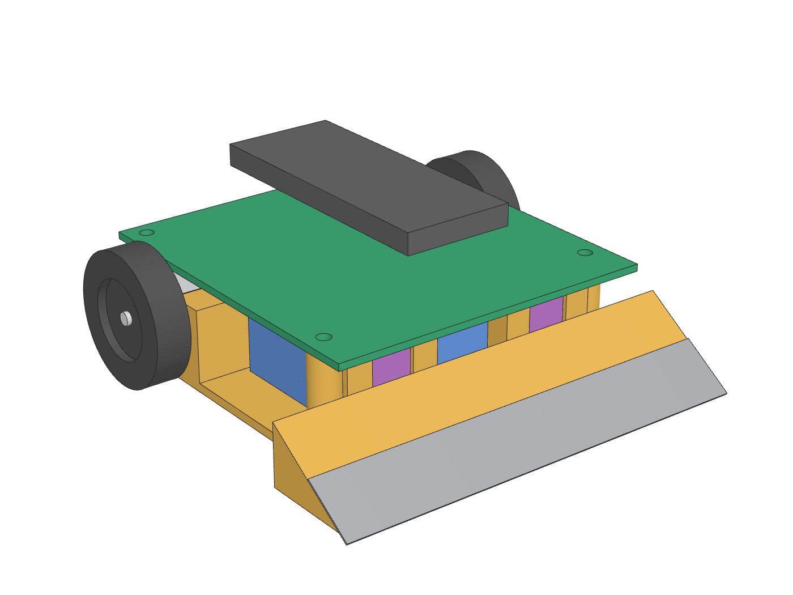
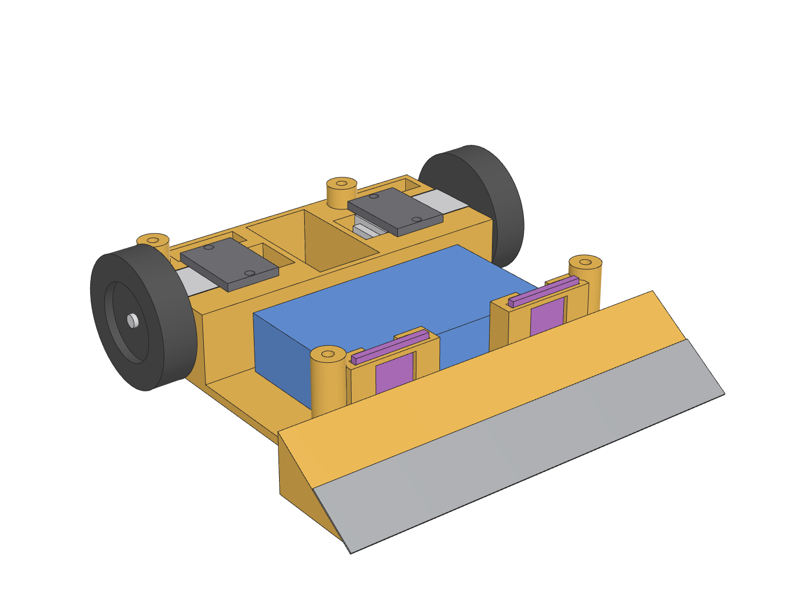
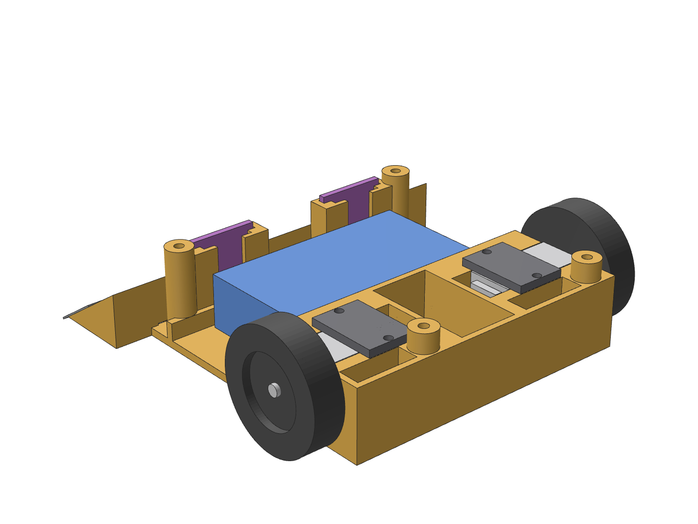
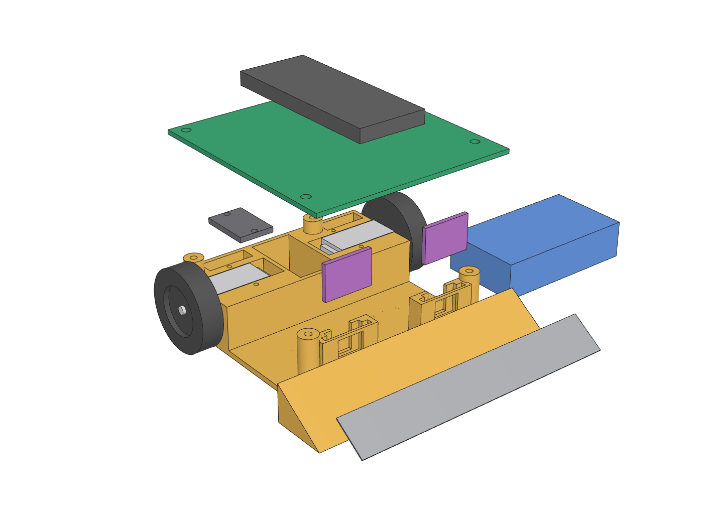
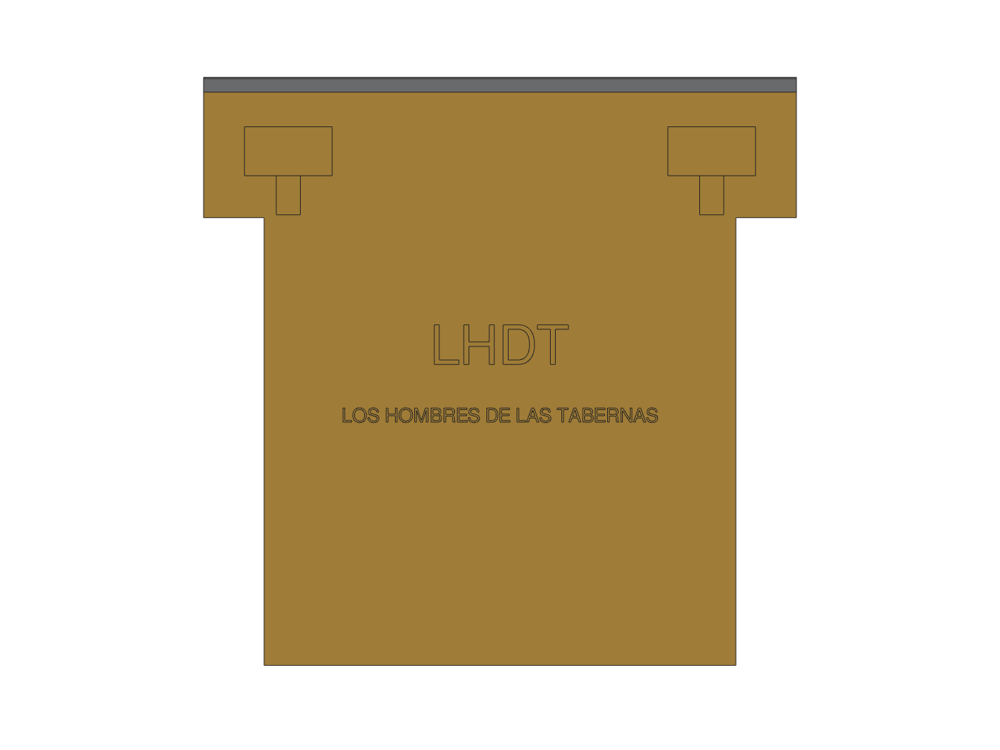
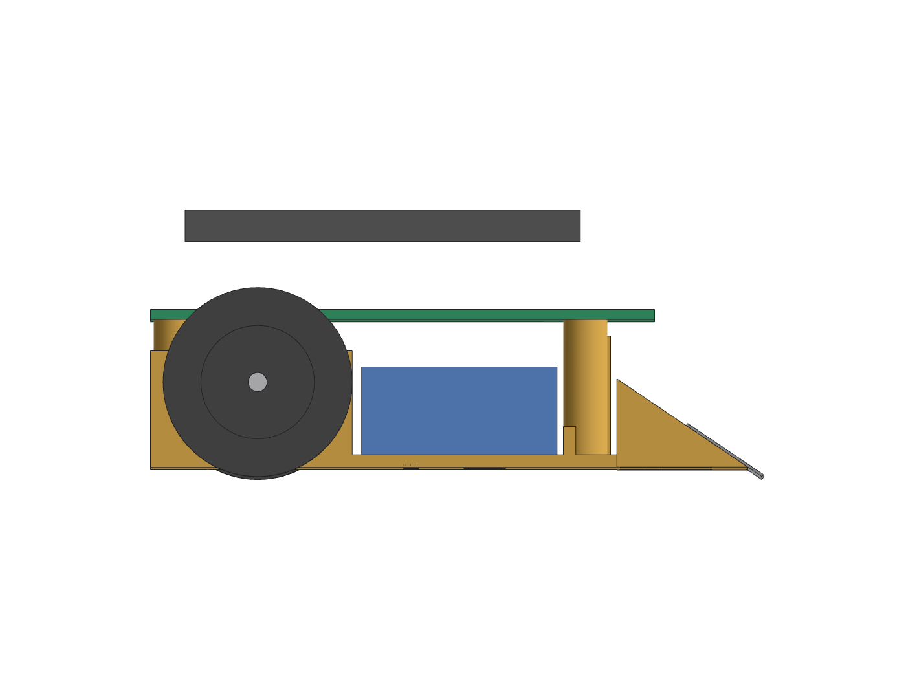
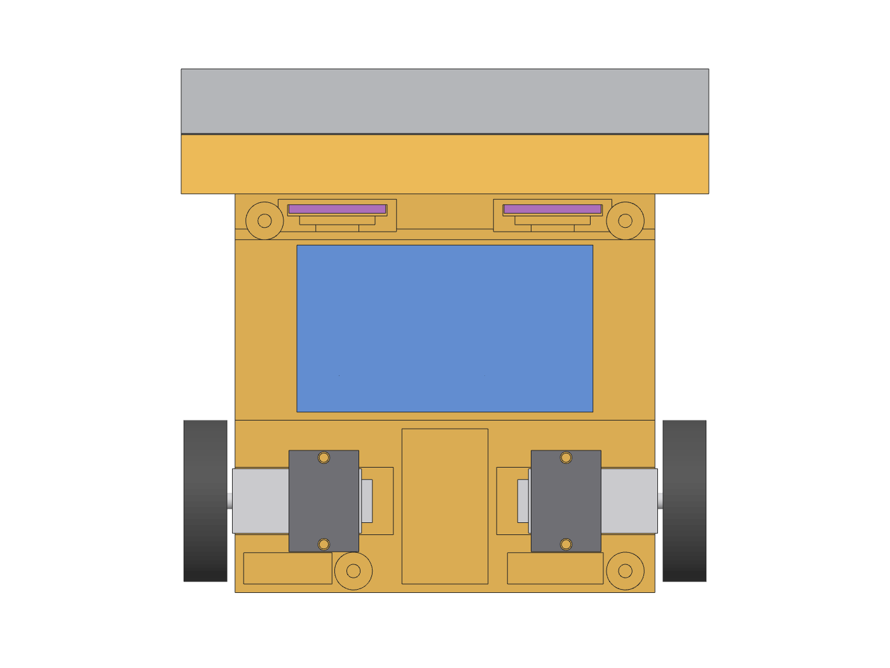

# Chasis del robot v2 (base mecánica del equipo)

Base impresa en 3D para el robot v2 de 2 motores. Se abre y se modifica en **Fusion 360** con un script paramétrico, y también hay STEP y STL listos.

> **Todo es teórico**: nada está impreso ni montado. Las cotas con 🔶 en [`geometria_chasis.py`](fusion360/ChasisLHDT/geometria_chasis.py) son de piezas típicas y **hay que medirlas** con el calibre en las vuestras (rueda, batería, módulos VL53L0X y QRE1113, tapa del motor) antes de imprimir.



## Qué es

| | |
|---|---|
| Planta | **98 × 97,2 mm** (cabe en 10 × 10 cm con 1 mm de margen por lado) |
| Alto | 42,5 mm hasta la ESP32 |
| Tracción | 2 N20 detrás (eje a 81 mm del filo), ruedas de 30 mm 🔶 |
| Cuña | Rampa de **34°** a todo lo ancho (98 mm), 15,5 mm de alto, con **chapa de acero de 0,4 mm** opcional pegada encima |
| PCB | Atornillada con 4 M3 sobre 4 columnas, a 25 mm del suelo |
| Batería | LiPo 2S en un túnel bajo la PCB: **entra y sale de lado** sin desatornillar nada; se sujeta con velcro adhesivo |
| Sensores de suelo | 2 QRE1113 boca abajo en la rampa, en las esquinas delanteras, a 1,5 mm del suelo |
| Sensores de distancia | 2 VL53L0X en soportes detrás de la rampa, mirando al frente por encima de ella |
| Lastre | Huecos para ~11 cm³: **≈ 85 g de acero o ≈ 120 g de plomo** |
| Texto | "LHDT" y "LOS HOMBRES DE LAS TABERNAS" grabados en la cara inferior |
| Piezas impresas | Chasis (1 pieza, sin soportes) + 2 abrazaderas de motor. ≈ 40 g de PETG 🔶 |

| Sin la PCB | Por detrás |
|---|---|
|  |  |

| Despiece | Cara inferior |
|---|---|
|  |  |

| Lateral (frente a la derecha) | Planta sin PCB (frente arriba) |
|---|---|
|  |  |

## Abrirlo en Fusion 360

1. Copiar la carpeta [`fusion360/ChasisLHDT/`](fusion360/ChasisLHDT/) entera (son 3 ficheros) al ordenador.
2. En Fusion: **Utilidades → Complementos** (o `Mayús + S`) → pestaña **Scripts** → botón **+** → elegir la carpeta `ChasisLHDT`.
3. Seleccionar **ChasisLHDT** → **Ejecutar**. Crea un diseño nuevo con un componente por pieza:
   - `chasis`, `abrazadera_motor_izq`, `abrazadera_motor_der` → se imprimen.
   - `cuchilla_acero` → chapa (no se imprime).
   - `REFERENCIAS (no imprimir)` → motores, ruedas, batería, PCB, ESP32 y sensores, semitransparentes, para ver el montaje.
4. **Para cambiar una medida**: editar `geometria_chasis.py` (está todo comentado, en mm) y volver a ejecutar el script. Sale el diseño entero recalculado.
5. Para imprimir: clic derecho en el cuerpo → **Guardar como malla** (STL o 3MF).

Otra opción sin script: **Archivo → Abrir → `step/ensamblaje_chasis.step`** (o una pieza suelta de `step/`). Así se edita en modo directo, sin parámetros.

> El script se ha probado aquí con una imitación de la API de Fusion ([`pruebas/`](pruebas/)): las 15 piezas que crea coinciden al 100 % en volumen con las de CadQuery. **No se ha ejecutado en un Fusion 360 de verdad**. Si al ejecutarlo sale un error, el mensaje dice la línea; avisadme y lo corrijo. El texto grabado va aparte: si fallase, el script lo avisa y el resto del chasis se crea igual.

## Montaje

1. **Sensores de suelo**: cada QRE1113 entra por debajo en su hueco de la rampa, con el sensor mirando al suelo. El cable va por la ranura de la cara inferior hasta detrás de la rampa. Fijar con una gota de cola caliente.
2. **Sensores de distancia**: soldar los cables **directamente** al módulo VL53L0X (con tira de pines no cabe bajo la PCB) y meter el módulo desde arriba en la ranura de su soporte, con el chip hacia delante (se ve por la ventana). Los cables salen por detrás.
3. **Motores**: soldar los cables a los terminales, meter cada N20 en su alojamiento (la reductora hacia fuera) y apretar la abrazadera con 2 tornillos **M2 × 6** de rosca directa. Los cables suben por el hueco que queda junto al lastre central y van a las clemas de la PCB por el lateral.
4. **Ruedas** a presión en el eje en D.
5. **Lastre** en los tres huecos traseros (pletina, perdigones o plomo), pegado con epoxi o cola caliente. Ajustar con báscula para no pasar de 500 g.
6. **PCB**: 4 tornillos **M3 × 8** de rosca directa en las columnas (agujero de 2,5 mm). Si se prefieren insertos roscados de latón M3, poner `COLUMNA_AGUJERO_D = 4.0` y volver a generar.
7. **Batería**: velcro adhesivo en el suelo del túnel y en la batería; entra de lado. El cable sube por el lateral izquierdo hasta el XT30 (detrás a la izquierda de la PCB): hace falta que el cable de la batería mida **unos 6 cm** 🔶.
8. **Cuchilla** (opcional): chapa de acero de 0,4 mm (fleje o galga) de 98 × 14,5 mm, pegada sobre la rampa con cinta VHB o epoxi, con el filo tocando el suelo.

### Tornillería

| Qué | Cant. |
|---|---|
| Tornillo M3 × 8 (PCB a las columnas) | 4 |
| Tornillo M2 × 6 (abrazaderas de los motores) | 4 |
| Velcro adhesivo (batería) | 1 tira |

## Imprimir

- **Material**: PETG (o PLA+). 3 perímetros, 30–40 % de relleno, capa de 0,2 mm.
- **Orientación**: el chasis tal cual, con la cara inferior (la del texto) sobre la cama. Todo está pensado para imprimirse **sin soportes**: los huecos de los QRE y las ranuras de los cables son puentes cortos.
- Las abrazaderas, planas sobre la cama.
- Holgura de los alojamientos: 0,25 mm por lado (`HOLG`). Si la impresora aprieta, subirla a 0,3.

## Comprobaciones (teóricas, 23/11/2026)

Las hace `construir_cadquery.py` y las guarda en [`informe_chasis.json`](informe_chasis.json):

- **Envolvente**: 98 × 97,2 mm en planta → cabe en 10 × 10 cm.
- **Choques**: 0 mm³ entre el chasis y motores, ruedas, batería, ESP32, sensores, abrazaderas y cuchilla. Las **137 patillas** de la PCB (leídas del fichero de KiCad, 2,5 mm por debajo 🔶) no tocan nada salvo las columnas donde apoya la placa, que caen en sus taladros.
- **La batería sale de lado sin tocar las ruedas** (se comprueba todo el recorrido).
- **Holguras**: rueda–chasis 1,5 mm; rueda–PCB 2,5 mm; batería–patillas de la PCB 5 mm (cabe una batería de hasta 18,5 mm de alto).
- **VL53L0X**: el borde inferior de su cono (25°) pasa 1,3 mm por encima de la rampa: la rampa no le tapa la vista 🔶 (supone el chip en el centro del módulo).
- **Masa estimada** 🔶 (masas de componentes supuestas, hay que pesarlas): ≈ 188 g sin lastre y ≈ 233 g con el lastre central de acero. El centro de masas queda **por delante del eje** (≈ 71–77 % del peso sobre las ruedas): la cuña se apoya en el suelo y el robot no se va hacia atrás.
- El script de Fusion genera exactamente las mismas piezas que CadQuery (`pruebas/probar_script_fusion.py`).

**Sobre el peso**: el robot quedará muy por debajo de los 500 g. Con el lastre lleno de plomo se ganan ~40 g más que con acero. Más masa da más empuje; si se quiere acercar a 500 g, lo siguiente sería una placa de lastre encima de la PCB (no está diseñada).

## Regenerar STEP, STL, informe e imágenes (sin Fusion)

```bash
cd Robot_Mini-Sumo/hardware/chasis
pip install cadquery            # Python 3.10+
python construir_cadquery.py    # step/, stl/, informe_chasis.json y mallas en _render/
python pruebas/probar_script_fusion.py   # prueba el script de Fusion con la API simulada
cd render && npm install && cd .. && node render/render.mjs   # img/ (Chromium con Playwright)
```

## Ficheros

| Ruta | Qué |
|---|---|
| `fusion360/ChasisLHDT/ChasisLHDT.py` (+ `.manifest`) | Script de Fusion 360 |
| `fusion360/ChasisLHDT/geometria_chasis.py` | **Todas las cotas** (las usa el script de Fusion y CadQuery) |
| `construir_cadquery.py` | Genera STEP/STL, comprueba choques y masas |
| `stl/` | Piezas para imprimir |
| `step/` | Piezas y ensamblaje (para Fusion, FreeCAD, Onshape…) |
| `informe_chasis.json` | Resultado de las comprobaciones |
| `img/` | Imágenes |
| `pruebas/` | Prueba del script de Fusion sin Fusion |
| `render/` | Generador de imágenes |

## Qué falta / medir antes de imprimir

- Medir: diámetro y ancho de las ruedas, batería (largo, ancho, alto y largo del cable), módulos VL53L0X (ancho, alto, dónde está el chip) y QRE1113, y la tapa de los N20.
- Ejecutar el script en Fusion 360 y confirmar que sale bien.
- Imprimir y probar el ajuste de motores, sensores y batería; pesar el robot y ajustar el lastre.
