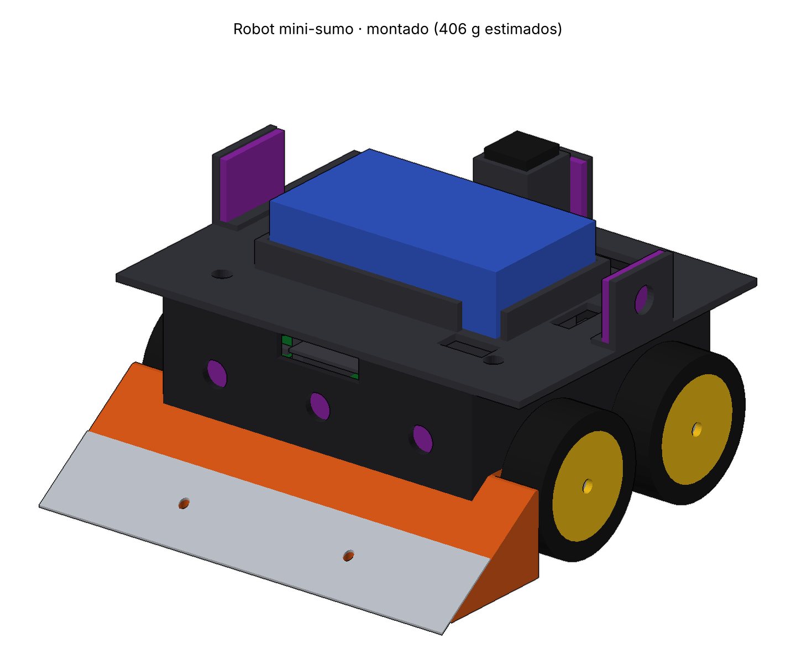
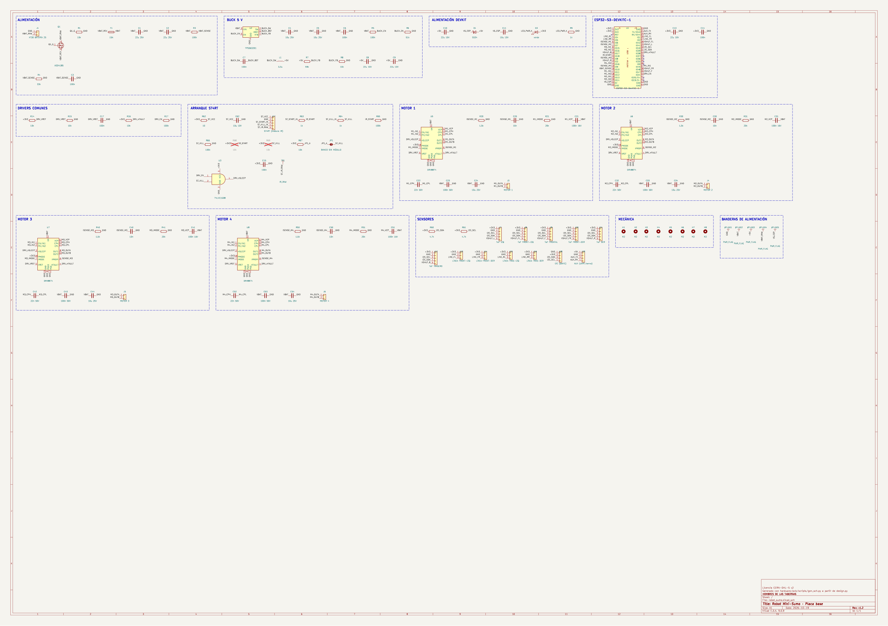
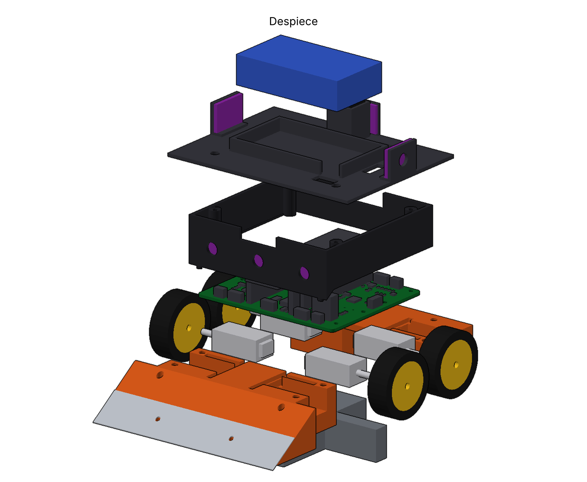

# Robot Mini-Sumo · Hombres de las Tabernas

**Tecnología Eléctrica · Grado en Robótica · Universidade de Santiago de Compostela · curso 2026/27**

> **Borrador (10/11/2026).** Límite: 6 páginas. Lo marcado **[COMPLETAR]** lo rellena el equipo cuando el robot exista: fotos, costes pagados, resultados. Las cifras son del diseño v1.2 y de cálculos teóricos; ninguna está medida.

**[COMPLETAR: logo del equipo]**

## 1. Presentación

| | |
|---|---|
| Equipo | Hombres de las Tabernas (LHDT) |
| Robot | **[COMPLETAR: nombre del robot]** |
| Categoría | Mini Sumo autónomo, reglamento OSHWDem rev. 7 (2026) |
| Repositorio | https://github.com/Mateosmerodes/Mini_Sumo_Robot_LHDLT (hardware CERN-OHL-S v2, software MIT) |

**Componentes del equipo** **[COMPLETAR: confirmar nombres y reparto]**

| Integrante | Papel principal |
|---|---|
| Mateo Esmerodes Rodríguez | [COMPLETAR] |
| Paulo Bouza García | [COMPLETAR] |
| Mario Costoya Mera | [COMPLETAR] |

**Concepto.** Cuña (rampa) clásica con tracción 4WD, cuatro micromotores N20, una placa de desarrollo ESP32-S3 enchufada sobre una PCB propia que hace también de chasis, seis sensores de distancia ToF para encontrar al rival, cuatro sensores de línea para no salirse del dohyo y arranque y parada por IR con el módulo Sobotz ST4RT que entrega el profesor.

**[COMPLETAR: foto del robot construido]**

## 2. Construcción

### 2.1 Electrónica

La PCB propia (2 capas, 74 × 62 mm, FR4 de 1,6 mm) conecta la unidad de control, los sensores, el módulo de arranque y los controladores de motor. Lleva el nombre del equipo en la serigrafía.

| Bloque | Solución | Motivo |
|---|---|---|
| Control | ESP32-S3-DevKitC-1 enchufada en zócalo | Placa abierta (requisito 5.1), doble núcleo, ADC y PWM de sobra; se cambia sin soldar |
| Potencia | LiPo 2S 450 mAh ≥ 30 C, XT30, MOSFET P contra inversión, fusible de 15 A | Pico calculado de 10,2 A con los cuatro drivers en su límite |
| Drivers | 4 × TI DRV8874, uno por motor | Límite de corriente por hardware (2,44 A) y medida de corriente para detectar el contacto |
| 5 V / 3,3 V | Buck TPS563201 a 5,3 V → LDO de la DevKit a 3,3 V | Mantener el LDO en regulación con la batería baja |
| Arranque | Sobotz ST4RT (RC5) en un conector JST-SH; la línea KILL duerme los drivers por hardware con una puerta AND | El robot se para aunque falle el software |
| Sensores | 6 × VL53L0X (3 delante, 2 a los lados, 1 detrás), 4 × QRE1113 | Detectar al rival en cualquier orientación de salida y el borde blanco |

**Cálculos principales** (detalle, fórmulas y fuentes en `docs/08-Calculos-v1.2.md`, reproducibles con `hardware/calculos/calculos_electricos.py`):

| Magnitud | Valor | Margen |
|---|---|---|
| Corriente de pico de batería | 10,2 A (85 W) | Fusible 11,25 A útiles (+11 %) |
| Pin 5 V de la DevKit, peor caso | 4,46 V | +0,06 V sobre lo que pide el LDO: hay que medirlo |
| Temperatura del DRV8874, motor bloqueado | 95–113 °C | 37–55 °C hasta 150 °C |
| Autonomía, combate típico | ≈ 5 min | ×1,65 sobre los 3 min de un combate |

### 2.2 Mecánica

La PCB es el chasis: los motores quedan atrapados entre las cunas impresas en PETG y la placa. Piezas propias: rampa con cuna delantera, cuna trasera con parachoques, paredes, techo con la bahía de batería y la torre del módulo de arranque, y llantas. Cuchilla de fleje de acero de 0,4 mm con el filo matado y lastre de acero o plomo entre los ejes.

| Dato | Valor (modelo 3D) |
|---|---|
| Huella | 98 × 98 mm (límite 100 × 100) |
| Altura | 58,6 mm |
| Masa estimada | 420–426 g sin lastre extra; objetivo ≈ 495 g pesando (límite 500 g) |
| Ángulo de la rampa | 34,6° |

**[COMPLETAR: foto de las piezas impresas y del montaje]**

### 2.3 Software

Firmware en C++ (Arduino sobre ESP32-S3). El arranque sigue la salida START del módulo con una máquina de estados ESPERA → COMBATE → PARADO: arranca en 1–2 ms y, tras la parada, no vuelve a moverse hasta quitar la alimentación. La estrategia da prioridad al borde (retroceder y girar), después al ataque (orientarse hacia el ToF que ve al rival y empujar a fondo solo de cerca, porque a toda velocidad no le da tiempo a frenar antes del borde) y, si no ve nada, busca girando. La lógica se prueba en el PC.

**[COMPLETAR: resultados de las pruebas en el dohyo: tiempo de arranque medido, frenada, alcance de los ToF]**

## 3. Costes

Precios orientativos de la lista de compra (`docs/09-Lista-de-compra-y-presupuesto.md`). La columna "Pagado" es la que vale para el informe. **[COMPLETAR con los tickets]**

| Bloque | Estimación | Pagado |
|---|---|---|
| Control (ESP32-S3-DevKitC-1) | 22,5 € | [COMPLETAR] |
| PCB + componentes + envío | 25–35 € | [COMPLETAR] |
| Motores N20 + ruedas | 12–28 € | [COMPLETAR] |
| Baterías LiPo 2S (2) | 12–16 € | [COMPLETAR] |
| Sensores (6 ToF + 4 línea) | 13–25 € | [COMPLETAR] |
| Mecánica (tornillería, insertos, acero, lastre, PETG) | ≈ 10 € | [COMPLETAR] |
| Módulo de arranque ST4RT | 0 € (lo aporta el profesor) | 0 € |
| **Total** | **≈ 95–135 €** | **[COMPLETAR]** |

## 4. Resultados y conclusiones

**[COMPLETAR tras construir y competir]:** masa y medidas reales, comprobación del arranque y la parada con el mando del juez, resultados del campeonato, qué funcionó, qué cambiaríais en una v2 (propuestas en `docs/12-Memoria-rediseno-v1.2.md`).
